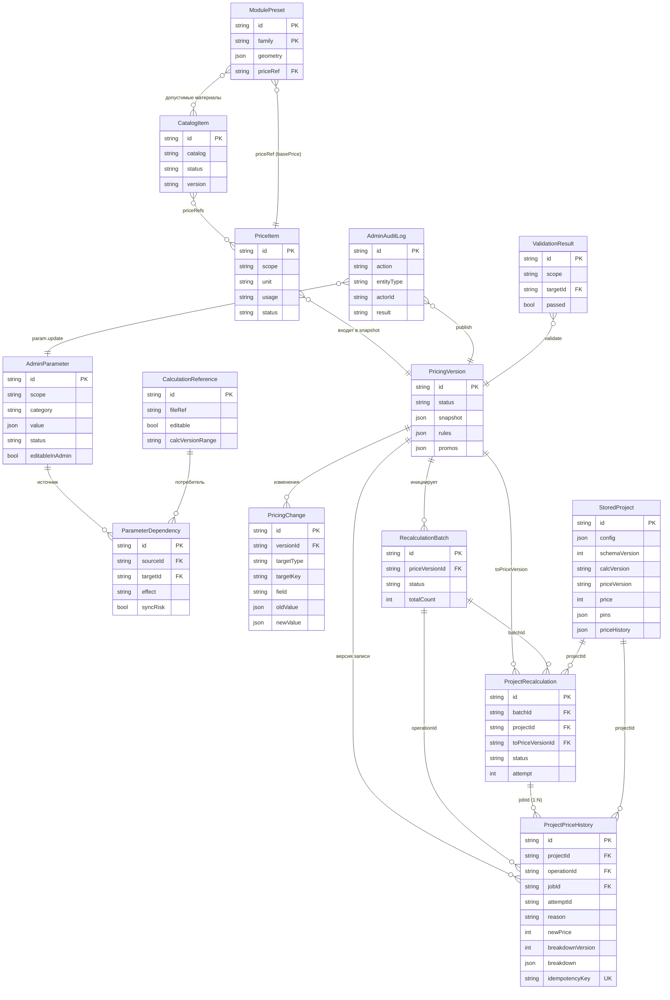
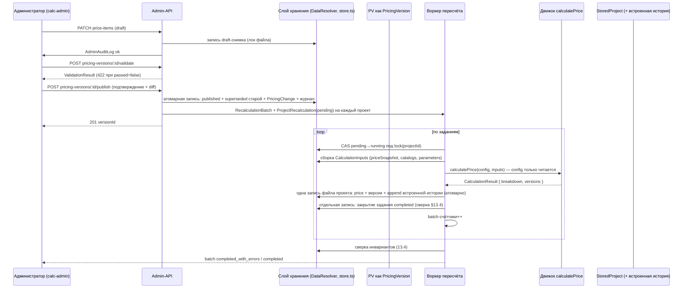
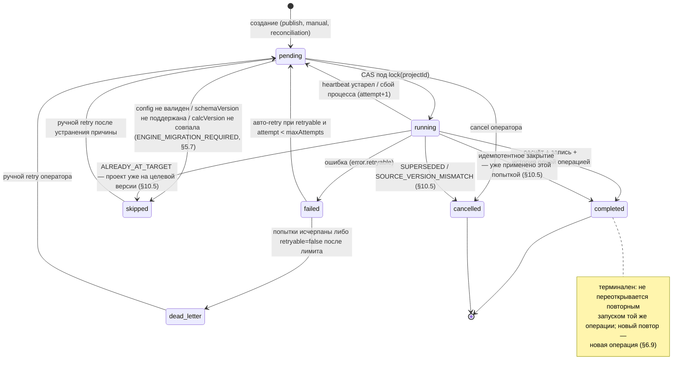
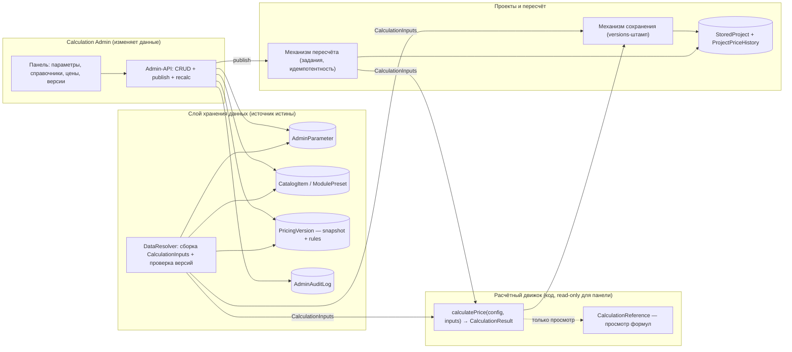
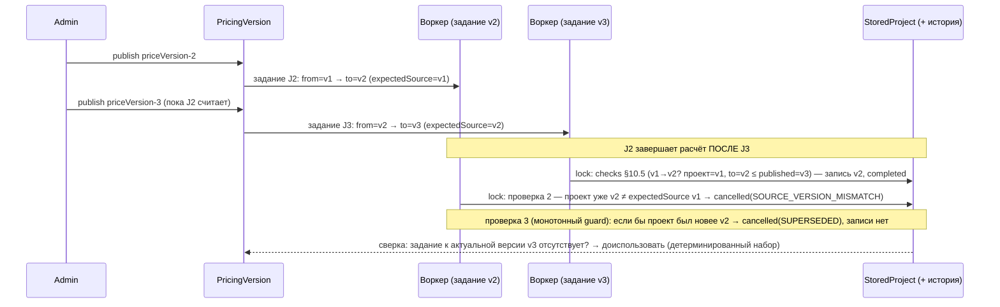

# CALCULATION ADMIN — Модель данных и версионирование

**Документ:** `docs/CALCULATION_ADMIN/CALCULATION_ADMIN_DATA_AND_VERSIONING_DESIGN.md`
**Тип:** Технический проект (design document)
**Статус:** На согласование (Revision 1)
**Дата:** 2026-11-04 (Revision 1: 2026-11-04)
**Основание:** `CALCULATOR_TECHNICAL_AUDIT.md` (аудит кода), `docs/CALCULATION_ADMIN/CALCULATION_ADMIN_TECHNICAL_SPECIFICATION.md` (ТЗ), утверждённые решения владельца (раздел 2), независимый архитектурный аудит Revision 1.
**Стадия:** Проектирование. Реализация кода запрещена и не выполнялась.

**Редакции:**

| Редакция | Содержание |
|---|---|
| Revision 0 | Первоначальный проект модели данных и версионирования. |
| **Revision 1** | Архитектурная корректировка: единый контракт движка (B-03), классификация расчётных данных и whitelist пересчёта (B-01), политика `calcVersion` (B-02), модель истории и идемпотентность (B-04), устаревшие задания (B-05), исправления модели S-01…S-13, пересмотр OI/Q/ADR/критического пути/WBS, таблица обеспечения A1–A9 (раздел 21). Изменён только настоящий документ; исходный код не изменялся. |

**Маркеры достоверности:**

| Маркер | Значение |
|---|---|
| **[ФАКТ]** | Подтверждено чтением кода (с указанием файла/функции). |
| **[ВЫВОД]** | Архитектурный вывод, следующий из фактов. |
| **[РЕШЕНИЕ]** | Предлагаемое решение документа (утверждается в порядке раздела 2). |
| **[ВЛАДЕЛЕЦ]** | Вопрос, требующий решения владельца (раздел 18). |
| **[ADR]** | Требует отдельного ADR (раздел 16). |
| **не обнаружено** | Элемент отсутствует в репозитории. |

---

## 1. Назначение документа

1.1. Документ детализирует архитектуру данных и версионирования Calculation Admin — панели управления расчётной системой калькуляторов кухонь и шкафов FORMAKUB.

1.2. Задачи документа:
- устранить неоднозначности предыдущего ТЗ (`PriceItem`/`PricingVersion`/`PricingChange`, состав снимка прайса, контракт движка, модель пересчёта);
- определить строгую модель трёх независимых версий (`schemaVersion`/`calcVersion`/`priceVersion`);
- представить логическую модель данных с ограничениями и жизненными циклами;
- спроектировать автоматический пересчёт проектов и историю стоимости;
- определить сценарии целостности и восстановления для фактического хранилища;
- сформировать полный реестр замечаний предыдущего аудита и открытых вопросов.

1.3. **Границы.** Разрешено: исследование, анализ, проектирование логической модели, создание настоящего Markdown-файла. Запрещено: код, изменения алгоритмов/API/схем/конфигураций, миграции, зависимости, правки предыдущих документов, самостоятельная смена утверждённой архитектуры, решения, отнесённые к владельцу.

1.4. **Отделение решений от фактов.** Все утверждения помечены маркерами. Факты приводятся с путями; предлагаемые решения отделены от фактов; решения владельца собраны в раздел 18 и не принимаются здесь.

---

## 2. Утверждённые архитектурные решения владельца

| № | Решение | Отражение в документе |
|---|---|---|
| A1 | Admin охватывает кухни и шкафы | Разделы 5–9, охват `kind: kitchen/wardrobe` |
| A2 | Старые проекты пересчитываются автоматически при публикации цен | Раздел 9 |
| A3 | Формулы доступны только для просмотра; изменение — разработкой | Разделы 8, 13 |
| A4 | Панель меняет входные параметры, справочники и цены | Разделы 6, 7 |
| A5 | Изменения геометрических параметров не должны автоматически менять конструкцию ранее созданных проектов | Разделы 6.6, 9.2; противоречие зафиксировано в OI-063 |
| A6 | Изменения алгоритмов расчёта требуют изменения `calcVersion` | Раздел 4 |
| A7 | Публикация прайса запускает автоматический пересчёт | Раздел 9 |
| A8 | История стоимости сохраняется | Раздел 10 |
| A9 | Архитектурные изменения — только после согласования и ADR | Разделы 15–16 |

2.1. **Проверка на противоречия.** Обнаружено одно противоречие между утверждённым решением и фактической реализацией/логикой системы:
- **A5 ↔ факт расчёта:** геометрические константы (`SINK_RULES` и др.) участвуют в производных расчётах (площади фасадов → `frontsCost`), поэтому их изменение через панель меняло бы стоимость при пересчёте, не меняя сохранённый `config`. Конфликт зафиксирован как **OI-063** и вынесен в раздел 18; до решения владельца геометрические параметры, влияющие на цену, не редактируются через панель (**[РЕШЕНИЕ]**, п. 7.5).
- Дополнительно: решение A8 противоречит фактическому поведению `getProject` (пересчёт цены при чтении, история не ведётся) — OI-020/OI-023/OI-040.

2.2. Прочие утверждённые решения (A1–A4, A6–A9) при проверке кодом противоречий не образуют; их реализуемость подтверждается в разделах 4–10.

2.3. **Проверка обеспечения (Revision 1).** Для каждого решения A1–A9 в разделе 21 приведена таблица «механизм обеспечения → раздел документа → метод проверки → оставшийся риск». Если решение не обеспечено полностью, это указано прямо; решение A5 и A2 имеют открытые остаточные риски (OI-063/Q6 и политика `calcVersion` — раздел 5.7), которые **не закрываются молча** и требуют решений владельца.

---

## 3. Исследованная архитектура

3.1. **Исследованные файлы и компоненты.**

| Область | Файлы | Что проверено |
|---|---|---|
| Аудит и ТЗ | `CALCULATOR_TECHNICAL_AUDIT.md` (644 стр.), `docs/CALCULATION_ADMIN/CALCULATION_ADMIN_TECHNICAL_SPECIFICATION.md` (1136 стр.) | Полный перечень замечаний, рисков, вопросов |
| Расчётный движок | `src/lib/configurator/pricing.ts` | `calculateKitchenPrice` (стр. 171–450), `calculateWardrobePrice` (452–578), `calculatePrice` (580), `roundMoney` (30), `applyPromo`/`calculatePromo` (102–169), импорты `@/content/*` (стр. 1–11) |
| Геометрия | `src/lib/configurator/sink.ts`, `supports.ts`, `lighting.ts` | `sinkLayout`, `computeSupports`, `computeLighting` |
| Нормализация/валидация | `defaults.ts`, `validation.ts` | `normalizeKitchen`, `validateConfig` |
| Схемы | `schema.ts` | `z.strictObject` (стр. 22, 57, 67, 93, 159, 167, 191, 200, 210), `version: z.literal(1)` (94, 168), `preprocess` + `COUNTERTOP_LEGACY_MAP` (102–105) |
| Типы | `types.ts` | `PriceBreakdown` (227–242), `StoredProject` (274–280), `PriceLine` (221), `PromoResult` (212), `version: 1` (141, 184) |
| Хранилище | `src/lib/server/store.ts` | `readCollection` (12), `writeCollection` — temp-файл + `rename` (24–30), `withFileLock` — in-process `Map<file, Promise>` (32–47), `updateCollection` (49–59) |
| Проекты | `src/lib/server/projects.ts` | `saveProject` — валидация → `calculatePrice` → запись `.slice(-2000)` (18–53), `getProject` — `normalizeKitchen` → `validateConfig` → **пересчёт цены** (55–73) |
| API | `src/app/api/projects/route.ts` (POST), `[id]/route.ts` (GET), `leads/route.ts` | Rate-limit 6/10 мин, same-origin у лидов, авторизации нет |
| Справочники | `src/content/{catalog,pricing,plinth,supports,lighting}.ts` | 118 ценовых элементов, `PRICING.version = "demo-2026-01"` |
| Черновик | `src/lib/configurator/storage.ts` | ключ `formakub:draft:{type}:v1`, `VERSION = "v1"` |
| Инфраструктура | `Dockerfile`, `docker-compose.yml`, `next.config.ts`, `.env.example` | один контейнер, **нет volume для `/app/data`**, секретов auth нет |
| Тесты | 6 файлов, 116 тестов (`vitest`) | `pricing/sink/supports/lighting/validation/migration` |
| Данные | `data/projects.json` | фактически `[]` (пустой массив) |

Документы, указанные в задании: оба найдены по указанным путям; других документов по архитектуре в репозитории **не обнаружено**.

---

## 4. Подтверждённые факты и обнаруженные проблемы

### 4.1. Ключевые архитектурные факты

| Файл / компонент | Текущее поведение **[ФАКТ]** | Проблема **[ВЫВОД]** | Предлагаемое решение **[РЕШЕНИЕ]** |
|---|---|---|---|
| `pricing.ts: PRICING` (импорт стр. 9) | Движок читает цены из статического модуля `src/content/pricing.ts` | Панель не может менять цены без правки кода и деплоя | Контракт входа `CalculationInputs` через слой хранения (раздел 9, ADR-06) |
| `projects.ts: getProject` (55–73) | Выдаёт проект с **пересчётом** `calculatePrice` по текущим ценам; сохранённый снимок не используется | Нет истории, факт A8 нарушен | Выдача по сохранённому снимку; пересчёт только заданием (разделы 9–12, OI-020) |
| `projects.ts: getProject` (64–65) | Проект, не прошедший текущий `validateConfig`, возвращает `null` → 404 | Данные есть, доступа нет; молчаливая недоступность | Квартирное чтение + флаг несовместимости (раздел 12, OI-064) |
| `store.ts: writeCollection` (24–30) | Запись через temp-файл + `rename` (атомарно в пределах одного файла POSIX) | Атомарность есть только внутри одного файла | Использовать как механизм; одна запись = одна транзакция (раздел 13) |
| `store.ts: withFileLock` (32–47) | Сериализация операций по файлу внутри процесса | Работает только для одного инстанса | Фиксируется как ограничение v1; масштабирование → ADR-01/ADR-05 |
| `store.ts/projects.ts: .slice(-2000)` (48) | Хранилище отбрасывает самые старые проекты сверх 2000 | Потеря проектов и истории молча | Лимит выводится в диагностику; решение по хранению — **[ВЛАДЕЛЕЦ]** (OI-042) |
| `schema.ts` (93, 168) | `version: z.literal(1)` + `strictObject` | Единственная «версия» — литерал структуры; новые поля без дефолта ломают чтение | `schemaVersion` = обобщение существующего `version` (раздел 5, OI-019/OI-022) |
| `schema.ts` (102–105) | `preprocess` + `COUNTERTOP_LEGACY_MAP` | Есть точечная миграция, нет системы миграций | Политика миграций: цепочка по `schemaVersion` (раздел 5.5) |
| `types.ts: StoredProject` (274–280) | `{id, config, price, createdAt, updatedAt}` — версий нет | Ни одна из трёх версий не сохраняется | Добавить три опциональных поля (раздел 5.1) |
| `types.ts: PriceBreakdown` (227–242) | `{currency, baseCost, bodyCost, frontsCost, fittingsCost, optionsCost, complexityFactor, subtotal, discount, total, minOrderApplied, lines[], promo, disclaimer}` | Нет ссылок на использованные версии и ставки | Обёртка `CalculationResult` с `versions` (раздел 9, не меняя `PriceBreakdown`) |
| `storage.ts` | Черновик в localStorage; при ошибке парсинга возвращает `null` | Черновик теряется молча | Вне модели данных; OI-066 |
| `docker-compose.yml` | Нет volume для `/app/data` | Потеря `projects.json`/`leads.json` при пересоздании | ADR-03, OI-039 |
| `src/app/api/*` | Авторизации/ролей нет (`auth/session/role` не найдены, middleware отсутствует) | Admin-API без auth был бы публичным | ADR-02 до реализации, раздел 15, OI-037 |

### 4.2. Что уже работает и переиспользуется

1. Единая точка расчёта `calculatePrice` — единственный механизм цены для обоих типов (**[ФАКТ]** `projects.ts`, `leads.ts` используют его же).
2. Идемпотентная нормализация и точечные легаси-миграции с тестами (`migration.test.ts`).
3. Zod-валидация на всех входах (API, черновики, проекты).
4. Атомарная запись одного файла и сериализация операций (принципы переиспользуются для данных Admin).
5. `validateConfig`/`ValidationIssue` — готовый формат результатов проверок.
6. Golden-база: 116 существующих тестов как регрессионный каркас.

### 4.3. Отсутствующие механизмы (**не обнаружено**)

БД/ORM, очередь задач, авторизация/сессии/роли, admin-API, журнал административных действий, история стоимости, хранение `schemaVersion`/`calcVersion`/`priceVersion` в проекте, реестр миграций, механизм публикации прайса, бэкап `data/`.

## 5. Модель независимого версионирования

### 5.1. Три версии: определение и хранение

| Версия | Определяет | Тип | Где хранится | Кто создаёт |
|---|---|---|---|---|
| `schemaVersion` | Формат хранения проекта, структуру данных, совместимость, необходимость миграции, правила чтения/преобразования | положительное целое (v1, v2, …) | Поле записи проекта (`StoredProject.schemaVersion`) и черновика; отсутствие ⇒ вычисляется из существующего `config.version` | Только разработка (миграция схемы) |
| `calcVersion` | Используемые расчётные алгоритмы, правила геометрических вычислений, формулы, распределение элементов, расчёт комплектации, совместимость с сохранёнными проектами | строка-идентификатор версии движка (формат: `calc-YYYY.MM.N` **[РЕШЕНИЕ]**, альтернатива семантическая — OI-069/Q17) | Поле записи проекта (`calcVersion` — версия, посчитавшая текущую цену) + в каждой записи `ProjectPriceHistory` | Только разработка (релиз); панель **не** создаёт `calcVersion` |
| `priceVersion` | Стоимость материалов/фурнитуры/компонентов, коммерческие коэффициенты, наценки/скидки, правила округления и минзаказа как часть коммерческой политики, промокоды | строка-идентификатор (формат: `price-YYYY.MM.N`) | Снимок целиком (`PricingVersion.items`); в проекте — ссылка `priceVersion` + в каждой записи истории | Calculation Admin (публикация) |

**[РЕШЕНИЕ]** Имена полей: использовать `schemaVersion`, `calcVersion`, `priceVersion`. Существующее `config.version: 1` (**[ФАКТ]** `types.ts:141,184`, `schema.ts:94,168`) трактуется как `schemaVersion = 1` при отсутствии нового поля — это исключает дублирование смыслов и не ломает существующие записи (правило 5.4).

### 5.2. Правила изменения версий (таблица правил)

| Изменение | `schemaVersion` | `calcVersion` | `priceVersion` | Кто выполняет |
|---|---|---|---|---|
| Добавление/переименование/удаление полей конфигурации проекта | **да** | нет | нет | разработка |
| Изменение формулы, алгоритма, геометрического правила, распределения элементов, комплектации (включая правку констант, участвующих в формулах: `SINK_RULES`, допуски опор, пороги) | нет | **да** | нет | разработка (A6) |
| Изменение ставок цен, коэффициентов коммерческой политики, промокодов, округления, минимального заказа, `basePrice` пресетов | нет | нет | **да** | Calculation Admin (публикация) |
| Добавление нового материала/декора/опции без изменения цен | нет | нет | нет (достаточно журнала) | Calculation Admin |
| Изменение отображаемых названий/лейблов | нет | нет | нет (журнал `AdminAuditLog`) | Calculation Admin |
| Изменение геометрических параметров, влияющих на производные цены (см. OI-063) | нет | **да** (до решения владельца — только разработкой) | нет | разработка / **[ВЛАДЕЛЕЦ]** |
| Автоматический пересчёт проекта | нет | фиксируется фактически использованный | фиксируется фактически использованный | механизм пересчёта |

### 5.3. Передача версий в расчётный движок

**[РЕШЕНИЕ] Единый контракт определён в разделе 9.4 (Revision 1) и здесь не дублируется.** Кратко и без расхождений с §9.4:

- `CalculationRequest = { config, schemaVersion, inputs }` — то, что вызывающий механизм (сохранение/пересчёт) передаёт на исполнение;
- `CalculationInputs = { priceSnapshot, catalogs, parameters, presets }` — пакет данных, собирается **только** `DataResolver`;
- `calcVersion` **не входит** в `inputs`: это константа сборки движка; движок штампует собственную версию в `CalculationResult.versions.calcVersion`, а вызывающий сверяет её с ожидаемой (§9.4);
- `schemaVersion` берётся из записи проекта и передаётся в запросе;
- версии не выбираются внутри движка — их подбирает `DataResolver`/вызывающий и фиксирует в результате (`CalculationResult.versions`).

### 5.4. Совместимость

- Записи без `schemaVersion` ⇒ v1 (согласуется с фактическим `version: 1`).
- Записи без `calcVersion`/`priceVersion` ⇒ стратегии раздела 11; **молчаливое присвоение актуальных версий запрещено**, если оно приводит к недостоверности.
- Проект с `schemaVersion` новее поддерживаемого ⇒ чтение запрещено, флаг `unsupported_schema` (вместо `null`-404, OI-064).
- Проект с `priceVersion`, отсутствующей в хранилище прайсов ⇒ показ сохранённой стоимости + пометка «версия прайса недоступна»; пересчёт разрешён только после подтверждения.

### 5.5. Воспроизведение исторического состояния

Состояние проекта на момент `T` воспроизводится тройкой: `schemaVersion` (структура), `calcVersion` (движок — бинарно воспроизводим только при наличии сборки, иначе фиксируется как неизвестный, OI-019), `priceVersion` (снимок ставок — воспроизводим всегда, пока снимок хранится). Историческая стоимость восстанавливается из `ProjectPriceHistory` (раздел 11).

### 5.6. Миграция существующих данных

1. Миграции привязаны к `schemaVersion`: `migrate_v1_to_v2`, …; каждая идемпотентна, последовательна, тестируется (`migration.test.ts` — существующая база).
2. Физический носитель миграции (JSON-in-place vs таблицы) — **[ADR]** ADR-01.
3. Обязательных полей в Zod добавлять нельзя без `.optional().default(...)` (**[ФАКТ]** `strictObject`, OI-022/OI-027).
4. Точка невозврата: чтение версий старше поддерживаемых — только через цепочку миграций, без «тихой» нормализации.

### 5.7. Политика несовпадения `calcVersion` (B-02, Revision 1)

**Назначение:** полностью определить поведение системы, когда `calcVersion` проекта и версия текущей сборки не совпадают. Молчаливая подмена `calcVersion` проекта текущей версией **запрещена** (п. 5.4). Формат версии (`calc-YYYY.MM.N` vs семантический) остаётся вопросом **Q17/OI-069** и здесь не выбирается.

**Кто назначает `calcVersion`.** Только разработка при релизе (**[ФАКТ]** §5.1): версия — константа сборки (`BUILD_CALC_VERSION`); панель и воркер не создают и не переписывают её.

**Как определяется версия алгоритма, реально использованная при расчёте.** Движок в каждом `CalculationResult.versions.calcVersion` штампует **собственную константу сборки** — эту версию механизм сохранения/пересчёта записывает в `StoredProject.calcVersion` и в `ProjectPriceHistory`. Определение «по факту» исключает возможность указать несуществующую версию.

**Когда требуется увеличение `calcVersion`.** Правила §5.2 (изменение формулы/алгоритма/геометрического правила/комплектации/констант, входящих в формулы). Дополнительное правило Revision 1: правка `AdminParameter`, которая меняет значение, читаемое движком, **требует** релиза с новым `calcVersion` — панель переводит параметр в состояние «ожидает релиза» (`pending_release`), фактическое применение происходит только с новой сборкой (**[ВЫВОД]** следует из A6 и §7.7).

**Допустимо ли пересчитывать проект новой сборкой.** Да, но только как **явный переход версии**, а не как побочный эффект публикации прайса:

1. переход фиксируется в записи истории: `prevCalcVersion` → `calcVersion` (+ причина: `engine_migration` / `retro_certification`);
2. переход на более новую сборку для старых проектов массово выполняется **только после согласования владельцем** (см. матрицу); автоматический пересчёт по прайсу (A2/A7) **не** сопровождается сменой `calcVersion` — он обязан выполняться той же версией движка, что у проекта;
3. если подходящей сборки нет — см. «Что происходит с заданием» ниже.

**Когда требуется ручное подтверждение.**

- ретроспективная сертификация старого проекта (`reason=retro_certification`) — всегда;
- массовый переход на новую `calcVersion` (`engine_migration`) — всегда (решение владельца, фиксируется в `AdminAuditLog` с `actorId` владельца/оператора, действующего по его решению);
- восстановление `priceVersion`/`calcVersion` по гипотезе (§12 S3/S4) — подтверждение оператора, как уже описано в §12.

**Что происходит с заданием, если подходящей сборки нет.** Задание не выполняется и не подменяет версию: `status=skipped`, `error={code:"ENGINE_VERSION_UNAVAILABLE" | "ENGINE_MIGRATION_REQUIRED", retryable:false}`; проект сохраняет прежнюю стоимость и версии; оператор видит задание в списке; сверка (§13.4) не «лечит» это автоматически — требуется решение (миграция движка либо отказ от пересчёта). Новый `calcVersion` проекту при этом **не** присваивается.

**Как фиксируется переход проекта на новую `calcVersion`.** Одной операцией с записью проекта: `StoredProject.calcVersion := новая` + запись истории с `prevCalcVersion` + (для ручных операций) запись `AdminAuditLog`. Отдельного «журнала переходов» не требуется: последовательность переходов восстанавливается по цепочке записей `ProjectPriceHistory` проекта.

**Как обеспечивается воспроизводимость исторического результата.** Исторический результат воспроизводим **как запись**: `breakdown` + `versions` + ссылка на `priceVersion` (снимок хранится) — всегда, пока история и версия прайса хранятся. Бинарное воспроизведение расчёта возможно **только при сохранённой сборке** с соответствующей `calcVersion`; факт наличия/отсутствия сборки фиксируется честно (`engineBuildAvailable: false` для старых записей, **[ВЫВОД]** OI-019). **Сохранение исторических сборок** — требование к эксплуатации: грузится на ADR-03/backup-регламент; глубина хранения сборок — **[ВЛАДЕЛЕЦ]** (не выделена в отдельный Q: не блокирует модель, но определяется при утверждении регламента ADR-03).

**Матрица совместимости.**

| Project `calcVersion` | Available engine | Action | Status | Owner approval |
|---|---|---|---|---|
| совпадает с текущей сборкой | текущая | штатный расчёт/пересчёт; версия штампуется из сборки | `completed` | не требуется |
| старее текущей, сборка с этой версией сохранена и объявлена поддерживаемой | текущая + сохранённые старые сборки | при публикации прайса: пересчёт **текущей** сборкой запрещён, пока не выполнен переход; допустим ли переход — по решению ниже | `skipped(MIGRATION_REQUIRED)` до решения | требуется для перехода (`engine_migration`) |
| старее текущей, старая сборка недоступна | только текущая | переход на текущую сборку = изменение расчётных правил для старого проекта ⇒ только явный `engine_migration` с записью `prevCalcVersion`; без согласия — не пересчитывать | `skipped(MIGRATION_REQUIRED)` | **требуется** |
| новее поддерживаемой сборки | ни одна подходящая | чтение проекта — в режиме отображения; расчёт запрещён; ошибка до вызова движка (`CompatibilityError`) | `skipped(ENGINE_VERSION_UNAVAILABLE)` | требуется обновление сборки (разработка) |
| прайс опубликован, `calcVersion` проекта ≠ `calcVersion` сборки | текущая | прайс-пересчёт выполняется только при равенстве версий; иначе задание блокируется до `engine_migration`; после миграции — штатный прайс-пересчёт | `skipped` → после миграции `pending` | да (миграция) |
| у проекта нет `calcVersion` | текущая | §12 S3: `calcVersionUnknown`, не присваивать молча; первое штатное определение — `retro_certification` | `completed` c `reason=retro_certification` | подтверждение оператора/владельца |
| требуется ретроспективная сертификация | текущая | ручной запуск `reason=retro_certification`; переход версии записывается явно | `completed` | **требуется** |

**Итоговое правило (Revision 1):** автоматический пересчёт (A2/A7) — это всегда пересчёт **той же** `calcVersion`, что уже стоит у проекта, с **новой** `priceVersion`. Смена `calcVersion` для старых проектов — отдельная операция типа `engine_migration`, требующая согласования и оставляющая явный след в истории (A6/A8).

---

## 6. Логическая модель данных

6.0. **Общий статус модели.** Логическая модель; физическая схема не создаётся (ADR-01). Источники: 12 сущностей из ТЗ + одна обоснованная дополнительная (`RecalculationBatch`, п. 6.13). Условные обозначения в таблицах полей: **PK** — первичный ключ, **FK** — внешний ключ, **U** — уникальное ограничение.

### 6.1. AdminParameter

**Назначение:** хранилище значений редактируемых параметров калькулятора (геометрические, технологические, конструктивные, визуализационные константы), не являющихся ценовыми.

| Поле | Тип | Обяз. | Ключи | Описание |
|---|---|---|---|---|
| `id` | string | да | PK | Стабильный ключ (`kitchen.limit.maxModules`) |
| `scope` | enum(`kitchen`,`wardrobe`,`shared`) | да | — | Принадлежность типу калькулятора (A1) |
| `category` | enum(`geometric`,`technological`,`constructive`,`commercial_ref`,`visualization`,`system`) | да | — | Категория (раздел 7) |
| `group` | string | да | — | Раздел панели (01–06) |
| `valueType` | enum(`int`,`decimal`,`boolean`,`string`,`enum`,`string[]`) | да | — | Тип значения (раздел 7) |
| `value` | int\|decimal\|bool\|string\|string[] | да | — | Текущее значение |
| `defaultValue` | тот же тип | нет | — | Значение по умолчанию |
| `unit` | enum(`cm`,`mm`,`m`,`m2`,`pcs`,`kg`,`rub`,`rubPerM`,`rubPerM2`,`none`) | да для чисел | — | Единица измерения |
| `min`/`max`/`step` | decimal\|null | нет | — | Диапазон и шаг (для чисел) |
| `enumValues` | string[]\|null | для `enum` | — | Допустимые значения |
| `sourceRef` | string | да | — | `файл:константа` (трассировка к коду) |
| `appliesTo` | enum(`new_projects`,`all_read_paths`) | да | — | Правило применения (раздел 7.4) |
| `affects` | object{price:bool, geometry:bool, visualization:bool, validation:bool} | да | — | Зоны влияния |
| `status` | enum(`active`,`readonly`,`preliminary`,`pending_release`,`dead`) | да | — | `dead` — не влияет на расчёт; `preliminary` — не подтверждён (A-замечания аудита); `pending_release` — правка принята, применяется к расчёту только с новым `calcVersion` (§5.7) |
| `editableInAdmin` | bool | да | — | Разрешение редактирования (п. 7.5) |
| `version` | string | да | — | Версия значения (= `schemaVersion` контента панели) |
| `updatedAt`/`updatedBy` | timestamp / string | да | — | Метаданные |

- **Связи:** 1:N с `ParameterDependency` (источник); N:M с `CalculationReference`; **1:N с `AdminAuditLog`** (Revision 1: одно изменение = одно событие журнала; связь «1:1 на изменение» из Revision 0 признана некорректной — см. модель истории ниже и §6.11).
- **Уникальности:** U(`id`); события изменений — U(`entityType`,`entityId`,`paramVersion`) в `AdminAuditLog` (см. модель истории ниже).
- **Модель истории изменений (S-03, Revision 1).** Разделяются три слоя:
  1. **Текущая версия параметра** — поля `AdminParameter.value`/`version`/`updatedAt` (единственное «настоящее» состояние, перезаписывается при PATCH);
  2. **Событие изменения** — append-only запись `AdminAuditLog` с `action=param.update`, `entityType=parameter`, `entityId=<id>`, `paramVersion=<новая версия>`, `oldValue`/`newValue`; предыдущее значение хранится **в событии** (`oldValue`), поэтому цепочка событий самодостаточна;
  3. **Журнал действий пользователя** — `AdminAuditLog` целиком (включая `param.create`, отказы `result=denied`, просмотр) — шире, чем события изменений значений.
  **Восстановление состояния на дату/версию:** отфильтровать события `action=param.update` с `entityId=id`, отсортировать по `paramVersion` (при равенстве — по `createdAt`), взять последнее с `paramVersion ≤ требуемому` (либо fold всех событий с `createdAt ≤ T`); отсутствие событий ⇒ `defaultValue`. Монотонность `paramVersion` (optimistic locking `expectedVersion`) не даёт пропусков. Новая физическая сущность `ParameterChange` **не вводится** — событие является типизированной подмножеством журнала; физическое разделение хранилищ возможно только вместе с ADR-01.
- **Целостность:** `min ≤ defaultValue ≤ max`; `value ∈ [min,max]`; `enumValues ≠ []` при `valueType=enum`; запрет `editableInAdmin=true` при `category=geometric` и `affects.price=true` до закрытия OI-063.
- **Создание/изменение:** только через Administrative API (`PATCH`, optimistic locking `expectedVersion`); mass-импорт при первичном запуске из `src/content/*`.
- **Жизненный цикл:** `active ⇄ readonly` (админ) → `dead` (параметр перестал читаться кодом; не удаляется) ; `preliminary` снимается только записью подтверждения.
- **Архивирование/удаление:** удаление запрещено; `dead` — терминальный статус с сохранением истории.
- **Кто меняет:** `calc-admin` (значения), `calc-viewer` (просмотр).

### 6.2. CatalogItem

**Назначение:** элементы справочников (материалы, фасады, стили, ручки, столешницы, цоколя, опоры, LED, стандарты мойки, монтирования, промокоды-опции).

| Поле | Тип | Обяз. | Ключи | Описание |
|---|---|---|---|---|
| `id` | string | да | PK | Совпадает с `id` в `src/content/*` (**не переименовывать**) |
| `catalog` | enum | да | — | Принадлежность справочнику (`bodyMaterial`, `facadeMaterial`, `facadeStyle`, `handle`, `countertop`, `plinthMaterial`, `plinthFinish`, `plinthMount`, `supportSystem`, `ledStrip`, `ledProfile`, `ledDiffuser`, `ledControl`, `ledPsu`, `sinkSize`, …) |
| `label` | string | да | — | Отображаемое имя |
| `attrs` | object | да | — | Справочные атрибуты (множители, толщины, `finishes[]`, `ratePerMeter` небоевых полей) |
| `priceRefs` | string[] | нет | FK→PriceItem.id | Ставки, относящиеся к элементу |
| `status` | enum(`active`,`archived`,`preliminary`) | да | — | Жизненный цикл |
| `sortOrder` | int | нет | — | Порядок в UI |
| `version` | string | да | — | Версия значения |
| `createdAt`/`updatedAt`/`updatedBy` | — | да | — | Метаданные |

- **Связи:** N:M с `ModulePreset` (допустимые материалы); N:M с `PriceItem`; N:1 с `PricingVersion` (через цены).
- **Уникальности:** U(`catalog`,`id`).
- **Целостность:** `attrs` валидируется схемой справочника; цены живут только в `PriceItem` (не дублируются в `attrs`).
- **Версии при расчёте (S-06, Revision 1).** Разрешение ссылок при расчёте: атрибуты, входящие в стоимость, обязаны жить в снимке прайса (§7.7: Commercial Snapshot) и берутся из `priceSnapshot` — изменение таких атрибутов возможно только публикацией версии прайса. Атрибуты, влияющие на геометрию/валидацию (толщины, `finishes[]`, допуски), — Reference Data: расчёт разрешает ссылки по паре **(`id`,`version`)**, зафиксированной в проекте (`StoredProject.pins.catalogVersions`); правка `attrs` создаёт новую `version` и **не** действует на старые проекты. Для легаси-проектов без `pins` значение выводится один раз с пометкой `inferred` (классификация `auto_warn`, §12) и закрепляется в проекте; глобальная подмена значений старого проекта новыми запрещена (A5, §7.7).
- **Создание/изменение:** API; добавление элементов допустимо без версии прайса (A-правило 5.3 таблицы версий), изменение цен — только через `PriceItem`.
- **Жизненный цикл:** `active → archived` (архивирование вместо удаления — проекты ссылаются на `id`, OI-046).
- **Удаление:** запрещено всегда.
- **Кто меняет:** `calc-admin`.

### 6.3. ModulePreset

**Назначение:** пресеты модулей кухни (8 шт.) и секций шкафа: диапазоны геометрии, дефолты комплектации, `basePrice`.

| Поле | Тип | Обяз. | Ключи | Описание |
|---|---|---|---|---|
| `id` | string | да | PK | `base`/`sink`/`hob`/`drawers`/`wall`/`tall`/`oven`/`bottle` (+ пресеты шкафа) |
| `family` | enum(`kitchen`,`wardrobe`) | да | — | Семейство (A1) |
| `zone` | string | да | — | Зона |
| `width`/`height`/`depth` | object{min,max,default} (cm) | да | — | Границы (**не** входят в `priceVersion`) |
| `defaultShelves`/`defaultDrawers` | int | да | — | Дефолты |
| `priceRef` | string | да | FK→PriceItem.id | `basePrice` (**входит** в `priceVersion`) |
| `status` | enum(`active`,`archived`) | да | — | Жизненный цикл |
| `version`/`updatedAt`/`updatedBy` | — | да | — | Метаданные |

- **Уникальности:** U(`family`,`id`).
- **Целостность:** границы ≤ zod `kitchenModuleSchema` (width 15–200, height 40–280, depth 20–80); иначе 422.
- **Версии при расчёте (S-06, Revision 1):** `width/height/depth`, `defaultShelves/defaultDrawers` — Reference Data: применяются при создании/нормализации нового проекта и при валидации вводов; для существующих проектов значения зафиксированы в `config`, глобальное изменение пресета их не затрагивает (A5). При необходимости разрешения ссылок проекта на пресет фиксируется `StoredProject.pins.presetVersions` (та же схема, что у `CatalogItem`). `priceRef` (`basePrice`) входит в Commercial Snapshot (§7.7) и разрешается через `priceSnapshot`.
- **Связи:** N:M `CatalogItem` (материалы); FK на `PriceItem`.
- **Жизненный цикл/удаление:** архивирование; удаление запрещено (на пресеты ссылаются конфиги проектов через `type`).
- **Кто меняет:** `calc-admin`.

### 6.4. PriceItem

**Назначение:** единица прайса — идентификатор и метаданные ставки. **[РЕШЕНИЕ]** Устранение неоднозначности: `PriceItem` **не хранит действующую цену самостоятельно** — сумма живёт в черновике версии или в снимке опубликованной версии (раздел 8).

| Поле | Тип | Обяз. | Ключи | Описание |
|---|---|---|---|---|
| `id` | string | да | PK | `kitchen.hingePerDoor`, `catalog.body.ldsp.rate`, … |
| `scope` | enum(`kitchen`,`wardrobe`,`shared`) | да | — | Область |
| `label` | string | да | — | Название |
| `unit` | enum(`RUB`,`RUB_PER_SQM`,`RUB_PER_M`,`RUB_PER_LINM`,`RUB_PER_PCS`,`FACTOR`) | да | — | Единица |
| `usage` | enum(`used`,`unused`) | да | — | **Ортогонально статусу:** `unused` — ставка не читается движком (4 мёртвых поля аудита OI-005…008), не отображается как настройка; не является синонимом `archived` |
| `status` | enum(`active`,`archived`) | да | — | **Жизненный цикл определения:** `active` — ставка включается в новые версии; `archived` — определение выведено из новых версий, история сохраняется (см. жизненный цикл) |
| `editable` | bool | да | — | `false` для permanently-unused |
| `sourceRef` | string | да | — | `src/content/pricing.ts:PRICING.kitchen.shelf` |
| `groupId` | string | нет | — | Группа для UI |
| `createdAt`/`updatedAt` | — | да | — | Метаданные |

- **Значения:** атрибуты `amount` находятся в `PricingVersionSnapshotItem` (снимок) — в записи версии: `{priceItemId, amount}`.
- **Уникальности:** U(`id`).
- **Целостность:** каждая ставка из `src/content/*` (**118**, аудит §4) имеет `PriceItem`; **правило полноты снимка (S-01, Revision 1):** снимок версии содержит **ровно** множество `{status=active ∧ usage=used}` — каждый такой `PriceItem` присутствует ровно один раз; элементы с `status=archived` или `usage=unused` в снимке **обязаны отсутствовать** (наличие — ошибка валидации); неизвестный `priceItemId` — ошибка (раздел 8.3).
- **Жизненный цикл (единый, S-01):** два независимых поля, **не синонимы**:
  - `status`: `active → archived` (архивирование вместо удаления — проекты и старые снимки ссылаются на `id`, OI-046); возврат `archived → active` допустим только для ставок, отсутствующих в `published`-версиях либо как явное решение оператора с журналом; архивная ставка не попадает в новые `draft`-копии;
  - `usage`: `used → unused` — ставка перестала читаться движком (удаление кода — Этап 0, OI-054); `unused → used` — возврат в расчёт (только через релиз/публикацию);
  - комбинации: `active+used` (штатная), `active+unused` (зарегистрирована, код её не читает — отображается с пометкой), `archived+used` (недопустимо: движок читает ставку, исключённую из новых версий — валидация падает), `archived+unused` (мёртвое определение, хранится для истории).
- **Кто меняет:** `calc-admin` (черновик; `status` — отдельное право `price.publish`-класса, журнал `AdminAuditLog`).

### 6.5. PricingVersion

**Назначение:** версия прайса — неизменяемый полный снимок всех ставок и коммерческих правил; единственный источник цен для расчёта.

| Поле | Тип | Обяз. | Ключи | Описание |
|---|---|---|---|---|
| `id` | string | да | PK | `price-2026.11.1` |
| `label` | string | да | — | Человекочитаемое имя |
| `status` | enum(`draft`,`published`,`superseded`) | да | — | Статус (диаграмма, раздел 14.2) |
| `snapshot` | array[{priceItemId, amount}] | да | FK→PriceItem.id | **Полный** снимок ставок |
| `rules` | object{rounding, minOrder, complexityPerExtraModule, complexityMax, bodyFactor, bodyDepthReference, …} | да | — | Коммерческие правила (состав — раздел 8.7) |
| `promos` | array[PromoDefinition] | да | — | Промокоды (снимком) |
| `disclaimer` | string | нет | — | Текст дисклеймера |
| `baseSchema` | int | да | — | Минимальная поддерживаемая `schemaVersion` |
| `notes` | string | нет | — | Комментарий |
| `createdAt`/`createdBy` | — | да | — | Создание |
| `publishedAt`/`publishedBy` | — | при `published` | — | Публикация |

- **Уникальности:** U(`id`); **бизнес-ограничение:** не более одной версии в статусе `published` (единая активная версия; обеспечивается слоем хранения в single-writer режиме, раздел 13.3).
- **Целостность:** после `published` запись неизменяема (нет UPDATE по `snapshot`/`rules`/`promos`; API отклоняет); `superseded` выставляется при публикации новой.
- **Связи:** 1:N `PriceItem` (через snapshot), 1:N `PricingChange`, 1:N `ProjectRecalculation`, 1:N `ProjectPriceHistory`.
- **Создание:** только копированием последней версии (`fromVersionId`) либо из базовых значений при первом запуске (импорт `src/content/*`).
- **Жизненный цикл:** `draft → published → superseded`; откат = публикация новой версии со значениями целевой (раздел 8.5).
- **Удаление:** запрещено, пока есть `ProjectPriceHistory`-ссылки (раздел 11.6).
- **Кто меняет:** `calc-admin` (draft, публикация — отдельное право, раздел 15).

### 6.6. PricingChange

**Назначение:** фиксация конкретного изменения объекта прайса между версиями (ставка, правило, промокод, метаданные) — audit-трасса прайса, основа diff-просмотра.

| Поле | Тип | Обяз. | Ключи | Описание |
|---|---|---|---|---|
| `id` | string | да | PK | |
| `versionId` | string | да | FK→PricingVersion | Версия, в которой изменение вступило |
| `targetType` | enum(`priceItem`,`rule`,`promo`,`metadata`) | да | — | **Универсальная ссылка на изменяемый объект (S-02, Revision 1)** |
| `targetKey` | string | да | — | Ключ объекта: `PriceItem.id` (для `priceItem`); имя правила `rules.*` (`rounding`,`minOrder`,`complexityPerExtraModule`,…); `code` промокода; имя метаданных (`label`,`disclaimer`,`notes`) |
| `field` | string | да | — | Изменённое поле объекта (`amount`, `value`, `active`, `minSubtotal`, …) |
| `oldValue`/`newValue` | json | да | — | До/после (для `promo`/`rule` — соответствующее значение; для удаления — `newValue=null`) |
| `createdBy`/`createdAt` | — | да | — | Метаданные |

- **Уникальности:** U(`versionId`,`targetType`,`targetKey`,`field`).
- **Правила:** создаётся автоматически при публикации (сравнение снимка `snapshot/rules/promos/metadata` с предыдущей версией); append-only; ручное редактирование запрещено. `priceItemId` **не обязателен** и не требуется для изменений правил, промокодов и метаданных (исправление Revision 0, где поле было обязательным при любом изменении).
- **Связи:** N:1 `PricingVersion`; N:1 `PriceItem` — **только** при `targetType=priceItem` (как ссылка `targetKey`, без физического FK на уровне модели; физическое ограничение — ADR-01).

### 6.7. CalculationReference

**Назначение:** read-only реестр расчётных формул (A3): путь к коду, входы/выходы, зависимости. Источник раздела «Формулы» панели.

| Поле | Тип | Обяз. | Ключи | Описание |
|---|---|---|---|---|
| `id` | string | да | PK | `calculateKitchenPrice` |
| `name` | string | да | — | Название функции |
| `fileRef` | string | да | — | `src/lib/configurator/pricing.ts:calculateKitchenPrice` |
| `family` | enum(`kitchen`,`wardrobe`,`shared`) | да | — | Область |
| `description` | string | да | — | Назначение |
| `inputs`/`outputs` | string[] | да | — | Вход/выход |
| `dependsOn` | string[] | FK→AdminParameter.id/PriceItem.id | — | Входные параметры |
| `calcVersionRange` | string[] | да | — | Версии движка, к которым относится описание |
| `editable` | `false` | да | — | Константа, запрета изменений (A3) |
| `source` | enum(`code`,`audit`) | — | — | Происхождение описания |

- **Изменяется только при деплое** (сверкой с кодом); редактирование панелью запрещено.
- **Связи:** 1:N `ParameterDependency`.

### 6.8. ParameterDependency

**Назначение:** граф «параметр/ставка → формула/визуализация/валидация» с отметкой риска рассинхронизации. Основа диагностики.

| Поле | Тип | Обяз. | Ключи | Описание |
|---|---|---|---|---|
| `id` | string | да | PK | |
| `sourceType` | enum(`parameter`,`priceItem`,`preset`,`catalogItem`) | да | — | Источник |
| `sourceId` | string | да | FK | Источник |
| `targetType` | enum(`calculation`,`visualization`,`validation`) | да | — | Потребитель |
| `targetId` | string | да | FK→CalculationReference.id / `компонент` | Потребитель |
| `effect` | enum(`price`,`geometry`,`validation`,`visualization`,`none`) | да | — | Характер влияния; `none` ⇒ источник `dead` |
| `syncRisk` | bool | да | — | Продублированное значение (аудит 6.1–6.4, 6.9) |
| `duplicatedIn` | string[] | нет | — | Пути дублей (`KitchenScene.tsx:EDGE_GAP`) |

- **Уникальности:** U(`sourceType`,`sourceId`,`targetType`,`targetId`).
- **Правила полиморфных ссылок (S-04, Revision 1):**
  1. **Допустимые пары:** `sourceType ∈ {parameter→AdminParameter.id, priceItem→PriceItem.id, preset→ModulePreset.(family,id), catalogItem→CatalogItem.(catalog,id)}`; `targetType ∈ {calculation→CalculationReference.id, visualization→component key, validation→component key}`. `component key` — строка фиксированного реестра компонентов (`component:<файл:имя>`), создаваемого импортом при деплое; произвольные строки не принимаются.
  2. **Проверка существования:** при записи — разрешение источника в его хранилище и цели в реестре `CalculationReference`/компонентов; отсутствующий объект ⇒ отказ записи (ошибка валидации, `ValidationResult.scope=dependency`). Допустимых комбинаций «источник-потребитель» вне перечня — нет.
  3. **Архивирование:** архивация источника **не** удаляет связи — они сохраняются с вычисляемой пометкой `sourceArchived` (диагностика показывает устаревшие рёбра).
  4. **Удаление:** физическое удаление связей запрещено (граф append-only); «отключение» — `effect=none` (что означает `dead` источника, см. поле `effect`).
  5. **Циклы:** в текущей схеме рёбра всегда ведут «объект → потребитель», а потребитель не является источником, поэтому циклы **структурно невозможны**; при будущем введении рёбер «параметр → параметр» запись обязана проходить проверку циклов (DFS) — зафиксировано как требование, не реализация.
  6. **Контроль полноты графа:** диагностическое правило — каждый `AdminParameter` с `affects.*=true` должен иметь ≥ 1 ребро; «осиротевшие» параметры и параметры без рёбер фиксируются в `ValidationResult(scope=dependency)` (полнота — инвариант диагностики, не условие публикации прайса).
  7. **Ссылочная целостность:** физические FK при JSON-хранилище невозможны **[ФАКТ]** — целостность обеспечивается (а) валидацией при записи в API, (б) периодической сверкой (§13.4) с отчётом нарушений, (в) запретом переименования/удаления источников (§6.2, §6.3). Это компенсирующий, а не структурный контроль — ограничение документируется (ADR-01).
- **Заполняется** на этапе реализации из аудита (задача T-1.5 ТЗ); панель не создаёт связи произвольно — только импорт + подтверждение.

### 6.9. ProjectRecalculation

**Назначение:** задание пересчёта одного проекта по конкретной версии прайса. Детали жизненного цикла — раздел 10.

| Поле | Тип | Обяз. | Ключи | Описание |
|---|---|---|---|---|
| `id` | string | да | PK | |
| `batchId` | string | да | FK→RecalculationBatch | Батч публикации |
| `projectId` | string | да | FK→StoredProject.id | Проект |
| `fromPriceVersionId` | string\|null | нет | FK | Версия, с которой ушло (если была) |
| `toPriceVersionId` | string | да | FK→PricingVersion | Целевая версия |
| `calcVersion` | string | да | — | Версия движка, которой выполняется |
| `status` | enum(`pending`,`running`,`completed`,`failed`,`cancelled`,`skipped`,`dead_letter`) | да | — | Диаграмма, раздел 14.4 |
| `attempt` | int | да | ≥0 | Номер попытки |
| `maxAttempts` | int | да | — | Лимит (конфигурируемое правило) |
| `oldPrice`/`newPrice` | int\|null | нет | — | До/после (₽) |
| `deltaReason` | enum(`price_publish`,`manual`) | да | — | Причина |
| `error` | object{code,message,retryable}\|null | при `failed` | — | Ошибка |
| `lastHeartbeatAt` | timestamp\|null | при `running` | — | Защита от зависших |
| `createdAt`/`startedAt`/`finishedAt` | timestamp\|null | да | — | Тайминги |
| `createdBy` | string | да | — | `admin:<id>` или `system:publish` |

- **Идентификаторы (S-05, Revision 1) — четыре уровня, не смешиваются:**

  | Идентификатор | Носитель | Назначение |
  |---|---|---|
  | **business operation ID** = `RecalculationBatch.id` | `RecalculationBatch` | Бизнес-операция («публикация V» или «ручной запуск»); объединяет задания; `trigger` различает `publish`/`manual` |
  | **recalculation job ID** = `ProjectRecalculation.id` | `ProjectRecalculation` | Задание «пересчитать проект P в версию V»; живёт до терминального статуса |
  | **attempt ID** = `ProjectRecalculation.id` + `#` + `attempt` | вычисляется | Конкретная попытка выполнения; нарастает при retry; не является отдельной сущностью |
  | **history event ID** = `ProjectPriceHistory.id` | `ProjectPriceHistory` | Неизменяемое событие расчёта; создаётся не более одного раза на успешную попытку |

- **Уникальности (идемпотентность):** U(`projectId`,`toPriceVersionId`,`operationId`) — **внутри одной операции** на сочетание не более одного задания; **повторный** ручной пересчёт или повторная сертификация при неизменной версии прайса создаёт **новую операцию** ⇒ новое задание ⇒ допустимо (правило Revision 0 `U(projectId,toPriceVersionId)` удалено — оно блокировало законные повторы, B-04). Идемпотентность операции = отсутствие дублей заданий в её пределах; идемпотентность попытки = не более одного применения результата на attempt (см. §10.4).
- **Целостность:** переходы статусов только по диаграмме 14.4; `oldPrice` фиксируется до вычисления; `newPrice` ≠ null ⇔ `completed`.
- **Retry vs новая операция vs завершённая операция:** `retry` (та же операция) — только из `failed`/`skipped`/`dead_letter` и только при `error.retryable=true` либо после устранения причины (attempt+1); **новая операция** — новый запуск (в т.ч. повторный ручной пересчёт, повторная сертификация, `engine_migration`) ⇒ новый `RecalculationBatch` (или отдельная операция `trigger=manual`); **операция завершена** — все её задания терминальны (`completed`/`skipped`/`cancelled`/`dead_letter`), повторный запуск той же операции не переоткрывает `completed`-задания.
- **Кто создаёт/меняет:** механизм пересчёта (система); оператор — `retry`, `cancel` (через API с журналом).

### 6.10. ProjectPriceHistory

**Назначение:** append-only история стоимости проекта (A8). Состав и глубина — раздел 11.

| Поле | Тип | Обяз. | Ключи | Описание |
|---|---|---|---|---|
| `id` | string | да | PK | **history event ID** (одна запись = одно неизменяемое событие) |
| `projectId` | string | да | FK | Проект |
| `operationId` | string\|null | да (кроме `create`) | FK→RecalculationBatch | **business operation ID** — какая операция породила событие |
| `jobId` | string\|null | да (кроме `create`) | FK→ProjectRecalculation | **recalculation job ID** (Revision 0: `recalculationId` — переименовано для ясности, смысл сохранён) |
| `attemptId` | string\|null | да (кроме `create`) | — | **attempt ID** = `<jobId>#<attempt>` — какая именно попытка применила результат |
| `reason` | enum(`create`,`price_publish`,`manual_recalc`,`retro_certification`,`engine_migration`) | да | — | Причина записи |
| `fromPriceVersionId`/`toPriceVersionId` | string\|null / string | да | FK | Смена версии прайса |
| `calcVersion` | string | да | — | Фактически использованный движок (штамп сборки) |
| `prevCalcVersion` | string\|null | нет | — | Версия движка проекта до этого события; заполняется при переходе версии (`engine_migration`/`retro_certification`) — след перехода (§5.7) |
| `schemaVersion` | int | да | — | Структура конфига при расчёте |
| `oldPrice`/`newPrice`/`delta` | int\|null / int / int\|null | по правилам | — | Стоимость ₽ (правила денег — §8.9) |
| `breakdown` | json (состав — раздел 11.4) | да | — | Детализация расчёта |
| `breakdownVersion` | int | да | — | Версия структуры `breakdown` (начальное значение 1; чтение — §11.4) |
| `usedPriceItems` | array[{id, amount}]\|null | нет | FK | Использованные ставки (заполняется после ADR-06, OI-067) |
| `computedAt` | timestamp | да | — | Момент расчёта |

- **Уникальности:** U(`idempotencyKey`), где `idempotencyKey` = `<projectId>:<jobId>:<attempt>` (для `create` — `<projectId>:create:<createdAt>`; для сверки — `<projectId>:reconcile:<toPriceVersionId>`). **Ограничение Revision 0 `U(projectId,toPriceVersionId,reason)` снято (B-04):** оно запрещало повторный ручной пересчёт и повторную сертификацию при неизменной версии прайса. Защита от дублей обеспечивается на уровне задания (одна успешная попытка на job) и ключа идемпотентности, а не бизнес-уникальности. При JSON-хранилище ключ проверяется приложением под локом проекта (append-проверка), структурного ограничения на диске нет (ADR-01).
- **Append-only (что именно):** неизменяемы **события расчёта** — записи `ProjectPriceHistory` (никакие поля, включая цену и версии, не обновляются; update/delete через API отсутствуют). **Текущее состояние операции** живёт в `ProjectRecalculation.status` (изменяемо по диаграмме 14.4); **история переходов статусов** — append-only записи `AdminAuditLog` (`action=recalc.*`) с таймингами; отдельный «журнал статусов» не вводится. Поле `status` у истории (Revision 0: `applied/pending_apply/superseded`) **удалено** как противоречивое append-only семантике: событие существует только вместе с применённым результатом (одна запись файла проекта, §13.1), поэтому признак «применено» избыточен. Для отклонённого варианта раздельного хранения (§16.4, вариант Б) состояние «не применено» пришлось бы хранить **вне** события — одно из последствий этого варианта.
- **Retention:** обрезка старых записей (при выборе K, Q13) — **единственное** исключение из «не удаляется»: выполняется только после решения владельца, фиксируется в `AdminAuditLog` и явно помечается в проекте (`historyTruncated:true`) — до решения Q13 действует «хранить всё» (§11.6).
- **Целостность:** запись `price_publish` обязана иметь предыдущую запись того же `projectId` либо быть `reason=create`; удаление `PricingVersion`, на которую ссылается история, запрещено; `prevCalcVersion` обязан совпадать с `calcVersion` предыдущей записи события того же проекта (проверка сверкой).

### 6.11. AdminAuditLog

**Назначение:** журнал всех административных действий (обязательное требование архитектуры).

| Поле | Тип | Обяз. | Ключи | Описание |
|---|---|---|---|---|
| `id` | string | да | PK | |
| `action` | enum(`param.create/update`, `catalog.create/update/archive`, `preset.update`, `priceitem.update`, `pricing.create/validate/publish/rollback`, `recalc.run/retry/cancel`, `project.view`, `diagnostic.run`) | да | — | Действие |
| `entityType`/`entityId` | enum/string | да | — | Объект |
| `oldValue`/`newValue` | json\|null | для изменений | — | Снимки до/после (чувствительные значения — частично маскируются) |
| `actorId`/`actorRole` | string / enum | да | — | Кто |
| `requestId` | string | нет | — | Трассировка HTTP |
| `result` | enum(`ok`,`denied`,`error`) | да | — | Итог, включая отказы прав |
| `createdAt` | timestamp | да | — | Когда |

- **Append-only**, без API удаления; роли без `delete` (раздел 15).
- **Связь:** N:1 ко всем изменяемым сущностям (по `entityType/entityId`, без FK — журнал переживает архивирование сущностей). **Revision 1 (S-03/S-05):** подмножество `action=param.update` + `paramVersion` = события изменений параметров (восстановление состояний, §6.1); подмножество `action=recalc.*` = история переходов статусов заданий пересчёта (§6.10).

### 6.12. ValidationResult

**Назначение:** результат проверки (публикация прайса, параметры, диагностика).

| Поле | Тип | Обяз. | Ключи | Описание |
|---|---|---|---|---|
| `id` | string | да | PK | |
| `scope` | enum(`price_version`,`parameter`,`catalog`,`preset`,`config`,`dependency`) | да | — | Область |
| `targetId` | string | да | FK | Объект проверки |
| `passed` | bool | да | — | Итог |
| `issues` | array{code,message,path,severity} | да | — | Формат близок к `ValidationIssue` (**[ФАКТ]** `types.ts:206`) |
| `createdAt`/`createdBy` | — | да | — | Метаданные |

- Хранится для решений о публикации (ссылка из `PricingVersion.notes`/журнала); трансформные проверки (диагностика) могут не сохраняться — хранятся только результаты критичных операций.

### 6.13. RecalculationBatch (дополнительная сущность — обоснование)

**Назначение:** агрегат запуска пересчёта (публикация N): мониторинг, retry-all, cancel, контроль завершения массового пересчёта. Без неё счётчики пришлось бы вычислять по 2000+ заданиям на каждый запрос, а «контроль завершения» и «отмена» не имели бы объекта. Сущность добавлена не формально: ТЗ (раздел 06, `/recalculations`, batch status) требует этот объект.

| Поле | Тип | Обяз. | Ключи | Описание |
|---|---|---|---|---|
| `id` | string | да | PK | |
| `priceVersionId` | string | да | FK | Опубликованная версия |
| `trigger` | enum(`publish`,`manual`) | да | — | Инициатор |
| `status` | enum(`running`,`completed`,`completed_with_errors`,`cancelled`) | да | — | Итог по заданиям |
| `totalCount`/`pendingCount`/`runningCount`/`completedCount`/`failedCount`/`skippedCount` | int | да | — | Счётчики (пересчитываются при изменении заданий) |
| `startedAt`/`finishedAt` | timestamp | да/нет | — | Тайминги |
| `createdBy` | string | да | — | |

### 6.14. Полнота модели для кухонь и шкафов

Проверено по фактическим потребностям обоих типов (**[ФАКТ]** `kind: kitchen/wardrobe`, диспетчер `calculatePrice`):

| Потребность | Закрыта сущностью |
|---|---|
| Параметры кухни и шкафа (`KITCHEN_LIMITS`/`WARDROBE_LIMITS`/`SINK_RULES`/опоры/LED) | `AdminParameter` (`scope`) |
| Справочники обоих типов (общие `CatalogItem` + `scope` в `PriceItem`) | `CatalogItem`, `PriceItem` |
| Пресеты кухни и секций шкафа | `ModulePreset` (`family`) |
| Цены обоих типов (общий `PRICING.kitchen/wardrobe`, аудит §4) | `PriceItem.scope` + снимок |
| Пересчёт проектов обоих типов | `ProjectRecalculation`, `RecalculationBatch` |
| История стоимости | `ProjectPriceHistory` |
| Формулы обоих типов (17 основных, аудит §3) | `CalculationReference.family` |
| Журнал и валидация | `AdminAuditLog`, `ValidationResult` |

**Заявленные 12 сущностей + `RecalculationBatch` достаточны для целей v1.** Сознательно **не вводятся** (с обоснованием отсутствия):
- `ParameterSetVersion` — не нужна: геометрические значения пользовательского проекта хранятся в самом `config` (**[ФАКТ]** `StoredProject.config`), а не ссылаются на глобальный параметр; правка глобального параметра не трогает сохранённые конфиги (A5).
- `Project` как отдельная сущность Admin — используется существующий `StoredProject` (**[ФАКТ]**), панель читает его через API хранения.
- `User`/`Role` — вне модели данных v1: авторизация не спроектирована здесь (ADR-02, OI-037); сущность появится с RBAC-этапом.
- `Lead` — вне охвата (вопрос владельца OI-061/Q-11).
- `PricingChannel`/`ActivePointer` — не нужна: активность выражается статусом `published` + ограничением единственности (п. 6.5).

---

## 7. Типизация параметров

### 7.1. Модель типа `AdminParameter`

Типы значений (жёсткая типизация):

| `valueType` | Формат значения | Обязательные атрибуты | Пример (`sourceRef`) |
|---|---|---|---|
| `int` | целое | `unit`, `min`, `max` | `KITCHEN_LIMITS.maxModules = 25` (`src/content/catalog.ts`) |
| `decimal` | десятичное (до 3 знаков) | `unit`, `min`, `max`, `step` | `SINK_RULES.facadeEdgeGap = 0.2` (`src/lib/configurator/sink.ts`) |
| `boolean` | `true/false` | — | `ownSupports`-правило модуля |
| `string` | строка (макс. длина 500) | паттерн при `category=commercial_ref` | текст `PRICE_DISCLAIMER` |
| `enum` | одно из `enumValues` | `enumValues ≠ []` | `defaultPlinthMount = clips/hidden` |
| `string[]` | список (порядок значим) | каждый элемент ∈ каталогу | `SINK_RULES.standardWidths = [40,…,120]` |

Обязательные для всех: `id`, `scope`, `category`, `group`, `sourceRef`, `appliesTo`, `affects`, `status`, `editableInAdmin`, `version`, `updatedAt/updatedBy`.
Единицы измерения — из фиксированного перечисления (`cm, mm, m, m2, pcs, kg, rub, rubPerM, rubPerM2, none`); для `rub*` параметры не применяются (цены живут в `PriceItem`).

### 7.2. Категории параметров

| Категория | Содержание (фактические примеры кода) | Редактирование в v1 |
|---|---|---|
| `geometric` (геометрические) | `KITCHEN_LIMITS.minTotalWidth`, `wallGapAboveCountertop`, `WARDROBE_LIMITS.*`, допуски опор `MIN_LEG_SPACING_CM/PARTITION_SNAP_CM/MERGE_TOLERANCE_CM` | ограниченно (п. 7.5) |
| `technological` (технологические) | `SINK_RULES.mountEdge = 50 мм`, `sinkStep`, `LED_END_MARGIN_CM`, `maxShelvesPerSection` | только при `affects.price=false`, иначе ограниченно |
| `constructive` (конструктивные) | `SINK_RULES.sidePanel/partition = 1.6`, зазоры фасадов, `MODULE_LOAD_KG`, параметры `SUPPORT_SYSTEMS` | `readonly` до закрытия дублей (OI-001…004) и OI-063 |
| `commercial_ref` (коммерческие) | **не являются** `AdminParameter`: `rounding`, `minOrder`, коэффициенты — это поля `PricingVersion.rules` (раздел 8) | через прайс |
| `visualization` (визуализационные) | константы сцены `MIN_FLOOR_Y`, `MARGIN`, `EDGE_GAP/NEIGHBOR_GAP/DOOR_GAP` | `readonly` до устранения дублей (syncRisk) |
| `system` (системные) | `maxProjectsStored = 2000`, лимиты rate-limit, `LED_PSU_MARGIN` (как допуск) | `readonly`/только просмотр в v1 |

### 7.3. Зоны влияния (`affects`)

| Флаг | Значение | Следствие для существующих проектов |
|---|---|---|
| `affects.geometry` | входит в геометрические правила | на сохранённые `config` **не действует** (значения в конфиге); влияет на производные расчёты ⇒ **опасно при пересчёте** (OI-063) |
| `affects.price` | меняет итоговую стоимость | может менять стоимость только при новом расчёте; само по себе не меняет `config` (A5 соблюдён для конфига, но см. OI-063) |
| `affects.visualization` | меняет отрисовку | риск рассинхрона 2D/спецификации при дублях (OI-002…004) |
| `affects.validation` | меняет допустимость вводов | действует на новые вводы; старые проекты при повторной валидации могут стать невалидными ⇒ пересчёт обязан ловить это как `skipped` (раздел 10) |

### 7.4. Правила применения (`appliesTo`)

- `new_projects` — параметр участвует только при создании/нормализации нового проекта. Сохранённые проекты не затрагиваются (**базовое правило A5**).
- `all_read_paths` — параметр участвует в производных вычислениях (валидация, пересчёт стоимости, отрисовка). Для таких параметров с `affects.price=true` или `affects.geometry=true` действует запрет редактирования до решения OI-063.

### 7.5. Правила изменения параметра

1. `PATCH` только при `editableInAdmin=true` и `status ∈ {active, readonly→active}`; `dead` и `preliminary`-подтверждение — отдельный режим (п. 7.6).
2. Проверки: тип, диапазон, `expectedVersion` (optimistic locking), ограничение «не выходить за zod-границы `schema.ts`».
3. Каждое изменение: `AdminAuditLog` (`oldValue/newValue`) + инкремент `version`.
4. Параметры с `affects.price=true` **не могут** вступить в силу молча: требуют либо (а) пометки «применяется к новым проектам», либо (б) выпуска `calcVersion` (решение владельца OI-063).
5. Запрет: изменение одного параметра никогда не пишет в `StoredProject.config` — панель физически не имеет операции записи в конфиги проектов (**архитектурное ограничение**, обеспечивается разделением API).

### 7.6. Защита от случайного изменения сохранённой конструкции

1. Панель не редактирует `StoredProject.config` (нет такого endpoint в модели).
2. Пересчёт (раздел 10) применяет только `priceVersion`; геометрия берётся из конфига проекта, а не из глобальных параметров.
3. Для параметров категории `constructive`/`geometric` со статусом `readonly` правка блокируется на уровне модели (`editableInAdmin=false`).
4. Неподтверждённые инженерные данные — `status=preliminary`: отображение с пометкой, изменение только через процедуру подтверждения (требование архитектуры № 10).

### 7.7. Классификация расчётных данных и whitelist пересчёта (B-01, Revision 1)

**Назначение:** обеспечить A5 строгой классификацией **всех** данных, участвующих в расчёте, и однозначным правилом: **автоматический пересчёт старых проектов меняет только Commercial Snapshot**. Новая глобальная геометрия или новая конструктивная комплектация **не может** попасть в старый проект только потому, что опубликован новый прайс.

**Классификация (пять категорий):**

| Data category | Stored in project | Versioned | Can affect geometry | Can affect price | Recalculation policy |
|---|---|---|---|---|---|
| **1. Project Configuration** (`StoredProject.config`: размеры, комплектация, материалы по выбору пользователя, промокод) | **да** (в `config`) | нет отдельной версии (структура — `schemaVersion`) | да (это и есть геометрия проекта) | да (вход расчёта) | **read-only** при пересчёте; никогда не пишется механизмом пересчёта и панелью (A5) |
| **2. Commercial Snapshot** (ставки `PriceItem`, `rules`, `promos`, `disclaimer`, `basePrice` пресетов через `priceRef`, ценовые множители) | нет (ссылка `priceVersion` + штамп в истории) | **да: `priceVersion`** (`PricingVersion`, §8) | нет | **да** | **единственный** объект автоматического пересчёта (A2/A7); применяется к старым проектам всегда; массовый пересчёт — только он |
| **3. Calculation Rules** (алгоритмы `pricing.ts`/`sink.ts`/`supports.ts`/`lighting.ts`; геометрические константы, входящие в формулы: `SINK_RULES`, допуски опор, `wallGapAboveCountertop`, `LED_END_MARGIN_CM`, пороги счётчиков; правила валидации, влияющие на допустимость) | нет (зафиксированы константой сборки) | **да: `calcVersion`** (только релиз, A6) | **да** | **да** (производные: `frontsCost` и др.) | в автоматический пересчёт **не входит**; применяется к старым проектам только через явный переход `engine_migration` с согласия владельца (§5.7) |
| **4. Reference Data** (`CatalogItem.attrs` без цен, `ModulePreset`-геометрия и дефолты, `finishes`, `sortOrder` справочников, `ParameterDependency`) | через **`pins`** проекта (см. архитектурное требование ниже) | да: `version` сущности (+ `pins` в проекте) | может (толщины, допуски) | нет (цены — в категории 2) | к старым проектам **не применяется** (разрешение ссылок по `pins`); влияет на новые проекты и на валидацию вводов |
| **5. Presentation Data** (лейблы, названия, группы UI, порядок отображения, `PRICE_DISCLAIMER`-как-текст-вне-`PriceBreakdown`) | нет | нет (журнал `AdminAuditLog`) | нет | нет | никогда; массовый пересчёт не запускается |

**Детальные свойства категорий:**

| Категория | Влияет на геометрию | Влияет на стоимость | Влияет на валидацию | Сохраняется в проекте | Собственная версия | Изменение через Admin | К старым проектам | Только новым проектам | Допустимо в массовом пересчёте |
|---|---|---|---|---|---|---|---|---|---|
| 1. Project Configuration | да | да | да | **да** | `schemaVersion` (структура) | **нет** (нет операции записи в `config`) | — | — | нет (только читается) |
| 2. Commercial Snapshot | нет | да | косвенно (пороги правил) | нет (ссылка) | `priceVersion` | **да** (черновик + публикация) | **да** | да | **да — единственная** |
| 3. Calculation Rules | да | да | да | нет (константа сборки) | `calcVersion` | только как `pending_release` + релиз | только через `engine_migration` (согласие владельца) | да (новая сборка) | **нет** |
| 4. Reference Data | может | нет (см. оговорку) | да | через `pins` | `version` + `pins` | да (attrs/пресеты) | нет (по `pins`) | да | нет |
| 5. Presentation Data | нет | нет | нет | нет | нет (audit) | да | да (безвредно) | да | нет |

**Оговорка по оценке «влияет ли справочник на стоимость»:** любое значение, входящее в вычисление `total`, **обязано** жить в Commercial Snapshot (правило §8.7, критерий «входит ли значение в `total` при неизменном `config`»). Если атрибут `CatalogItem` фактически участвует в цене, но не вынесен в снимок — это дефект классификации, фиксируется диагностикой. Конкретная классификация каждого атрибута выполняется по фактам кода при импорте `ParameterDependency`; случаи, которые по имеющимся фактам однозначно не разрешаются, помечаются **[НЕ ДОСТАТОЧНО ДАННЫХ]** и выносятся **[ВЛАДЕЛЕЦ]** (не решаются здесь).

**Особое внимание (проверка по сущностям):**

| Объект | Категория | Комментарий |
|---|---|---|
| `AdminParameter` | зависит от `category`/`affects` | `geometric`/`technological`/`constructive`, влияющие на формулы → **3. Calculation Rules** (правка = `pending_release` + `calcVersion`, §5.7); параметры `appliesTo=new_projects` без влияния на формулы → граница 3/4: применяются при создании/нормализации, не при пересчёте; `visualization`/`system` → 5/3 по факту чтения кодом; `commercial_ref` — не параметр (§7.2) |
| `CatalogItem` | 4 (+ цены в 2) | `attrs` → 4 (pins); ценовые атрибуты обязаны быть в снимке (2) |
| `ModulePreset` | 4 (+ `basePrice` в 2) | диапазоны/дефолты → 4; `priceRef` (`basePrice`) → 2 |
| `SINK_RULES` | 3 | геометрические правила мойки входят в производные цены (`sinkLayout → sinkFacadeTotals → frontsCost`, **[ФАКТ]** OI-063) ⇒ Calculation Rules, не прайс |
| `SUPPORT_SYSTEMS` | цены → 2; пролёты/нагрузки → 3 | цены опор — ставки снимка; правила расчёта опор и `MODULE_LOAD_KG` — Calculation Rules; статус `preliminary` — OI-031/Q11 |
| LED-параметры (`LED_STRIPS`, `LED_END_MARGIN_CM`, `LED_PSU_MARGIN`, `psuRequiredW`) | цены → 2; правила подбора → 3 | ленты/профили/БП — ставки; `computeLighting`/пороги — Calculation Rules; `preliminary` — Q11 |
| Геометрические константы (`KITCHEN_LIMITS`, `WARDROBE_LIMITS`, зазоры, толщины) | 3 | правка только релизом (`calcVersion`); в панели — `readonly` до ADR-04/OI-063 |
| `basePrice` пресетов | 2 | через `priceRef` в снимке; изменение = новая версия прайса |
| Производные значения стоимости (`complexityFactor`, `subtotal`, `frontsCost`, площади) | не категория | **вычисляются** движком из `config` + снимка; не редактируются, не хранятся как вход; в истории сохраняются как часть `breakdown` |

**Whitelist входов автоматического пересчёта старых проектов (A2/A7):**

1. `priceSnapshot` (ставки, `rules`, `promos`, `disclaimer`) — **единственный** изменяемый вход;
2. `config` проекта — строго на чтение;
3. версии-штампы (`schemaVersion` проекта, `calcVersion` сборки — без подмены, §5.7);
4. разрешение ссылок `CatalogItem`/`ModulePreset` строго по `pins` проекта (без чтения «живых» глобальных значений);
5. `parameters` — из реестра, привязанного к `calcVersion` операции (константы сборки), **не** из актуальных `AdminParameter.value`.

**Вне whitelist (запрещено в массовом пересчёте):** новые/изменённые `CatalogItem.attrs`, новые `ModulePreset`-значения, любые `AdminParameter.value`, Presentation Data. Если для выполнения расчёта требуется вход вне whitelist — задание получает `skipped` и вопрос выносится владельцу; **молчаливое включение входа в пересчёт запрещено.**

**Архитектурное требование для сохранения A5 (описывается, не реализуется):**

1. **`StoredProject.pins`** — фиксация версий разрешаемых ссылок: `{ catalogVersions: {<catalog>: {<id>: <version>}}, presetVersions: {<family>: {<id>: <version>}} }`. Без неё правка `attrs` меняла бы геометрию/валидацию старого проекта при следующем пересчёте — нарушение A5. Поле добавляется к `StoredProject` при реализации хранения (ADR-01); для легаси-проектов — вывод с пометкой `inferred` (§12, `auto_warn`).
2. **Привязка `parameters` к `calcVersion`** (§5.7): пересчёт разрешает параметры по реестру своей сборки; правки панели становятся действующими только с новым `calcVersion` — и только через явную миграцию для старых проектов.
3. **Неизменность `config`:** операция записи в `config` отсутствует у панели и механизма пересчёта (§7.5, §10.2).
4. Если владелец сочтёт необходимым снимать дополнительно иные значения (например, полный набор геометрических констант эпохи расчёта) — это фиксируется как расширение `pins`/snapshot; **изменение A5 не требуется и не выполняется** — требуется лишь решение о составе фиксируемых полей **[ВЛАДЕЛЕЦ]** (связано с Q6/OI-063).

**Что не удаётся классифицировать по имеющимся фактам:** точный перечень атрибутов `CatalogItem`, реально входящих в формулы (помимо явно вынесенных в снимок), и часть констант `content/lighting.ts`/`supports.ts` без сверки всех точек чтения — помечены **[НЕ ДОСТАТОЧНО ДАННЫХ]**; сверка выполняется задачей импорта `ParameterDependency` (T-1.5 ТЗ), спорные позиции — **[ВЛАДЕЛЕЦ]** (OI-031/Q11).

---

## 8. Модель цен и PricingVersion

### 8.1. Устранение неоднозначности `PriceItem` / `PricingVersion` / `PricingChange`

| Сущность | Роль | Хранит ли деньги? | Изменяемость |
|---|---|---|---|
| `PriceItem` | **Определение** ставки: идентификатор, единица, метаданные, `usage` | **Нет** (сумма не живёт здесь) | Админ меняет метаданные; суммы — нет |
| `PricingVersion.snapshot[].amount` | **Значение** ставки внутри версии | **Да** | `draft` — редактируется; `published`/`superseded` — неизменяемо |
| `PricingChange` | **Факт** изменения между версиями (diff) | Только как до/после | Append-only, создаётся автоматически при публикации |

**Где хранятся текущие (активные) цены:** в снимке единственной версии со `status=published`. «Рабочие» цены администратора — в снимке `draft`-версии. Отдельного «глобального актуального прайса» вне версий не существует.

**[ВЫВОД]** Это устраняет главную неоднозначность ТЗ: раньше под «текущими ценами» подразумевался `src/content/pricing.ts` (**[ФАКТ]** статический импорт движком) — после внедрения модели источником становится активный `PricingVersion`, а `src/content/*` — источником для импорта первой версии.

### 8.2. Создание новой версии и изменение отдельных цен

1. `POST pricing-versions {fromVersionId}` → создаётся `draft` **копией полного снимка** последней версии.
2. Правки: `PATCH price-items/:id {amount}` применяются **только к draft-снимку** (через привязку «рабочая версия черновика» — единственный `draft` на момент операции, ограничение U по статусу `draft` ≤ 1 **[РЕШЕНИЕ]**, снимается путём архива черновика).
3. Изменение коммерческого правила/промокода — туда же (`rules`, `promos` draft-версии).
4. Каждая правка фиксируется в `AdminAuditLog` (`oldValue/newValue`) независимо от `PricingChange` (тот создаётся при публикации и отражает межверсионный diff).

### 8.3. Валидация новой версии

`POST pricing-versions/:id/validate` → `ValidationResult` (`scope=price_version`). Проверки:
- полнота снимка (**S-01**): множество `priceItemId` снимка = **ровно** `{PriceItem | status=active ∧ usage=used}` — каждый присутствует ровно один раз; `status=archived` или `usage=unused` в снимке → ошибка; неизвестные `priceItemId` → ошибка;
- типы и диапазоны сумм (`≥ 0`, `FACTOR` ∈ [0.1, 10]);
- целостность правил: `rounding > 0`, `minOrder ≥ 0`, `complexityPerExtraModule ≥ 0`, `complexityMax ≥ 1`;
- промокоды: уникальность кодов, `value ≥ 0`, `minSubtotal ≥ 0`;
- предупреждения: включение ставок, помеченных как требующих инженерного подтверждения (опоры/LED, `preliminary` — аудит §10); равенство ставок разных материалов (OI-010) как warning.

Публикация при `passed=false` — **422, запрещена**.

### 8.4. Публикация и определение активной версии

1. `POST pricing-versions/:id/publish` → финальная валидация → атомарно (одна запись файла прайса, раздел 13): `status=published`, предыдущая активная → `superseded`, `publishedAt/publishedBy`, `PricingChange[]` (diff с предыдущей), `AdminAuditLog`, запуск пересчёта (раздел 10).
2. **Активная версия** = единственная `published` (бизнес-ограничение единственности, п. 6.5).
3. Движок и пересчёт получают версию явным указателем из слоя хранения (раздел 9), а не «самой новой по дате».

### 8.5. Откат

**[РЕШЕНИЕ]** Откат — это публикация **новой** версии, снимок которой скопирован из целевой (исторической) версии. Так:
- история остаётся append-only (никакие опубликованные записи не мутируют);
- работает тот же единственный механизм `publish` + пересчёта;
- `PricingChange` фиксирует «откат» как обычное изменение с `notes: "rollback to <id>"`.
Альтернатива (переключение статуса `published` обратно на старую версию) отклоняется: нарушает неизменяемость/единство статусной модели и усложняет идемпотентность пересчёта (сравнение вариантов — п. 16.3).

### 8.6. Неизменяемость опубликованного прайса

1. Модель: `snapshot`, `rules`, `promos` при `status ≠ draft` — только чтение (ограничение на уровне API и слоя хранения; UPDATE отклоняется с 409).
2. `PricingChange`/`AdminAuditLog` — append-only без удаления.
3. Физическая защита при JSON-хранилище: запись файла версии через temp+rename под `withFileLock` (**[ФАКТ]** механизм `store.ts`), отдельный файл на версию либо каталог `data/pricing/versions/<id>.json` **[РЕШЕНИЕ]** — тогда перезапись версии технически возможна только прямым доступом к ФС, что исключается правами ОС контейнера (вопрос инфраструктуры — ADR-01).
4. Каждая попытка редактирования опубликованной версии фиксируется в журнале (`result=denied`).

### 8.7. Состав снимка `PricingVersion` (полнота)

**Включается в снимок (всё, что влияет на итоговую стоимость):**

| Блок | Содержание | Источник фактов |
|---|---|---|
| Ставки (118 позиций) | `PRICING.kitchen/wardrobe` все ставки, ставки материалов (`BODY_MATERIALS`, `FACADE_MATERIALS`), множители стилей, ручки, столешницы (`ratePerLinearMeter`), цоколя (`PLINTH_MATERIALS.ratePerMeter` + `rateDelta` исполнений), опоры (цены опор/клипс/винтов/анкеров), LED (ленты/профили/рассеиватели/управление/БП/заглушки/соединители/монтаж), `basePrice` 8 пресетов кухни и пресетов шкафа | аудит §4 (118 элементов) |
| Коммерческие правила | `rounding = 100`, `minOrder = 45000`, `complexityPerExtraModule = 0.02`, `complexityMax = 1.12`, `bodyFactor = 1.15`, `bodyDepthReference = 60` (кухня/шкаф) | `src/content/pricing.ts` |
| Промокоды | 3 `PROMOS` целиком (`code`, `type`, `value`, `minSubtotal`, `maxDiscount`, `appliesTo`, `active`, `demo`) | аудит §4.108–110 |
| Тексты, влияющие на восприятие цены | `PRICE_DISCLAIMER` (текст, входящий в `PriceBreakdown.disclaimer`) | `pricing.ts:27` |
| Мета-версии | `baseSchema`, `id`, `label`, `createdBy/publishedBy` | модель |

**Не включается в снимок (обоснование):**

| Данные | Почему исключены | Где живут |
|---|---|---|
| Геометрические параметры (`KITCHEN_LIMITS`, `WARDROBE_LIMITS`, `SINK_RULES`, допуски опор, `wallGapAboveCountertop`, `LED_END_MARGIN_CM`) | относятся к конструкции и расчётной логике; включение в прайс смешало бы версии (решение: «изменение прайса не меняет геометрию»); значения пользовательских проектов и так хранятся в `config` | `AdminParameter` (п. 6.1), код |
| Диапазоны пресетов (`min/max/height` и пр.) | геометрия новых модулей, не цена | `ModulePreset` |
| Формулы и алгоритмы | только просмотр (A3) | код + `CalculationReference` |
| Декоры/финиши (`finishes`) без цен | не влияют на сумму; выбор хранится в `config` | `CatalogItem` |
| `PRICING.version = "demo-2026-01"` | это маркер исходного статического файла; заменяется `PricingVersion.id` | заменяется |

**[ВЫВОД]** «Ценовые» vs «конструктивные/логические» данные разделяются критерием: *входит ли значение в вычисление `total` при неизменном `config`* — да ⇒ снимок прайса; нет ⇒ `AdminParameter`/`ModulePreset`/код. Спорные случаи (геометрия, влияющая на производные цены) — OI-063, решение владельца; до него геометрия в прайс не включается.

### 8.8. Варианты хранения снимка — сравнение

| Вариант | Плюсы | Минусы | Влияние на текущую архитектуру |
|---|---|---|---|
| **А. Полный снимок в записи версии (выбран)** | воспроизводимость O(1); нет реконструкции цепочки; 118 ставок ≈ десятки КБ — совместимо с JSON-хранилищем; удаление версии-источника не ломает чтение | дублирование общих метаданных ставок | минимальное; используется принцип `store.ts` |
| Б. Только дельты от предыдущей версии | экономия места | чтение = реконструкция цепочки; повреждение одной записи ломает все последующие; сложная откат-логика | высокое; требует БД |
| В. Нормализованные строки «ставка×версия» | нет дублей, запросы через JOIN | без БД неэффективно; снимок перестаёт быть самодостаточным; JSON-хранилище теряет атомарность чтения | требует ADR-01 (СУБД) |

**[РЕШЕНИЕ]** вариант **А** — наиболее подходящий для существующего проекта (JSON-файлы, отсутствие БД, требование самодостаточности снимка для истории). Пересмотр — только вместе с ADR-01.

### 8.9. Денежные значения: единое представление (S-07, Revision 1)

| Аспект | Правило |
|---|---|
| Тип | `number` (JSON number), валюта — фиксированная `"RUB"` (**[ФАКТ]** `PriceBreakdown.currency: "RUB"`, `types.ts:228`) |
| Точность | Итоговые денежные значения — **целые рубли**, кратные шагу округления; промежуточные вычисления — вещественные (IEEE-754) без промежуточного округления |
| Округление | **[ФАКТ]** `roundMoney(value) = Math.max(0, Math.round(value / step) * step)`, `step = PRICING.rounding` (100) — `pricing.ts:30`; применяется к `discount` (стр. 158), `subtotal` (`max(minOrder, roundMoney(raw))`, стр. 421/549), `total` (`roundMoney(max(0, subtotal − discount))`, стр. 432/560) |
| Сериализация | JSON number без строк и без округления при записи; снимок ставок хранит суммы «как есть» (≥ 0; `FACTOR` ∈ [0.1, 10]) |
| Сравнение | Денежные итоги сравниваются **после** `roundMoney` — точным равенством целых рублей (допуск не нужен: значения кратны 100). Сравнение снимков/гипотез (§12 S4) — по этому же правилу («±`roundMoney`» = совпадение после округления) |
| Расчёт `delta` | `delta = newPrice − oldPrice` в целых рублях (точное вычитание); `delta = null` только если `oldPrice = null` (`reason=create`) |
| Ограничение | Правила округления **не меняются** без отдельного ADR: смена шага `rounding` — коммерческое правило (`priceVersion`, §5.2); изменение самого алгоритма `roundMoney` — код ⇒ `calcVersion` (A6). Представление (тип/сериализация) меняется только вместе с ADR-01/ADR-06 |

**[ВЫВОД]** Текущая реализация и модель согласованы: все итоговые суммы — кратны шагу 100 ₽ и хранятся как целые рубли, поэтому инварианты сравнения и `delta` в истории стоимостьных записей детерминированы.

---

## 9. Контракт между Calculation Admin и расчётным движком

### 9.1. Что фактически есть сейчас

**[ФАКТ]** Движок (`pricing.ts`) жёстко импортирует данные на уровне модуля: `@/content/catalog`, `@/content/pricing` (`PRICING`, `PROMOS`), `@/content/plinth`, `@/content/supports`; `sink.ts`/`lighting.ts` содержат собственные константы (`SINK_RULES`, LED-справочники в `content/lighting.ts`).

**[ВЫВОД]** Контракт «панель → данные → движок» без изменений кода невозможен: движок не принимает никаких входных данных, кроме `config`. Требуется изменение способа передачи данных — **[ADR] ADR-06 «Входной контракт расчётного движка»** (влияние на архитектуру, поэтому изменение не вносится здесь самостоятельно, п. 16.1).

### 9.2. Способы передачи данных — варианты

| Вариант | Суть | Плюсы | Минусы | Риск |
|---|---|---|---|---|
| **А. Явный входной пакет `CalculationInputs`** (предпочтительный) | `calculatePrice(config, inputs)`, где `inputs` собран слоем хранения | чистая функция; тестируемость; явные версии в результате; запрет глобального состояния | правка сигнатур (разработка); затрагивает все вызовы (`projects.ts`, `leads.ts`, тесты) | средний — закрывается golden-тестами (116 существующих) |
| Б. Уровень переопределения поверх статических модулей | контент-модули читают значения из инициализированного хранилища | минимальные правки сигнатур | глобальное изменяемое состояние; риск рассинхронизации тестов и prod; неявность входа | высокий |
| В. Генерация `src/content/*.ts` из панели | панель переписывает исходники | движок не меняется | нарушает A3/A9 (правка кода панелью), требует деплоя, ломает аудит | недопустим |

**[РЕШЕНИЕ]** вариант **А** через ADR-06. Административный интерфейс **никогда** не вызывает формулы — он передаёт данные в слой хранения; расчётные алгоритмы не импортируют и не читают ничего из `src/app/admin` или admin-API (**прямая зависимость исключена по построению**: движок зависит только от `CalculationInputs`).

### 9.3. Роли и ответственность слоёв

| Слой | Ответственность | Не делает |
|---|---|---|
| **Calculation Admin** (панель + admin-API) | редактирование параметров/справочников/цен, валидация, публикация `PricingVersion`, постановка заданий пересчёта, журнал | не считает стоимость, не вызывает формулы, не пишет в `StoredProject.config` |
| **Слой хранения данных** (`DataResolver`) | **единственная** сборка `CalculationInputs` (§9.4): указанная/активная `PricingVersion`, `CatalogItem[]` по `pins`, реестр `parameters` привязанный к `calcVersion` операции, `ModulePreset[]` по `pins`; проверка существования версий; экспорт снимка | не редактирует данные, не принимает коммерческих решений, не подменяет версии |
| **Расчётный движок** (`calculatePrice` + `sink/supports/lighting/validation`) | чистое вычисление `PriceBreakdown` по `config + inputs`; фиксация версий в результате | не читает хранилище, не выбирает версии сам, не знает об админе |
| **Механизм сохранения проектов** (`projects.ts`) | валидация → расчёт → запись `StoredProject` со всеми тремя версиями | не выбирает версии (получает от вызывающего), не пересчитывает при чтении (после изменений, OI-020) |
| **Механизм пересчёта** | оркестрация: публикация → задания → вызов движка → сохранение + история; идемпотентность, статусы, повторы | не реализует собственных формул цены (пересчёт = вызов того же `calculatePrice`) |

Единый источник достоверных данных: **`DataResolver` — единственная точка сборки входов** для обоих типов (`kitchen`/`wardrobe`), используемая сохранением, пересчётом и preview-проверками. Второй сборки входов не существует (архитектурное требование: «не создавать второй механизм расчёта»).

### 9.4. Единый контракт расчётного движка (B-03, Revision 1)

**Источник истины по составу контракта — настоящий раздел; §5.3 и §10 ссылаются на него и не дублируют определения.** Три раздельные структуры: `CalculationRequest` (что передаётся на исполнение), `CalculationInputs` (пакет данных, собираемый `DataResolver`), `CalculationResult` (что возвращается). Движок — чистая функция: не читает хранилище, не выбирает версии, не знает об Admin (**[ВЫВОД]**; обеспечивается разделением слоёв §9.3). **`DataResolver` — единственный компонент сборки расчётного контекста** для обоих типов и всех вызывающих (сохранение, пересчёт, preview).

#### 9.4.1. `CalculationRequest`

| Поле | Обяз. | Тип | Источник данных | Версии | Валидация | Ответственный компонент |
|---|---|---|---|---|---|---|
| `config` | да | `FurnitureConfig` | `StoredProject.config` (чтение) либо ввод нового проекта | структура = `schemaVersion` | Zod + `validateConfig` (**[ФАКТ]** текущий контракт API) | вызывающий механизм (сохранение/пересчёт) |
| `schemaVersion` | да | int | поле проекта; отсутствие ⇒ 1 (§5.4) | ≤ поддерживаемой текущей схемы | `≤ supported`; иначе `CompatibilityError` до расчёта | вызывающий |
| `inputs` | да | `CalculationInputs` | **только** `DataResolver` | см. 9.4.2 | состав и типы по 9.4.2 | `DataResolver` |
| `expectedCalcVersion` | при пересчёте — да; при создании — нет | string | константа сборки вызывающего (`BUILD_CALC_VERSION`) | ожидаемая версия | результат обязан совпасть; иначе `CompatibilityError` (защита от подмены) | вызывающий |
| `expectedSourcePriceVersion` | при пересчёте — да | string\|null | текущий `StoredProject.priceVersion` (снимок под локом) | — | перед записью результата сверяется (§10.5) | механизм пересчёта |
| `operationId`/`jobId`/`attemptId` | при пересчёте — да | string | `RecalculationBatch`/`ProjectRecalculation` | — | трассировка; попадает в `ProjectPriceHistory` | механизм пересчёта |

#### 9.4.2. `CalculationInputs`

| Поле | Обяз. | Тип | Источник данных | Версии | Валидация | Ответственный компонент |
|---|---|---|---|---|---|---|
| `priceSnapshot` | да | `{versionId, snapshot[{priceItemId, amount}], rules, promos, disclaimer, baseSchema}` | `PricingVersion`: опубликованная либо явно указанная в операции (**не** «последняя по дате») | `versionId` = `priceVersion` | версия существует; полнота по §8.3; `schemaVersion ≤ baseSchema` | `DataResolver` |
| `catalogs` | да | `CatalogItem[]` | хранилище, разрешение по `StoredProject.pins.catalogVersions` (§7.7) | `version` каждого элемента + `pins` | id существуют; статусы; при расхождении `pins` — `CompatibilityError` | `DataResolver` |
| `parameters` | да | `Record<AdminParameter.id, value>` | реестр параметров, **привязанный к `calcVersion` операции** (константы сборки; не «живые» значения панели, §5.7/§7.7) | привязка к `calcVersion` | типы/диапазоны (§7.1); отсутствие обязательного параметра — `ValidationError` | `DataResolver` |
| `presets` | да | `ModulePreset[]` (geometry-часть) | хранилище, разрешение по `pins.presetVersions` (новые проекты — актуальные) | `version` элементов + `pins` | границы ≤ zod `kitchenModuleSchema` (§6.3) | `DataResolver` |

**Состав `CalculationInputs` не содержит:** `config` (он в запросе), `calcVersion` (константа сборки), `schemaVersion` (в запросе), `priceVersion` как отдельного поля (входит в `priceSnapshot.versionId`).

#### 9.4.3. `CalculationResult`

| Поле | Обяз. | Тип | Куда попадает | Правило |
|---|---|---|---|---|
| `breakdown` | да | `PriceBreakdown` (**[ФАКТ]** `types.ts:227–242`, состав не меняется) | `StoredProject.price`, `ProjectPriceHistory.breakdown` | без изменений структуры; оборачивается версиями |
| `versions.schemaVersion` | да | int | штамп истории | из запроса (не вычисляется движком) |
| `versions.calcVersion` | да | string | `StoredProject.calcVersion`, `ProjectPriceHistory.calcVersion` (+ `prevCalcVersion` при переходе) | **константа сборки движка** — «версия реально использованная»; сверяется с `expectedCalcVersion` |
| `versions.priceVersion` | да | string | штамп истории | из `priceSnapshot.versionId` |
| `usedPriceItems` | нет | `array[{id, amount}]` | `ProjectPriceHistory.usedPriceItems` | заполняется после ADR-06 (OI-067) |
| ошибки | — | `CompatibilityError` / `ValidationError` / `CalculationError` | механизм сохранения → `ok:false` + `ValidationIssue[]` (**[ФАКТ]** текущий контракт API сохраняется); пересчёт → `failed`/`skipped` c `retryable=false` для первых двух классов, `retryable=true` для транзиентных | классификация §9.4.3 |

#### 9.4.4. Словарь: что чем отличается

| Термин | Что это | Где живёт | Кто меняет | Попадает ли в результат |
|---|---|---|---|---|
| `config` | индивидуальная конструкция/выборы проекта | `StoredProject.config` | только пользователь (создание/редактирование проекта) | нет (только вход на чтение) |
| `schemaVersion` | формат хранения/структура данных | поле проекта | только разработка (миграция) | да (`versions.schemaVersion`) |
| `calcVersion` | версия расчётных алгоритмов | константа сборки; штамп в проекте и истории | только разработка (релиз, A6) | да (`versions.calcVersion`, штамп сборки) |
| `priceVersion` | версия коммерческой политики | id `PricingVersion` | Admin (публикация) | да (через `priceSnapshot.versionId`) |
| `priceSnapshot` | полный неизменяемый снимок ставок/правил/промокодов | запись `PricingVersion` | Admin до `published`; далее неизменяем | да (как `versions.priceVersion`) |
| `catalogs` | справочные атрибуты (Reference Data) | `CatalogItem` + `pins` проекта | Admin (без влияния на старые проекты) | нет (но входит в `inputs`) |
| `parameters` | значения расчётных правил для данной операции | реестр, привязанный к `calcVersion` | разработка (релиз); панель — `pending_release` | нет (но входит в `inputs`) |
| `presets` | геометрические диапазоны/дефолты модулей | `ModulePreset` + `pins` | Admin (новые проекты) | нет (но входит в `inputs`) |

#### 9.4.5. Что передаётся движку в двух сценариях

| Сценарий | `config` | `schemaVersion` | `inputs.priceSnapshot` | `inputs.catalogs`/`presets` | `inputs.parameters` | `expectedCalcVersion` |
|---|---|---|---|---|---|---|
| **Создание нового проекта** | ввод пользователя (нормализация §12 S5) | из схемы ввода (текущая) | активная опубликованная версия | актуальные значения (новый проект получает актуальные Reference Data) | реестр текущей сборки | константа текущей сборки |
| **Пересчёт старого проекта** | `StoredProject.config` — **строго на чтение** | из записи проекта | версия, указанная в задании (`toPriceVersionId`) — не «последняя по дате» | **по `pins` проекта** (никаких «живых» глобальных значений) | реестр `calcVersion` проекта (той же сборки, §5.7) | `calcVersion` проекта |

#### 9.4.6. Правила совместимости и фиксация версий

- **Выбор версий:** `priceVersion` — из задания пересчёта или явно активной версии (никак не «самая новая по дате» внутри движка); `calcVersion` — константа сборки, передаётся/сверяется вызывающим; `schemaVersion` — из записи проекта.
- **Проверка совместимости:** `DataResolver` проверяет до расчёта: версия прайса существует; `schemaVersion ≤ baseSchema` версии; `schemaVersion` ≤ поддерживаемой текущей схемы; ожидаемая `calcVersion` совпадает с константой сборки. Несовпадение ⇒ `CompatibilityError` до расчёта, а не неверный результат.
- **Фиксация использованных версий:** `CalculationResult.versions` → `StoredProject.{schemaVersion, calcVersion, priceVersion}` и каждая `ProjectPriceHistory` (включая `prevCalcVersion` при переходе, §5.7).
- **Чистота движка:** движок не читает хранилище, не выбирает версии и не штампует ничего, кроме собственной `BUILD_CALC_VERSION`; Admin-API никогда не вызывает формулы (§9.2, вариант А).

### 9.5. Текущий разрыв и необходимые изменения

**[ВЫВОД]** Контракт не может быть реализован без правок кода. Перечень необходимых изменений (фиксация, **не** выполняется в рамках настоящего документа):

1. ADR-06: введение `CalculationInputs` и правка сигнатуры `calculatePrice` (и/или необязательного второго аргумента с поведением-обратной совместимости).
2. Перенос чтения `PRICING`/`PROMOS`/ставок справочников на `inputs` (в `pricing.ts`, `plinthRatePerMeter`, `computeSupports`, `computeLighting`).
3. Обёртка `CalculationResult` во всех точках вызова (`projects.ts`, `leads.ts`, тесты).
4. Слой `DataResolver` и хранилище версий (ADR-01).
5. Замена поведения `getProject` (выдача сохранённой цены) — OI-020, решение владельца OI-049/Q-04.

До завершения этих изменений панель может работать в режиме «справочно» (просмотр/редактирование с копированием в `src/content/*` — **не предлагается**, нарушает A3/A9); корректный режим — только после ADR-06. Отдельный ADR обязателен: контракт меняет архитектуру (A9).

---

## 10. Автоматический пересчёт старых проектов

### 10.1. Сценарий публикации (10 шагов)

| № | Шаг | Механизм / сущности | Гарантия |
|---|---|---|---|
| 1 | Администратор создаёт версию | `POST pricing-versions` (копия `fromVersionId`) → `PricingVersion.status=draft` | только один draft |
| 2 | Вносит изменения | `PATCH price-items`, `rules`, `promos` → снимок draft; `AdminAuditLog` на каждую правку | журнал |
| 3 | Проверка корректности | `validate` → `ValidationResult`; публикация при `passed=false` → 422 | битая версия не публикуется |
| 4 | Публикация | `publish`: одна атомарная запись (раздел 13): `published` + предыдущая → `superseded` + `PricingChange[]` + журнал | единственная активная версия |
| 5 | Новая версия активна | бизнес-ограничение единственности `published` | определение активной версии однозначно |
| 6 | Определение проектов | выборка всех `StoredProject` (обоих типов, A1) | полнота охвата |
| 7 | Создание заданий | `RecalculationBatch` + `ProjectRecalculation(pending)` для каждой пары (проект, toPriceVersion); идемпотентно по U(`projectId`,`toPriceVersionId`,`operationId`) — см. §6.9 | детерминируемость: отсутствующие задания восстанавливаются сверкой (п. 13.4) |
| 8 | Обработка | воркер: `pending → running` (CAS под локом), вызов `CalculationRequest` | не более одной активной обработки проекта |
| 9 | Пересчёт стоимости | тот же `calculatePrice(config, inputs)`; **`config` только читается** | A5/A2 |
| 10 | Сохранение и история | **одна запись файла проекта**: `StoredProject.{price, priceVersion, calcVersion}` + append `ProjectPriceHistory` (версии + события) — атомарно; **закрытие задания** — вторая, отдельная запись файла заданий, согласуемая сверкой (§13.1, §13.4) | «пересчёт без истории» невозможен конструкцией; «проект ↔ задание» не заявляется транзакцией |

Фоновое завершение: сверка batch-счётчиков → `RecalculationBatch.status=completed|completed_with_errors`; уведомление оператора.

### 10.2. Правила пересчёта

**Whitelist входов (B-01, §7.7):** автоматический пересчёт использует **только** `priceSnapshot` как изменяемый вход; `config` — на чтение; ссылки — по `pins`; параметры — по реестру `calcVersion` операции. Любые другие данные в массовый пересчёт не включаются (см. §7.7, «Вне whitelist»).

**Меняется при пересчёте (только):** `StoredProject.price` (и связанные `priceVersion`, `calcVersion`, `updatedAt`), запись истории, статусы заданий.

**Не меняется никогда (защищено на уровне модели):**
- `StoredProject.config` — размеры, геометрия, конструкция, расположение элементов, комплектация, пользовательские решения (материалы, фурнитура, подсветка, промокод) — панель и механизм пересчёта не имеют операции записи в `config`;
- данные не пересоздаются, не удаляются, не нормализуются в рамках пересчёта (нормализация применяется только к чтению-копии, если нужна для расчёта, и её результат **не** сохраняется — **[РЕШЕНИЕ]**, чтобы не скрыто менять структуру).

**Если пересчёт невозможен без изменения конструкции** (например, конфиг перестал проходить валидацию после изменения параметров `affects.validation`): задание получает `status=skipped`, `error={code:"CONFIG_INVALID_UNDER_CURRENT_RULES", retryable:false}`, проект остаётся с прежней стоимостью и версиями; система **не** изменяет конфиг и **не** молча «чинит» его — требуется отдельное решение оператора/владельца (ручная проверка, раздел 12). То же при `CompatibilityError` (`schemaVersion` новее поддерживаемой).

### 10.3. Модель задания `ProjectRecalculation`

**Структура** — п. 6.9 (поля `id`, `batchId`, `projectId`, `from/toPriceVersionId`, `calcVersion`, `status`, `attempt`, `maxAttempts`, `oldPrice`, `newPrice`, `deltaReason`, `error`, `lastHeartbeatAt`, тайминги, `createdBy`).

**Статусы и переходы (диаграмма — п. 14.4):**

| Переход | Условие |
|---|---|
| `pending → running` | воркер забрал задание; CAS-переход под файловым локом проекта; проверка U(`projectId`,`toPriceVersionId`,`operationId`) (§6.9) |
| `running → completed` | расчёт успешен, сохранение+история одной записью |
| `running → failed` | ошибка; `error.retryable` определяет дальнейшее |
| `failed → pending` | ручной/автоматический retry при `attempt < maxAttempts` |
| `failed → dead_letter` | `attempt ≥ maxAttempts` либо `retryable=false` после лимита — требует оператора |
| `pending/running → cancelled` | оператор (cancel) или система (задача вытеснена более новой версией — `error.code=SUPERSEDED`) |
| `running → pending` | восстановление после сбоя процесса (сверка, п. 13.4) |
| `pending → skipped` | валидация/совместимость конфига не пройдена (п. 10.2) либо `calcVersion` проекта ≠ `calcVersion` сборки без согласованной миграции (§5.7, `ENGINE_MIGRATION_REQUIRED`) |
| `skipped/dead_letter → pending` | ручной retry оператора после устранения причины |

Дополнительные статусы обоснованы: `skipped` — «пересчёт невозможен без изменения конфига» (отдельно от технической ошибки, требует иного типа реакции); `dead_letter` — исчерпанные попытки, чтобы автоматический retry не зациклился и проблема не потерялась (предотвращение потери заданий).

**Идентификаторы и связи (S-05):** PK `id` = recalculation job ID; FK `projectId`, `batchId` (= business operation ID), `from/toPriceVersionId`; attempt ID = `id#attempt`; U(`projectId`,`toPriceVersionId`,`operationId`) — см. §6.9.

**Правила повторного запуска:** retry только из `failed`/`skipped`/`dead_letter` (оператор) и автоматически из `failed(retryable=true)` до `maxAttempts`; попытка инкрементируется; `oldPrice` пересчитывается на момент каждой попытки.

**Правила отмены:** `cancel` переводит в `cancelled`; уже выполненная часть батча не откатывается (отмена — прекращение дальнейшей обработки); отмена при `running` допускается только после завершения текущей операции записи (лок).

**Зависшие задания:** `running` с `lastHeartbeatAt` старше порога (конфигурируемо; базовое правило: воркер обновляет heartbeat не реже, чем раз в N секунд **[ВЛАДЕЛЕЦ]** — уточнение не требуется для логики) → сверка переводит в `pending` с `attempt+1` (п. 13.4). Порог хранится в `AdminParameter` (`system.recalc.staleSeconds`, `readonly` по умолчанию).

### 10.4. Надёжность

**Идемпотентность (B-04/S-05) — двухуровневая:**

1. **Уровень операции (business operation):** повторное создание заданий одной операции не даёт дублей — U(`projectId`,`toPriceVersionId`,`operationId`); повторная публикация той же версии невозможна (версия уже `published` → 409); сверка (п. 13.4) доиспользует отсутствующие задания и не переоткрывает терминальные. **Законные повторы не блокируются:** новый ручной пересчёт, повторная сертификация и `engine_migration` при неизменной `priceVersion` создают **новую операцию** ⇒ новое задание (§6.9).
2. **Уровень попытки (attempt):** успешная попытка применяет результат ровно один раз: одна запись файла проекта (цена + версии + история) + закрытие задания; `idempotencyKey` истории (`<projectId>:<jobId>:<attempt>`) исключает вторую запись события от той же попытки; повторный вызов уже применённой попытки обнаруживает факт применения (`StoredProject.priceVersion = toPriceVersionId` + наличие события с этим ключом) и закрывает задание **без записи** (§10.5). Невыполненная попытка не оставляет частичных следов (одна запись одного файла) и безопасно повторяется: при неизменных входах результат детерминирован (golden-тесты).

**Защита от повторного пересчёта.** Повторный запуск **той же операции** по уже обработанной паре → задание не создаётся/не переоткрывается (`completed` терминален); `retry` доступен только из `failed`/`skipped`/`dead_letter`; новые операции при неизменной версии прайса — законны (§6.9).

**Защита от параллельной обработки одного проекта.** Механизм (для фактического хранилища): CAS-переход `pending→running` выполняется **внутри `withFileLock` файла проекта** (**[ФАКТ]** `store.ts:32`): под локом статус перечитывается, и если он уже не `pending` — второй обработчик получает «занято» и возвращает задание в `pending`. Параллельные воркеры одного инстанса сериализуются локом; для нескольких инстансов требуется внешний лок — **[ADR]** ADR-05 (OI-038).

**Повторные попытки.** Автоматический retry только при `error.retryable=true` (транзиентные: ФС, таймауты), до `maxAttempts`, с шагом задержки (политика экспоненциальной задержки — реализация на этапе кода). Постоянные ошибки (`CompatibilityError`, `Validation`-класс) — `retryable=false`: после первой попытки `failed` → ручной retry оператора.

**Обработка временных ошибок:** `failed(retryable)` → авто-`pending` (attempt+1) → повтор; каждая попытка фиксируется таймингами и текстом ошибки.

**Обработка постоянных ошибок:** `skipped` (причина — конфиг/совместимость) или `failed` → `dead_letter` после лимита; оба статуса видны оператору, требуют ручного решения; автоматика их не трогает.

**Восстановление после сбоя.** Инвариант: ни одно задание не может «потеряться», потому что набор заданий **детерминированно восстанавливается** из двух фактов: (а) список опубликованных версий, (б) список проектов. Сверка (п. 13.4) находит отсутствующие пары и доиспользует их. Файловая запись заданий предшествует выполнению (сначала запись `pending`, потом работа) — сбой процесса не теряет поставленные задания.

**Обработка зависших заданий.** `running` + устаревший `lastHeartbeatAt` → сверка переводит в `pending` (attempt+1); после N восстановлений → `dead_letter` (защита от цикла «упал → восстановился → упал»).

**Предотвращение потери заданий.** Три уровня: (1) детерминируемость набора + сверка; (2) запись до выполнения; (3) batch-счётчики сверяются с фактическими статусами заданий (расхождение → фиксируется диагностикой).

**Согласованность результатов.** Единственный источник истины — `StoredProject.price` + его версии; история — append-only журнал того же события (записываются одной операцией, п. 13.1). Задание `completed` ⇔ в проект записаны новые цена и версии (проверка целостности диагностики: `completed`-задание без совпадения `StoredProject.priceVersion` → ошибка целостности).

### 10.5. Параллельные публикации и устаревшие задания (B-05, Revision 1)

**Сценарий (нормируемый):** (1) опубликован `priceVersion-2`; (2) начался пересчёт проекта в v2; (3) опубликован `priceVersion-3`; (4) задания выполняются в произвольном порядке; (5) старое задание (v2) пытается завершиться после нового (v3).

**Определения.**

- **Актуальная целевая версия проекта** = последняя версия в статусе `published` на момент применения результата (определяется под локом файла проекта, а не на момент постановки задания).
- **Ожидаемая исходная версия** = `expectedSourcePriceVersion` задания — `StoredProject.priceVersion` в момент старта попытки (для проекта без пересчётов — версия, зафиксированная при `create`).

**Проверки перед сохранением результата (под `withFileLock` файла проекта, последовательно):**

| № | Проверка | При нарушении |
|---|---|---|
| 1 | задание по-прежнему в `running` (CAS не отозван другим обработчиком) | запись не выполняется; обработчик возвращает задание в `pending` либо получает отказ |
| 2 | `StoredProject.priceVersion == expectedSourcePriceVersion` | `cancelled(SOURCE_VERSION_MISMATCH)` — проект изменён кем-то иным; сверка (§13.4) решает, нужно ли новое задание |
| 3 | `StoredProject.priceVersion` **не новее** `job.toPriceVersionId` (монотонный guard — **запрет отката** на более старую версию) | `cancelled(SUPERSEDED)`; записи результата нет |
| 4 | `job.toPriceVersionId` ≤ последней опубликованной версии | задание устарело → `cancelled(SUPERSEDED)`; сверка ставит/доиспользует задание для актуальной версии |

**Порядок применения результатов.** Победившая запись всегда отражает либо (а) актуальную целевую версию, либо (б) уже применённое состояние; смешение результатов двух версий исключено: применяется **одна** запись файла проекта целиком, сериализованная локом. Задание, прошедшее все четыре проверки, записывает цену + версии + историю одной операцией и закрывается `completed`.

**Поведение устаревших заданий (никогда не перезаписывают более новый результат):**

| Состояние проекта при завершении старого задания | Реакция |
|---|---|
| проект на версии **новее** `toPriceVersionId` задания | `cancelled(SUPERSEDED)`; **запись не выполняется** (проверка 3) |
| проект уже на `toPriceVersionId`, событие истории с ключом этой попытки существует | идемпотентное закрытие `completed` **без повторной записи** (§10.4, уровень попытки) |
| проект уже на `toPriceVersionId`, но применила другая операция/попытка | `skipped(ALREADY_AT_TARGET)` — без записи, без дубля истории |
| исходная версия не совпала (проверка 2) | `cancelled(SOURCE_VERSION_MISMATCH)` + разбор сверкой |

**Повторная постановка.** Набор заданий детерминирован (проекты × опубликованные версии): сверка (§13.4) доиспользует отсутствующие задания для **актуальной** целевой версии и не переоткрывает терминальные. Устаревшее задание не «чинится» — для актуальной версии создаётся/находится отдельное задание.

**Правила reconciliation (дополнение к §13.4):**

| Инвариант | Разрыв | Восстановление |
|---|---|---|
| для каждого проекта существует терминальное/активное задание к последней опубликованной версии | задание устарело/не создано | создать/доиспользовать задание актуальной версии |
| `StoredProject.priceVersion` монотонно не убывает относительно последнего применённого события истории | обнаружен «откат» (теоретически невозможен при проверке 3) | зафиксировать ошибку целостности, заблокировать пересчёты до ручного решения |
| нет `completed`-заданий с `SUPERSEDED`/`MISMATCH` | статус не согласован с проектом | привести задание к фактическому состоянию (без изменения проекта) |

**Почему `withFileLock` + CAS недостаточно сами по себе (явное ограничение):** лок сериализует операции одного процесса, а CAS защищает от параллельного взятия задания — но **оба не проверяют версионную актуальность результата**. Без проверок 2–4 старое задание могло бы законно «победить» и записать устаревшую цену. Поэтому в модель добавлены: ожидаемая исходная версия, монотонный guard версии, правило вытеснения и сверка. Диаграмма сценария — §14.7.

---

## 11. История стоимости

### 11.1. Назначение и принципы

Обеспечивает A8: объяснение изменения стоимости проекта и восстановление любого исторического финансового результата.

Принципы (**B-04, Revision 1**): **append-only = неизменяемость событий расчёта** (одна запись = один факт; обновление/удаление через API отсутствуют); **текущее состояние операции** живёт в `ProjectRecalculation.status` (изменяемо), **история переходов статусов** — в `AdminAuditLog` (`recalc.*`); связь с операцией/заданием/попыткой и версиями обязательна; смешение уровней запрещено.

### 11.2. Состав записи (поля — п. 6.10)

| Блок полей | Обязательность | Назначение |
|---|---|---|
| `projectId`, `id` (history event ID) | да | трассировка: к какому проекту, какое событие |
| `operationId`, `jobId`, `attemptId` | да, кроме `create` | **какая операция/задание/попытка** применили результат (разделены, §6.10) |
| `reason` (`create`/`price_publish`/`manual_recalc`/`retro_certification`/`engine_migration`) | да | **почему** запись появилась |
| `fromPriceVersionId` → `toPriceVersionId` | да (create: `null` → версия) | **смена какой версии** прайса отражена |
| `calcVersion`, `prevCalcVersion`, `schemaVersion` | `prevCalcVersion` — при переходе | каким движком/структурой посчитано; след перехода `calcVersion` (§5.7) |
| `oldPrice`, `newPrice`, `delta` | `oldPrice` null только при `create` | динамика стоимости (правила — §8.9) |
| `breakdown` + `breakdownVersion` | да | детализация и версия её структуры (п. 11.4) |
| `usedPriceItems` | нет (ограничение OI-067) | фактические использованные ставки |
| `computedAt`, `idempotencyKey` | да | когда применено; ключ единственности события |

**Поле `status` у события отсутствует** (B-04): событие существует только вместе с применённым результатом (одна запись файла проекта, §13.1) — «применено ли» определяется фактом наличия записи.

### 11.3. Что хранится и чего нет

**Хранится:** старая стоимость (`oldPrice`), новая (`newPrice`), старая и новая `priceVersion`, дата пересчёта (`computedAt`), причина (`reason`), итог (`newPrice` = итоговая стоимость), детализация (`breakdown`), ошибки — через связанное `ProjectRecalculation.error` (в саму историю не дублируются; неуспешные расчёты не создают запись истории, но остаются в заданиях).

### 11.4. Структура `breakdown`

**[РЕШЕНИЕ]** Снимок = полный существующий `PriceBreakdown` (**[ФАКТ]** `types.ts:227`, состав не меняется) + версии:

```yaml
breakdown:
  currency, baseCost, bodyCost, frontsCost, fittingsCost, optionsCost,
  complexityFactor, subtotal, discount, total, minOrderApplied,
  lines: [{label, amount, detail?}],        # построчная детализация
  promo: {code, title, discount, valid, reason?, demo},
  disclaimer,
  versions: {schemaVersion, calcVersion, priceVersion}   # обёртка CalculationResult
```

**Достаточность для объяснения:** сравнение `lines[]` двух записей одного `projectId` даёт ответ «почему изменилась цена» на уровне статей (например, «Столешница: +2 400 ₽»); `PricingChange` для `from→to` даёт ответ «почему изменились ставки»; `reason` даёт триггер. **Достаточность для восстановления финансового результата:** `newPrice` + `computedAt` + `projectId` позволяют восстановить выручку на любую дату; `breakdown` позволяет восстановить структуру суммы.

**Версия структуры `breakdown` (B-04/S-07):**

- поле `breakdownVersion` (int, начальное значение **1**) хранится **рядом** с `breakdown` в записи истории; отсутствие поля в старых записях ⇒ `breakdownVersion = 1`;
- **состав версии 1:** обязательные поля — `currency`, `baseCost`, `bodyCost`, `frontsCost`, `fittingsCost`, `optionsCost`, `complexityFactor`, `subtotal`, `discount`, `total`, `minOrderApplied`, `lines[]` (каждая строка: `label`, `amount`, опц. `detail`), `promo` (`code`, `title`, `discount`, `valid`, опц. `reason`, `demo`), `disclaimer`, `versions{schemaVersion, calcVersion, priceVersion}`; денежные поля — целые рубли по §8.9; `usedPriceItems` — отдельное поле записи истории (nullable);
- **правило чтения старых записей после изменения формата:** формат `breakdown` может меняться только вместе с увеличением `breakdownVersion`; старые записи **никогда не переписываются** (A8) — чтение выполняется версионным адаптером по `breakdownVersion` (`v1`-читатель всегда сохраняется); отсутствующий адаптер для какой-либо версии ⇒ честное сообщение «формат не поддерживается» и сохранение сырых данных, а не молчаливое преобразование;
- добавление **опциональных** полей в ту же версию допустимо только тогда, когда старый читатель их игнорирует без потери смысла; иначе — новая версия.

**Ограничение:** без `usedPriceItems` точная реконструкция «какие именно ставки применены» возможна только пока `priceVersion` хранится (снимок версии самодостаточен, п. 8.8). `usedPriceItems` заполняется после ADR-06 (движок вернёт состав входов) — до тех пор объяснение опирается на `lines[]` + снимок версии.

### 11.5. Правила записи

1. Запись создаётся **в одной операции** с обновлением `StoredProject.price` (п. 13.1) — при выбранной физической модели (встроенная история, §13.1/§16.4) событие **не может** существовать без применённого результата; отдельного статуса «не применено» у события нет (B-04).
2. Дубли исключены уникальностью `idempotencyKey` = `<projectId>:<jobId>:<attempt>` (проверяется приложением под локом проекта); бизнес-уникальность `U(projectId,toPriceVersionId,reason)` **снята** — законные повторы (ручной пересчёт, повторная сертификация при неизменной версии) должны создавать новые события.
3. Новые записи не редактируются и не удаляются; единственное исключение — retention-обрезка после решения владельца (Q13, пометка `historyTruncated`, §6.10).
4. Переходы статусов операций в историю не дублируются: они фиксируются в `ProjectRecalculation` и `AdminAuditLog` (`recalc.*`).

### 11.6. Retention и связь с версиями

- Удаление `PricingVersion`, на которую ссылается история, запрещено (п. 6.5): хранение прайсов ≥ хранению истории.
- Глубина/ротация истории — **[ВЛАДЕЛЕЦ]** (OI-049/Q-09); до решения — хранить всё (ограничение 2000 проектов делает объём прогнозируемым).
- `breakdown` в каждой записи увеличивает объём (десятки КБ × записи); при выборе ограничения — хранить `breakdown` только для последних K записей проекта, ранее — `oldPrice/newPrice/versions` (вариант требует решения владельца, OI-049).

---

## 12. Старые проекты и совместимость

12.0. **Базовый запрет (по заданию):** нельзя молча присваивать старому проекту актуальные версии, если это приводит к недостоверным результатам. Любое восстановление версий классифицируется: `auto` (автовосстановление), `auto_warn` (с предупреждением), `migration` (миграция), `manual` (ручная проверка), `impossible` (достоверно невозможно).

### 12.1. Сценарии и стратегии

| № | Ситуация | Стратегия | Механика |
|---|---|---|---|
| S1 | Нет `schemaVersion`, но есть `config.version = 1` | **`auto`** | `schemaVersion := config.version` (надёжно: поле проверено Zod при загрузке, **[ФАКТ]** `z.literal(1)`); запись помечается `versionsInferred: true` |
| S2 | Нет `config.version` вовсе | **`migration`** | чтение через легаси-ветку схемы (версионная цепочка, п. 5.6); при успехе → `schemaVersion := 1`, фиксируется в `AdminAuditLog` (без изменения конфига) |
| S3 | Нет `calcVersion` | **`auto_warn`** | `calcVersion := null` + флаг `calcVersionUnknown=true`. **Не присваивать текущую сборку.** Отображение: «версия расчёта неизвестна». Фактическая фиксация версии происходит только при первом штатном пересчёте (тогда запись истории `reason=retro_certification` явно говорит: цена пересчитана «задним числом»); политика и матрица — §5.7 |
| S4 | Нет `priceVersion` | **`auto_warn` с проверкой гипотезы** | Кандидат: `demo-2026-01` (**[ФАКТ]** единственное значение `PRICING.version` в коде эпохи проекта). Проверка: пересчёт копии конфига кандидатной версией ±`roundMoney` равен сохранённому `price` ⇒ `priceVersion := demo-2026-01` с пометкой `inferred`. Не совпало ⇒ `priceVersion := null`, статус «версия прайса неизвестна», показ сохранённой стоимости без пересчёта до решения оператора |
| S5 | Часть данных отсутствует (легаси-идентификаторы: `countertop: laminate/stone`) | **`auto`** | существующие механизмы: `COUNTERTOP_LEGACY_MAP` + optional-поля `.default()` + `normalizeKitchen` (**[ФАКТ]** `schema.ts:102`, `defaults.ts`, `migration.test.ts`) |
| S6 | Структура устарела сильнее поддерживаемой (нет соответствия ни одной версии цепочки) | **`manual` + квартирование** | проект читается в режиме `raw` (без нормализации), помечается `compatibility: unsupported`; недоступен для пересчёта; ручная миграция оператором/разработкой. **Замена текущего `null`-404** (OI-064: **[ФАКТ]** `getProject` сегодня возвращает `null` при провале валидации — данные фактически недоступны) |
| S7 | Невозможно достоверно определить использованные цены (S4 не подтвердилась) | **`impossible`** | `priceVersion := null`; сохранённая стоимость сохраняется как есть (это единственный достоверный факт), история начинается с первой штатной записи; **пересчёт без подтверждения оператора запрещён** — он уничтожит единственный известный финансовый факт |
| S8 | Проект содержит устаревшие параметры, которые больше не существуют (поле выпало из схемы) | **`migration`** | при чтении: неизвестные поля не отбрасываются молча — фиксируются в отчёте несовместимости (`extraFields`), значение сохраняется в архивной копии поля `legacyExtras` **[РЕШЕНИЕ]** (реализация в рамках ADR-06/миграций; `strictObject` это не позволяет — потребуется версионная схема) |
| S9 | Первичный расчёт невоспроизводим в принципе (движок эпохи неизвестен — см. S3) | **`impossible`** (для ретро-воспроизведения), но **не блокирует** будущие записи | честная фиксация: `calcVersion: null` в записях до сертификации; восстановление исторической динамики возможно только по `price`-значениям, а не по пересчёту |

### 12.2. Классификация средств

| Средство | Применяется к |
|---|---|
| Автоматическое восстановление | S1, S5 |
| Восстановление с предупреждением | S3, S4 (при подтверждении гипотезы) |
| Миграция | S2, S8 |
| Ручная проверка | S6, S7, S4 (при отклонении гипотезы) |
| Невозможность достоверного восстановления | S7 (цены), S9 (движок) |

### 12.3. Прочие ситуации совместимости

- **Проект новее поддерживаемой схемы** (создан более новой версией): чтение запрещено, `compatibility: unsupported_schema`, без попытки нормализации (**[ВЫВОД]** иначе `strictObject` всё равно отклонит — честнее отказать сразу и видимо).
- **Частично отсутствующие поля** (например, нет `lighting`): покрыто существующими `.default()` (**[ФАКТ]**).
- **Повторная валидация старого проекта текущими правилами** → провал не удаляет проект и не меняет его; пересчёт получает `skipped` (п. 10.2), проект продолжает храниться и выдаваться по сохранённой стоимости.
- **Черновики localStorage** (ключ `formakub:draft:{type}:v1`, **[ФАКТ]**) — не проекты; их версионирование не требуется, потеря при ошибке парсинга зафиксирована как OI-066.

---

## 13. Атомарность и целостность операций

### 13.1. Механизмы (честная характеристика)

**[ФАКТ]** Фактические механизмы хранилища (`store.ts`):
1. **Атомарная запись одного файла:** temp-файл + `rename` — читатель видит либо старую, либо новую версию целиком (POSIX, тот же каталог ⇒ один том).
2. **Сериализация операций по файлу:** `withFileLock` — цепочка Promise внутри процесса; операции над одним файлом выполняются строго последовательно.

**[РЕШЕНИЕ] Правило «одна логическая транзакция = одна запись одного файла»:** все составные изменения спроектированы так, чтобы уместиться в одну запись:
- публикация прайса ⇒ **один файл активного прайса** (`active.json` — указатель `+` снимок либо каталог версий с атомарной заменой указателя): `status`, `superseded` предыдущей, `PricingChange[]` — одной записью;
- результат пересчёта ⇒ **один файл проекта**, в который встроена его история (`StoredProject.priceHistory[]`, глубина по K, п. 11.6) и версии: цена + история + версии. **[ВЫВОД]** при JSON-хранилище только встроенная история даёт настоящую атомарность «пересчёт+история»; вариант раздельных файлов требует механизма сверки (п. 13.4) — сравнение вариантов в §16.
- **закрытие задания** (`ProjectRecalculation.status`) — отдельный файл заданий ⇒ **вторая** запись; «проект + задание» **не** образуют транзакцию (см. ограничение ниже) и согласуются сверкой (п. 13.4).

Называть операцию атомарной без `rename` одного файла нельзя — это ограничение документируется, а не игнорируется. **Несколько файлов не образуют транзакцию** — заявлять атомарность операций «в N файлах» запрещено.

**Физическая модель истории (S-08, Revision 1):**

- **Логическая модель:** append-only поток событий `ProjectPriceHistory` (§6.10, §11).
- **Выбранная физическая модель:** события **встроены** в файл проекта — массив `StoredProject.priceHistory[]` (вариант А, §16.4). Свойства:
  - **Атомарность:** запись цены + версий + новых событий истории выполняется одним `rename` одного файла — читатель видит либо старое, либо новое состояние целиком; «применённая цена без истории» и «история без цены» невозможны.
  - **Append-only семантика:** API поддерживает только добавление элемента массива (append) под локом проекта; обновление/удаление существующих элементов отсутствует; физически разделить «append» и «rewrite файла» при JSON невозможно — защита на уровне API/слоя хранения (правки массива, не являющиеся append, отклоняются), полная физическая защита — только с ADR-01 (права/СУБД). Ограничение документируется, а не скрывается.
  - **Размер файла:** растёт: `K` событий × размер `breakdown` (десятки КБ) + сам конфиг. Оценка: при K=50 и ~30 КБ/событии ≈ 1.5 МБ на проект, × 2000 проектов ≈ 3 ГБ суммарно — порядок величины для оценки, не обещание **[ВЫВОД]**. Регуляторы объёма: K и «`breakdown` только для последних K» — оба требуют решения Q13.
  - **Поиск и pagination:** чтение «история проекта» = чтение файла проекта + фильтр массива + сортировка по `computedAt` + offset/limit **в памяти**; ограничение — O(размер файла) на запрос, отсутствие кросс-проектных запросов без сканирования (допустимо при масштабе v1; индексы — при ADR-01).
  - **Retention:** «хранить всё» до решения Q13; при выборе K — обрезка как явная операция-исключение из append-only (§6.10, §11.5).
  - **Восстановление:** файл проекта — единица backup (ADR-03); повреждение/потеря файла = потеря проекта вместе с историей (следствие: backup обязателен, п. 13.8); сверка (13.4) не восстанавливает утраченный файл, а обнаруживает отсутствие проекта.
- **Отклонённый вариант (раздельное хранение, §16.4 Б):** «цена + история» перестают быть одной транзакцией; последствия — запись `pending_apply`-состояния **вне** события, риск «история есть, проекта нет», осиротевшие записи, обязательная сверка на каждом шаге; атомарность нескольких файлов **не заявляется**.

### 13.2. Атомарность публикации и смены активной версии

Одна запись файла прайса выполняет: `draft→published` новой, `published→superseded` старой, запись `PricingChange[]`. Возможные исходы: запись прошла (всё применено) или не прошла (ничего не изменилось — предыдущий `rename` сохранил старое состояние). `AdminAuditLog` пишется в отдельном файле журнала: при сбое между прайсом и журналом возможна запись «публикация есть, журнала нет» — устраняется сверкой (п. 13.4): активная версия без журнала порождает запись журнала `publish_reconciled` (журнал при этом не является источником истины для активности — истина в файле прайса).

### 13.3. Единственная активная версия (single-writer)

Ограничение «не более одной `published`» обеспечивается: (а) единственной точкой записи — API публикации; (б) `withFileLock` файла прайса (проверка статусов под локом перед транзицией); (в) сверкой — более одной активной ⇒ фиксация ошибки целостности и блокировка пересчётов до ручного решения. Для нескольких инстансов лок не гарантируется ⇒ до ADR-05 публикация на нескольких инстансах недопустима (**[ВЫВОД]** следует из in-process `Map`-лока, **[ФАКТ]** `store.ts:6`).

### 13.4. Сверка (reconciliation) — механизм, а не обещание

Фоновая/запускаемая диагностикой сверка проверяет инварианты и **дописывает недостающее** (операции только добавляющие, идемпотентные):

| Инвариант | Обнаруженный разрыв | Восстановление |
|---|---|---|
| Для каждой опубликованной версии V ≥ первой штатной: у каждого проекта существует задание `toPriceVersion=V` терминального статуса или активное | Задания не созданы (публикация прошла, сбой до постановки) | Доиспользовать `pending`-задания (**следствие: потеря заданий невозможна в принципе** — набор восстановим, п. 10.4) |
| `completed`-задание ⇔ `StoredProject.priceVersion = toPriceVersion` | Несоответствие | Перевести задание в `failed(integrity)` и в очередь повтора |
| `ProjectPriceHistory` содержит событие для каждого применённого пересчёта | История не записалась (возможно **только** при отклонённом варианте раздельного хранения, §16.4) | Создать запись из `StoredProject` (`oldPrice` — из предыдущего события либо `null`), ключ `<projectId>:reconcile:<toPriceVersionId>`; при выбранной встроенной модели такой разрыв невозможен |
| Задание `completed` к устаревшей версии либо «откат» `StoredProject.priceVersion` | Обнаружен откат/несогласованность (§10.5) | Ошибка целостности: блокировка пересчётов до ручного решения; проект не изменяется |
| Для каждого проекта существует терминальное/активное задание к **последней** опубликованной версии | Задание устарело/не создано (§10.5) | Доиспользовать задание актуальной версии; устаревшие привести к терминальному статусу |
| batch-счётчики = фактические | Рассинхрон счётчиков | Пересчитать |
| Активная версия имеет запись в журнале | Нет записи журнала | `publish_reconciled` |

Сверка идемпотентна: повторный запуск ничего не меняет, если разрывов нет.

### 13.5. Восстановление после сбоя обработчика

**[ФАКТ]** Воркер — часть процесса приложения (внешней очереди нет). При аварийном завершении:
1. Записи заданий и проектов сохранены (запись предшествует выполнению, п. 10.4).
2. `running`-задания без процесса обнаруживаются сверкой (нет heartbeat) → `pending` (attempt+1) — п. 13.4/10.4; после N раз → `dead_letter`.
3. Полу-записи невозможны: каждая операция — `rename` одного файла (п. 13.1), промежуточных состояний на диске нет.
4. Состояние «задание закрыто, проект не обновлён» невозможно при встроенном хранении (одна запись); при раздельном — инвариант таблицы 13.4 дорабатывает его.

### 13.6. Требуемые сценарии — ожидаемое поведение

| Сценарий | Ожидаемое поведение системы |
|---|---|
| Публикация прошла, задания не созданы | Допустимо: активная версия — факт; сверка (13.4) доиспользует задания; публикация **не** откатывается |
| Задание создано, обработка не началась | Остаётся `pending`; подхватывается воркером/сверкой; не теряется (детерминируемость набора) |
| Пересчёт завершился, история не записалась | При встроенном хранении — **невозможно** (одна запись); при отклонённом раздельном — сверка (13.4) создаёт событие по факту применения проекта |
| История записалась, обновление проекта не прошло | При встроенном — невозможно; при отклонённом раздельном — инвариант 13.4 (задание ⇔ проект) переводит задание в `failed(integrity)` и повторяет пересчёт; дубль события исключён `idempotencyKey` (§6.10) |
| Два задания одновременно обновляют один проект | `withFileLock` + CAS-переход (п. 10.4): второй получает «занято», задание возвращается в `pending`; смешение результатов исключено |
| Новая версия опубликована во время обработки предыдущей | Правило вытеснения и проверки §10.5: старое задание → `cancelled(SUPERSEDED)` под локом, сверка ставит задание новой версии; проект всегда получает результат последней опубликованной версии |
| Обработчик завершился аварийно | п. 13.5: полу-записей нет, `running` → `pending`, набор заданий восстановим |

### 13.7. Crash matrix и статус OI-065 (S-09, Revision 1)

**Гарантии (честная фиксация):** `temp+rename` даёт атомарность **одной записи одного файла** при условиях POSIX-ФС (тот же каталог/том); `withFileLock` — **только внутрипроцессная** сериализация; **несколько файлов не образуют транзакцию**. Всё остальное обеспечивается (а) порядком записей «сначала задание, потом работа», (б) идемпотентной сверкой (13.4), (в) проверками §10.5.

| Failure point | Persisted state | Recovery action | Idempotency guarantee |
|---|---|---|---|
| После публикации прайса, до создания batch | `PricingVersion.published` (+`PricingChange`); batch/задания нет | Сверка: детерминированный набор «проекты × последняя опубликованная» → доиспользовать batch + `pending`-задания; публикация не откатывается | U(`projectId`,`toPriceVersionId`,`operationId`); повтор сверки не создаёт дублей |
| До записи публикации (rename не прошёл) | Старое состояние прайса целиком (предыдущий `rename`) | Оператор повторяет `publish` (версия всё ещё `draft` → повтор корректен; уже `published` → 409) | повтор публикации отражается 409/корректным отклонением |
| После создания batch, до создания части заданий | batch + часть заданий | Сверка доиспользует недостающие задания той же операции | U операции исключает дубли при доиспользовании |
| После создания задания, до начала выполнения | `ProjectRecalculation.pending` | Воркер/сверка подхватывают задание; потеря невозможна (детерминируемость набора) | запись предшествует выполнению |
| Во время расчёта (в памяти процесса) | `running` + `lastHeartbeatAt`; на диске результат не записан | Heartbeat устарел → сверка: `running → pending` (attempt+1); после N — `dead_letter` | неуспешная попытка не оставляет следов (одна запись); повтор безопасен |
| После расчёта, до сохранения проекта | как выше (результата на диске нет) | то же, что предыдущая строка; результат вычислен повторно детерминированно | golden-тесты: повтор = байт-в-байт тот же `breakdown` |
| После сохранения проекта (цена+версии+история одной записью), до закрытия задания | проект обновлён; задание `running` | Сверка: инвариант «`completed` ⇔ `priceVersion`» + обнаружение применённого события с ключом этой попытки → закрыть задание `completed` **без** повторной записи и дубля события | `idempotencyKey` попытки; закрытие — без записи в проект |
| После закрытия задания, до обновления batch-счётчиков | проект + задание согласованы; счётчики устарели | Сверка: пересчёт batch-счётчиков по фактическим статусам | пересчёт детерминирован, повтор без разрывов ничего не меняет |
| Во время восстановления (сверка упала на середине) | частично доиспользованные задания/записи журнала | Сверка идемпотентна: повторный запуск доиспользует остаток; операции только добавляющие | все действия сверки — append/дозаполнение с ключами; повтор не создаёт дублей |

**Статус OI-065 (Revision 1): `RESOLVED` → `PARTIALLY_RESOLVED`.**
Что **обеспечено** (в модели): правило «одна транзакция = один файл», встроенная история (атомарность «цена+история»), порядок «задание → работа», идемпотентная сверка, проверки §10.5.
Что **остаётся нерешённым:** (1) многофайровые составные операции (проект ↔ задания ↔ batch ↔ журнал) по-прежнему не атомарны и зависят от сверки, которая **не реализована** и не проверена на практике; (2) гарантия `rename` опирается на условия ФС, не заявленные явно для среды эксплуатации; (3) `withFileLock` не защищает от нескольких инстансов (ADR-05); (4) физическая защита append-only при JSON не доказана (ADR-01); (5) backup/восстановление не утверждены (ADR-03, п. 13.8). Полное закрытие возможно только после реализации сверки и утверждения ADR-01/ADR-03/ADR-05 — **не объявляется RESOLVED**.

### 13.8. Условия эксплуатации: volume и backup (S-10, Revision 1)

Обязательные условия эксплуатации Calculation Admin (фиксируются как требования; **ADR-03 не считается закрытым**, пока владелец не утвердит конкретный регламент — Q3/OI-060):

1. **Постоянный volume** для `/app/data` в `docker-compose.yml` (**[ФАКТ]** сегодня volume отсутствует, OI-039) — без него пересоздание контейнера уничтожает проекты, прайсы и историю.
2. **Регулярный backup** файлов `data/` (включая `pricing/versions`, задания и журналы) с заданной периодичностью **[ВЛАДЕЛЕЦ]** (частота — Q3).
3. **Проверка восстановления** (restore-drill): регулярная процедура восстановления из backup в изолированную среду с подтверждением, что проекты читаются, прайсы активны, история на месте.
4. **Контроль целостности:** запуск сверки (13.4) после восстановления/миграции; расхождения — в отчёт оператору.
5. **Защита при пересоздании контейнера:** данные только на volume (не в слое образа); удаление контейнера не должно затрагивать том.
6. Сохранение **исторических сборок** движка (§5.7, воспроизводимость) — объём и глубина хранения в том же регламенте **[ВЛАДЕЛЕЦ]**.

### 13.9. Ограничения in-process очереди v1 (S-11, Revision 1)

Для выбранного варианта «воркер в процессе приложения + сверка» (§16.5) закрепляются эксплуатационные ограничения:

| № | Ограничение | Как контролируется |
|---|---|---|
| 1 | **Один активный инстанс** приложения, обслуживающий хранилище | Эксклюзивный lock-файл `data/.instance.lock` (создаётся с `O_EXCL` при старте, содержит PID + `bootId` + время); занятый чужой процесс ⇒ отказ старта + ошибка диагностики. Обнаружение нарушения: (а) отказ второго инстанса при старте, (б) сверка сверяет `bootId` в lock-файле с текущим процессом, (в) heartbeat-файл обновляется воркером и проверяется диагностикой — расхождение «heartbeat жив, lock чужой» = признак второго инстанса |
| 2 | **Один владелец файлового хранилища** (нет параллельной записи из другого процесса) | То же: lock-файл + запрет шаринга тома между инстансами (регламент, Q2/ADR-05) |
| 3 | **Запрет горизонтального масштабирования** | Регламент эксплуатации + compose (`replicas: 1`); при выборе «несколько инстансов» (Q2-Б) обязателен переход на ADR-05 (внешняя очередь + распределённый лок) **до** запуска второго инстанса |
| 4 | **Восстановление после рестарта** | Сверка (13.4): `running` без heartbeat → `pending`; набор заданий детерминирован; lock-файл устаревшего процесса определяется по PID/bootId и пере-создаётся |
| 5 | **Контроль зависших заданий** | `lastHeartbeatAt` + порог `AdminParameter(system.recalc.staleSeconds)` (§10.3); после N восстановлений → `dead_letter` |

Нарушение ограничения 1/2 диагностируется и блокирует публикацию/пересчёт до устранения (**[ВЫВОД]**: при нескольких инстансах `withFileLock` не сериализует процессы, §13.3).

---

## 14. ERD и диаграммы

### 14.1. ERD логической модели данных



### 14.2. Жизненный цикл `PricingVersion`

```mermaid
stateDiagram-v2
    [*] --> draft : создание (копия fromVersionId)
    draft --> draft : правки snapshot/rules/promos (+ AdminAuditLog)
    draft --> [*] : архив черновика (удаление draft)
    draft --> published : publish (validate passed, 422 иначе)
    published --> superseded : публикация следующей версии
    superseded --> [*] : хранится бессрочно (ссылки истории)
    note right of published : неизменяема; единственная активная; запускает пересчёт
    note right of superseded : откат = новый draft копией этой версии → published
```



### 14.3. Публикация прайса и пересчёт проектов



### 14.4. Состояния задания `ProjectRecalculation`



### 14.5. Взаимодействие Calculation Admin и расчётного движка



Связь «панель → формулы» отсутствует по построению: движок получает только данные из `DataResolver` и не знает об интерфейсе (раздел 9).

### 14.6. Итоговая последовательность: Admin → PricingVersion → Recalculation → DataResolver → Engine → StoredProject → History (B-03, Revision 1)

```mermaid
sequenceDiagram
    participant A as Calculation Admin (calc-admin)
    participant PV as PricingVersion (хранилище прайса)
    participant RC as Recalculation (batch + jobs)
    participant DR as DataResolver (единственная сборка входов)
    participant E as Engine calculatePrice (чистая функция)
    participant SP as StoredProject (файл проекта)
    participant H as ProjectPriceHistory (встроена в SP)

    A->>PV: create draft (копия fromVersionId) + PATCH snapshot/rules/promos
    A->>PV: validate → ValidationResult (422 при passed=false)
    A->>PV: publish → одна атомарная запись: published + superseded + PricingChange
    PV->>RC: RecalculationBatch(operationId) + ProjectRecalculation(pending) на каждый проект
    RC->>DR: запрос CalculationRequest {config, schemaVersion, inputs, expectedCalcVersion, expectedSourcePriceVersion}
    DR->>PV: разрешение priceSnapshot (toPriceVersionId из задания)
    DR->>DR: catalogs/presets по StoredProject.pins; parameters по реестру calcVersion операции
    DR-->>RC: CalculationInputs {priceSnapshot, catalogs, parameters, presets}
    RC->>E: calculatePrice(config, inputs) — config только читается
    E-->>RC: CalculationResult {breakdown, versions{schemaVersion, calcVersion(штамп сборки), priceVersion}}
    RC->>SP: под lock: проверки §10.5 (ожидаемая исходная версия, монотонный guard)
    SP->>SP: одна запись: price + версии + append события истории (idempotencyKey)
    SP->>H: append события {operationId, jobId, attemptId, prevCalcVersion, breakdownVersion}
    RC->>RC: закрытие задания completed + batch-счётчики (вторая запись, сверка 13.4)
```

Ключевые свойства: единственный сборщик входов — `DataResolver`; движок не читает хранилище и не выбирает версии; «проект + история» — одна запись; «задание» — отдельная запись, согласуемая сверкой.

### 14.7. Параллельные публикации и устаревшее задание (B-05, Revision 1)



Порядок завершений произволен; устаревшее задание **никогда** не перезаписывает более новый результат; «откат» исключён монотонным guard; повторная постановка задания к актуальной версии — задача сверки (§10.5, §13.4).

---

## 15. Безопасность и административный доступ

15.0. **Фактическая база.** **[ФАКТ]** авторизации в системе нет (`src/**` не содержит `auth/session/cookie/role/admin`; `middleware.ts` отсутствует; в `package.json` нет auth-библиотек; `.env.example` без секретов); существующая защита — in-process rate-limit (`rate-limit.ts`, 6/10 мин) и same-origin-проверка у лидов (`leads/route.ts`). **[ВЫВОД]** существующая защита для административных функций не подходит и не может быть расширена — требуется ADR-02 (OI-037).

### 15.1. Требования к модели данных и операциям (фиксируются здесь, независимо от выбранной технологии)

| № | Требование | Отражение в модели данных |
|---|---|---|
| B1 | Разделение просмотра и изменения: роли `calc-viewer` (чтение всех разделов, включая формулы и диагностику) и `calc-admin` (изменение) | Каждый объект панели имеет операции чтения/изменения; журнал фиксирует `result=denied` |
| B2 | Отдельное право публикации прайса (не совпадает с правом правки ставок): `price.publish` выделено из `admin` | `AdminAuditLog.action` различает `priceitem.update` и `pricing.publish` |
| B3 | Права изменения справочников: `catalog.write` (отдельно от `price.publish`) | `action=catalog.*` |
| B4 | Журналирование всех действий: кто, что, до/после, результат, requestId | `AdminAuditLog` (п. 6.11) — append-only, без API удаления, роли без `delete` |
| B5 | Защита от несанкционированного изменения: отказ по умолчанию; изменения только через admin-API; отсутствие операций записи в `StoredProject.config` в модели (п. 7.5) | архитектурное ограничение слоёв (раздел 9) |
| B6 | Подтверждение критических операций: публикация (показ diff и числа затронутых проектов), массовый пересчёт, архивирование справочников, откат | API publish требует явного подтверждения (версия черновика + `expectedVersion`), иначе 409/422 |
| B7 | CSRF: изменяющие запросы — проверка `origin` (переиспользование принципа `isSameOrigin` из `leads/route.ts`, **[ФАКТ]`) + обязательный заголовок контента; куки (если будут) — `httpOnly`, `SameSite` | уровень API |
| B8 | Ограничения API: rate-limit для изменяющих методов (переиспользование принципа `rate-limit.ts`; **[ВЫВОД]** in-process — не защищает от нескольких инстансов, ADR-05), валидация Zod на входе, размер payload ограничен схемой | Zod-схемы admin-объектов |
| B9 | Аудит изменений покрывает и отказы прав (`result=denied`) — попытки проникновения видимы | `AdminAuditLog.result` |
| B10 | Некорректная публикация: `ValidationResult.passed=false` → 422; проверки ставок обязательны до `published` (раздел 8.3) | связь `ValidationResult → PricingVersion` |

### 15.2. Роли (черновая модель, полный RBAC — вне рамок документа)

| Роль | Чтение | Правка ставок/справочников | Публикация | Пересчёт | Просмотр формул |
|---|---|---|---|---|---|
| `calc-viewer` | да | нет | нет | нет (запуск — нет) | да |
| `calc-admin` | да | да | **да** (отдельное право B2) | да (retry/cancel/run) | да |
| владелец/`owner` | — | — | — | — | решение вопросов раздела 18 |

**[ВЛАДЕЛЕЦ]/OUT OF SCOPE:** полная модель RBAC (сессии, хранение, восстановление прав, мульти-арендность, интеграция с провайдером) **не проектируется здесь** — закрепляется за ADR-02 и этапом «Безопасность» ТЗ (задача T-6.1, OI-037). В настоящем документе зафиксированы только B1–B10 как обязательные требования к данным и операциям — вопрос безопасности **не отложен без фиксации требований**.

### 15.3. Порядок ввода в эксплуатацию

**Четыре раздельных шага (S-13, Revision 1) — порядок строгий:**

1. **Проектирование безопасности:** утверждение B1–B10 и выбор механизма (ADR-02, Q4) — до начала кода защиты.
2. **Реализация защиты:** аутентификация, роли `calc-viewer`/`calc-admin`, проверки origin/rate-limit/Zod, журналирование отказов — готовность подтверждается тестами.
3. **Выпуск Admin API:** ни один admin-endpoint не публикуется до готовности шага 2 (B1/B4/B7/B8 обязательны, иначе панель недопустимо публичной); публикация прайса дополнительно требует B6/B10 (архитектурный запрет).
4. **Доступ к административному интерфейсу:** выдача учётных записей и включение панели — только после шага 3; до этого интерфейс недоступен извне.

Прочее:

1. Ни один admin-endpoint не выпускается без B1/B4/B7/B8 (иначе панель недопустимо публичной).
2. Публикация прайса без B6/B10 запрещена архитектурно.
3. Восстановление доступа к существующим проектам (раздел 12) не требует прав панели — это публичный read-path, но при ADR-02 должен получить отдельный флаг `compatibility` в диагностике.

---

## 16. Архитектурные варианты и рекомендации

### 16.1. Реестр ADR (все требуют согласования владельца, A9)

| ADR | Вопрос | Затрагивает | Статус |
|---|---|---|---|
| **ADR-01** | Хранилище данных Calculation Admin: JSON-файлы (как сегодня) vs SQLite vs Postgres; судьба `data/*.json`; том/backup | модели §6, §12, §13 | не оформлен |
| **ADR-02** | Авторизация и RBAC административной панели (провайдер, сессии, роли) | §15, OI-037 | не оформлен |
| **ADR-03** | Persistence рантайма: volume/backup для `/app/data` (сегодня volume нет, **[ФАКТ]**) | §13.7–13.8, OI-060/OI-039 | не оформлен; **не закрывается** до утверждения конкретного регламента (volume, backup, restore-drill, целостность) — §13.8 |
| **ADR-04** | Границы редактируемой геометрии: какие `AdminParameter` выносить сразу, какие — после устранения дублей аудита | §7, OI-001…004, OI-063 | не оформлен |
| **ADR-05** | Механизм заданий и локов: in-process воркер (сегодняшние `Map`-локи) vs внешняя очередь; допустимость нескольких инстансов | §10, §13, OI-038 | не оформлен |
| **ADR-06** | Входной контракт движка `CalculationInputs`/`CalculationResult` (правка сигнатур, перенос чтения `src/content/*`) | §9, OI-067 | не оформлен |

Самостоятельное принятие любого из этих решений запрещено настоящим документом.

### 16.2. Вариант: хранение данных панели

| Критерий | А. JSON-файлы `data/admin/*.json` (как `store.ts`) | Б. SQLite (один файл) | В. Postgres |
|---|---|---|---|
| Соответствие текущей архитектуре | полное: переиспользование `writeCollection`/`withFileLock` | среднее: новая зависимость (входит в ран) | низкое: новая инфраструктура |
| Транзакционность | одна запись = один файл (ограничение §13.1) | реальные транзакции, FK, индексы | то же + масштабирование |
| Целостность (FK, уникальности) | приложениеная | СУБД | СУБД |
| Несколько инстансов | нет | ограниченно | да |
| Риски | рост файлов, отсутствие типов на диске, риск потери без backup (OI-039) | миграция данных, отсутствие опыта в команде — **предположение** | overkill для 2000 проектов, нужен сервис |
| **[РЕШЕНИЕ]** | **предпочтителен для v1** — минимальные изменения, соответствие текущим механизмам | альтернатива при росте | только при подтверждённом масштабировании |

**Обоснование:** фактический объём мал (2000 проектов, 118 ставок), в репозитории нет ни БД, ни ORM, ни опыта их эксплуатации — выбор СУБД на этом этапе преждевременен (**[ВЫВОД]**: не вводить новые технологии без необходимости). Окончательный выбор — ADR-01 с учётом ответа владельца (вопрос OI-049/Q-01).

### 16.3. Вариант: механизм отката прайса (сравнение к §8.5)

| Критерий | А. Новая версия-копия целевой (выбран) | Б. Переключение статуса `published` на старую версию |
|---|---|---|
| Неизменяемость истории | да: ничего не мутирует | нарушается: статусы старых записей меняются |
| Единство механизма | один `publish` + один пересчёт | отдельный механизм «переключения» + пересчёт |
| `PricingChange` | отражает откат как обычное изменение | требует отдельной семантики |
| Цена хранения | +1 снимок (десятки КБ) | 0 |
| Идемпотентность | простая (U по версиям) | сложнее: «версия активна дважды в разное время» |
| **[РЕШЕНИЕ]** | **выбран (А)** | отклонён |

### 16.4. Вариант: хранение истории стоимости

| Критерий | А. Встроена в `StoredProject.priceHistory[]` (выбран) | Б. Отдельный файл `price-history.json` |
|---|---|---|
| Атомарность «цена + история» | **да**: одна запись проекта (§13.1) | нет: требуется сверка (§13.4) |
| Объём файла проекта | растёт (K-записей × breakdown) | проекты компактны |
| Запросы «история проекта» | локально в записи | нужна фильтрация массива |
| Сохранение при `slice(-2000)` | история уходит вместе с проектом (согласовано) | история может осиротеть |
| **[РЕШЕНИЕ]** | **выбран (А)**, глубина K-записей + `breakdown` только для последних K (OI-049) | отклонён для v1; возможен как долгое хранилище при росте (ADR-01) |

**Согласование с S-08 (Revision 1):** выбранная **логическая** модель (append-only события) и **физическая** (встройка в файл проекта) описаны в §13.1 со всеми свойствами (атомарность, размер, поиск/pagination, retention, восстановление). Последствия варианта Б зафиксированы там же: «цена + история» перестают быть одной транзакцией, требуется состояние «не применено» вне события и сверка на каждом шаге; **атомарность нескольких файлов не заявляется**. Retention-обрезка в варианте А — исключение из append-only только после решения Q13 (§6.10, §11.5).

### 16.5. Вариант: очередь пересчёта

| Критерий | А. Воркер в процессе приложения + сверка (выбран для v1) | Б. Внешняя очередь (Redis/BullMQ и аналоги) |
|---|---|---|
| Новые зависимости | нет | да (против п. 19 ограничений — без обоснования не вводится) |
| Надёжность | сверка компенсирует отсутствие очереди (п. 13.4) | встроенная доставка, но требует инфраструктуры |
| Несколько инстансов | нет | да |
| Сложность | низкая (использует `withFileLock`) | высокая |
| **[РЕШЕНИЕ]** | **выбран для v1**; переход на Б только при подтверждённой топологии в несколько инстансов | ADR-05 |

### 16.6. Прочие спорные вопросы (варианты зафиксированы в местах проектирования)

| Вопрос | Место | Варианты |
|---|---|---|
| Контракт движка | §9.2 | А (явный вход) / Б (override) / В (codegen) — выбран А, ADR-06 |
| Хранение снимка прайса | §8.8 | А (полный) / Б (дельты) / В (нормализация) — выбран А |
| Формат `calcVersion` | §5.1, §5.7 | календарный `calc-YYYY.MM.N` vs семантический — **[ВЛАДЕЛЕЦ]** OI-069/Q17 (не блокирует модель) |

---

## 17. Open Issues Register — Реестр замечаний и незакрытых вопросов

### 17.0. Правила и основание счёта

Реестр собран из **фактических** предыдущих документов: `CALCULATOR_TECHNICAL_AUDIT.md` (§6.1–6.11 — дублирования и наблюдения, §7 «чего нет», §10 — пробелы данных, §11 — риски) и `CALCULATION_ADMIN_TECHNICAL_SPECIFICATION.md` (§12.2 — проблемы, §12.1 — риски R-01…R-12, §12.4 — вопросы Q-01…Q-14), плюс новые находки настоящего исследования.

**Важное замечание о счёте:** количественные группы «6 блокирующих тем / 8 существенных / 10 некритичных», упомянутые в задании, **в фактическом аудите отсутствуют** — структура аудита иная (10 дублирований + 7 пунктов §6.11, при этом итоговый отчёт аудита заявляет «8 дополнительных наблюдений»). Расхождение зарегистрировано как **OI-068**. Категории (Блокирующее/Существенное/Некритичное) присвоены настоящим документом по влиянию на реализацию Calculation Admin; все исходные замечания сохранены без объединения и потери смысла.

Статусы: `RESOLVED` — закрыто конкретным решением здесь; `PARTIALLY_RESOLVED` — решена часть; `OPEN` — не решено; `OWNER DECISION REQUIRED` — вопрос владельца (раздел 18); `OUT OF SCOPE` — вынесено с указанием этапа.

### 17.1. Группа A. Дублирования и противоречия аудита (§6.1–6.10)

| ID | Исходное замечание | Категория | Область | Фактическое состояние | Решение | Статус | Место закрытия | Зависимости |
|---|---|---|---|---|---|---|---|---|
| OI-001 | Дублирование счётчика дверей: `doorCountForWidth` vs `doorCount`, порог 60 см дважды | Существенное | `pricing.ts` / `KitchenScene.tsx` | Подтверждено чтением кода | Не исправлялось (запрет); параметр помечен `syncRisk` в `ParameterDependency` | OUT OF SCOPE | ADR-04 + Этап 0 ТЗ (T-0.4, T-6.2) | ADR-04, решение владельца OI-053 |
| OI-002 | Различия зазоров фасадов `sink.ts` vs `KitchenScene.tsx` (третий зазор 0.25) | Существенное | геометрия/визуализация | Подтверждено; значения сейчас совпадают, константы разные | То же: `syncRisk=true`, `duplicatedIn` фиксирует пути | OUT OF SCOPE | ADR-04 + Этап 0 ТЗ | ADR-04, OI-053 |
| OI-003 | Толщина 1.6 продублирована литералом; у шкафа `2.8` vs `carcassThickness=2` | Существенное | `KitchenScene.tsx`, `WardrobeScene.tsx` | Подтверждено (3 расхождения) | Не исправлялось; параметр `constructive` → `readonly` в панели | OUT OF SCOPE | ADR-04 + Этап 0 ТЗ | ADR-04 |
| OI-004 | `bottleClearOffset 3.2` (см) против литерала `-32` (мм) в `KitchenPanel.tsx` (3 места) | Некритичное | `sink.ts` / `KitchenPanel.tsx` | Подтверждено; числа эквивалентны, связаны вручную | Не исправлялось; `readonly` до устранения | OUT OF SCOPE | Этап 0 ТЗ | ADR-04 |
| OI-005 | `PRICING.kitchen.plinthPerMeter` не читается нигде | Существенное | `content/pricing.ts` | Подтверждено: кухня считает через `content/plinth.ts`; `wardrobe.plinthPerMeter` — используется | **Решено в модели:** ставка получает `PriceItem.usage=unused` — не отображается как действующая настройка, помечена в диагностике; исключена из обязательной полноты снимка (§8.7) | PARTIALLY_RESOLVED | Удаление поля из кода — Этап 0 (вопрос OI-054) | OI-054 (владелец), ТЗ п. 5.9 |
| OI-006 | `PRICING.kitchen.sinkPartition` не начисляется; поле модели `sinkPartition` очищается нормализацией | Существенное | `content/pricing.ts`, `types.ts`, `defaults.ts` | Подтверждено: три несогласованных места | Как OI-005: `usage=unused`; поле модели помечено в диагностике как легаси | PARTIALLY_RESOLVED | Удаление поля/цены — Этап 0 (OI-054) | OI-054 |
| OI-007 | `PRICING.kitchen.underCabinetLightPerMeter` не используется (заменён `computeLighting`) | Некритичное | `content/pricing.ts` | Подтверждено | `usage=unused`, не отображается (§6.4) | PARTIALLY_RESOLVED | Удаление из кода — Этап 0 (OI-054) | OI-054 |
| OI-008 | `PRICING.kitchen.countertopDepthAllowance` не используется; цена столешницы не зависит от толщины | Существенное | `content/pricing.ts`, `pricing.ts` | Подтверждено | `usage=unused`; вопрос «вводить ли надбавку за толщину» вынесен владельцу | PARTIALLY_RESOLVED | Удаление/введение тарифа — Этап 0 + решение владельца | OI-054, OI-032 |
| OI-009 | Высоты 80/95 и 200 — литералы `KitchenPanel.tsx` помимо `KITCHEN_MODULES` | Некритичное | `KitchenPanel.tsx` / `catalog.ts` | Подтверждено | Не исправлялось; пресеты в панели редактируются с предупреждением о дубле | OUT OF SCOPE | Этап 0 ТЗ (синхронизация UI) | ADR-04 |
| OI-010 | Одинаковые ставки: `ldsp_hpl`/`compact_hpl` = 9500; `porcelain`/`solid_wood` = 29400 | Существенное | `catalog.ts` | Подтверждено; намеренность не подтверждена | Валидация прайса помечает равенство как warning (§8.3); решение о корректности ставок — владелец | OWNER DECISION REQUIRED | Раздел 18 (Q-08) | — |

### 17.2. Группа B. Дополнительные наблюдения аудита (§6.11)

| ID | Исходное замечание | Категория | Область | Фактическое состояние | Решение | Статус | Место закрытия | Зависимости |
|---|---|---|---|---|---|---|---|---|
| OI-011 | `KITCHEN_LIMITS.minCountertopMeters` не читается нигде | Некритичное | `catalog.ts` | Подтверждено | Параметр получает `status=dead` в модели — не отображается действующей настройкой | PARTIALLY_RESOLVED | Удаление из кода — Этап 0 (OI-054) | OI-054 |
| OI-012 | Высота цоколя и толщина столешницы не влияют на цену | Существенное | `pricing.ts` / геометрия 2D | Подтверждено | Модель фиксирует: влияние на цену не спроектировано; вводить ли тарификацию — продуктовое решение | OWNER DECISION REQUIRED | Раздел 18 | OI-032 |
| OI-013 | `maxWidthByTotal = Number.POSITIVE_INFINITY` — лимит общей ширины кухни снят в UI | Некритичное | `KitchenPanel.tsx` | Подтверждено | Параметр присутствует как readonly-информация; восстановление лимита — код | OUT OF SCOPE | Этап UI ТЗ (T-5.2) | решение владельца о лимите |
| OI-014 | `complexityFactor` применяется к `baseCost`, а строка «Основа проекта» показывает значение без множителя | Некритичное | `pricing.ts` / `PriceSummary` | Подтверждено | В `breakdown` истории хранится и `complexityFactor`, и `lines[]` — расхождение объяснимо; правка отображения — код | OUT OF SCOPE | Этап UI ТЗ | — |
| OI-015 | Подбор БП: при `psuRequiredW > 400` возможен «недобор»/избыток (`maxPsuW`) | Существенное | `lighting.ts` | Подтверждено чтением формулы; корректность не проверена инженерно | Требуется проверка алгоритма; ставки LED остаются `preliminary` | OPEN | Этап «Освещение»/диагностика (T-6.2) + инженерная проверка | данные владельца OI-062 |
| OI-016 | Ставка `sinkCutout` (3800 ₽) не зависит от площади выреза | Некритичное | `pricing.ts` | Подтверждено | Модель допускает фиксированную ставку; изменение тарификации — продуктовое решение | OWNER DECISION REQUIRED | Раздел 18 | — |
| OI-017 | 3D-визуализация не обнаружена (только 2D SVG) | Некритичное | `KitchenScene.tsx` | Подтверждено | Зафиксировано как примечание к области панели: раздел «Обзор» описывает 2D | OUT OF SCOPE | Уже зафиксировано в ТЗ (§12.2 п. 7); закрытие — при продуктовых требованиях | решение владельца |
| OI-018 | Итоговый отчёт аудита заявляет «8 дополнительных наблюдений», фактически в §6.11 — 7 пунктов | Некритичное | документация | Подтверждено подсчётом | Реестр считает 7 пунктов + это расхождение отдельной записью; правка аудита запрещена ограничениями | OPEN | Следующая ревизия документации аудита (правка запрещена сейчас) | — |

### 17.3. Группа C. Версионирование и хранение (аудит §7 «чего нет»)

| ID | Исходное замечание | Категория | Область | Фактическое состояние | Решение | Статус | Место закрытия | Зависимости |
|---|---|---|---|---|---|---|---|---|
| OI-019 | Не обнаружено: версии конфигурации расчётов и версии прайса в сохранённом проекте | Блокирующее | `StoredProject`, `schema.ts` | Подтверждено: `{id, config, price, createdAt, updatedAt}` | Модель трёх версий спроектирована (§5, §6.4): `schemaVersion`/`calcVersion`/`priceVersion` + правила отсутствия (§12) | RESOLVED | Модель документа; реализация — Фаза 1 ТЗ (T-1.3) | ADR-01 (хранение), ADR-06 (штампование) |
| OI-020 | Не обнаружено: хранение «цены на момент сохранения» — снимок есть, но выдача его пересчитывает | Блокирующее | `projects.ts: getProject` | Подтверждено: `price: calculatePrice(config)` при чтении | Выдача по сохранённому снимку; пересчёт только заданием (§9, §10); поведение `getProject` меняется кодом | PARTIALLY_RESOLVED | Модель §10/§11 закрыта; код — T-4.5, решение владельца OI-052 | OI-052 (владелец), ADR-06 |
| OI-021 | Не обнаружено: реестр миграций (chain of migrations) — только заливка значений по умолчанию | Существенное | `defaults.ts`, `schema.ts` | Подтверждено: точечные `COUNTERTOP_LEGACY_MAP` + `.default()` | Политика цепочки миграций по `schemaVersion` (§5.6) с идемпотентностью и версионными схемами | PARTIALLY_RESOLVED | Политика — здесь; реализация цепочки — Фаза 1 (T-1.3) + ADR-01 | ADR-01 |
| OI-022 | Не обнаружено: чтение проекта более новой версии схемы (`strictObject` отклонит незнакомые поля) | Существенное | `schema.ts` | Подтверждено (9 `strictObject`) | Правило: только optional-поля; отсутствие `schemaVersion` ⇒ v1; новее поддерживаемой ⇒ `unsupported_schema` вместо `null` (§5.4, §12) | RESOLVED | Модель §5/§12; реализация — Фаза 1 | OI-064 (квартирование) |

### 17.4. Группа D. Риски аудита (§11, пункты 1–7)

| ID | Исходное замечание | Категория | Область | Фактическое состояние | Решение | Статус | Место закрытия | Зависимости |
|---|---|---|---|---|---|---|---|---|
| OI-023 | Риск 1: старые проекты молча пересчитываются по текущим ценам, снимок не используется для показа | Блокирующее | `projects.ts` | Подтверждено (то же, что OI-020, сохранено как отдельная запись исходного реестра) | Как OI-020: замена поведения чтения + история | PARTIALLY_RESOLVED | §10/§11 модели; код — T-4.5 | OI-020, OI-052 |
| OI-024 | Риск 2: дубли зазоров/толщин/счётчика дверей → расхождение 2D и спецификации | Существенное | `sink.ts` ↔ рендер | Подтверждено | Пометка `syncRisk`; устранение — разработка | OUT OF SCOPE | ADR-04 + Этап 0 ТЗ | OI-001…004 |
| OI-025 | Риск 3: четыре «мёртвых» ценовых поля — ложные точки настройки | Существенное | `content/pricing.ts` | Подтверждено (4 поля) | `PriceItem.usage=unused` + запрет отображения (§6.4) + исключение из требований полноты снимка | PARTIALLY_RESOLVED | Здесь закрыто (представление); удаление кода — Этап 0 | OI-054 |
| OI-026 | Риск 4: нет каталога работ и комплектующих по мойкам/технике → итог неполон | Существенное | справочники | Подтверждено: «не обнаружено» (мойки/смесители/техника/работы) | Модель допускает добавление `CatalogItem`/`PriceItem` без изменения версий; поставка данных — владелец | OUT OF SCOPE | Этап «Недостающие справочники» ТЗ (Этап 5) | OI-030, OI-062 (данные владельца) |
| OI-027 | Риск 5: `strictObject` — новое обязательное поле сломает чтение старых проектов | Существенное | `schema.ts` | Подтверждено | Правило «только optional-поля + цепочка миграций» (§5.4–5.6) | RESOLVED | Модель §5; закрепляется тестами Фазы 1 | OI-019 |
| OI-028 | Риск 6: данные в репозитории проекта — изоляция демо-цен при выносе прайса наружу | Существенное | `data/*.json` | Подтверждено: JSON в контейнере, без volume | Хранение данных панели — ADR-01; доступ — права ОС/тома | OUT OF SCOPE | ADR-01 + ADR-03 | ADR-01, ADR-03 |
| OI-029 | Риск 7: все ставки — демо (`demo-2026-01`), инженерных подтверждений нет | Блокирующее | `content/*` | Подтверждено: `source: "preliminary"` у опор/LED, демо-маркеры | Статусы в модели: `preliminary` отображаются с пометкой; публикация как «подтверждённых» — решение владельца | OWNER DECISION REQUIRED | Раздел 18 | OI-062 (инженерные данные) |

### 17.5. Группа E. Пробелы данных и инженерных справочников (аудит §10)

| ID | Исходное замечание | Категория | Область | Фактическое состояние | Решение | Статус | Место закрытия | Зависимости |
|---|---|---|---|---|---|---|---|---|
| OI-030 | Отсутствуют каталоги: мойки и сифоны, смесители, встроенная техника, кромка фасадов, системы ящиков, петли по брендам, декоративные торцы, работы по сборке/доставке | Существенное | справочники | Подтверждено «не обнаружено» | Модель готова к приёму (`CatalogItem`/`PriceItem`), содержание — поставка данных владельцем | OUT OF SCOPE | Этап 5 ТЗ «Недостающие справочники» | OI-062 |
| OI-031 | Неподтверждённые инженерные данные: `SUPPORT_SYSTEMS` (пролёт/нагрузка), `MODULE_LOAD_KG`, `LED_STRIPS` (длинные/спады), `mountEdge = 50 мм` | Существенное | `content/supports.ts`, `content/lighting.ts`, `sink.ts` | Подтверждено: `source: "preliminary"` | Статус `preliminary` в модели (отображение с пометкой, изменение только с подтверждением); **привязка Revision 1: данные preliminary ⇒ Q11** (см. §17.11) | OWNER DECISION REQUIRED | Раздел 18 (Q11) | OI-062 |
| OI-032 | Не определена тарификация: цена от толщины столешницы/высоты цоколя, цена перегородок, минимальный погонный метр (`minCountertopMeters`) | Существенное | коммерческая политика | Подтверждено: соответствующих ставок нет или они мёртвые | Модель: новые ставки вводятся как `PriceItem` + версия прайса; решение о введении — владелец | OWNER DECISION REQUIRED | Раздел 18 | OI-012, OI-011, OI-008 |
| OI-033 | Корректность подбора БП при `psuRequiredW > 400 Вт` | Существенное | `lighting.ts` | Подтверждено формулой; не проверено | Проверка алгоритма разработкой; до этого — валидация как warning в диагностике | OPEN | Этап диагностики (T-6.2) + проверка алгоритма | OI-015 |
| OI-034 | Влияние `depthFactor` с зажимом `Math.max(0.5, …)` | Некритичное | `pricing.ts: calculateKitchenPrice` | Подтверждено: зажим в коде, влияние не исследовано | Исследование влияния на цены; в модель не вносится | OPEN | Этап «Контроль» (golden-тесты T-6.3) | — |
| OI-035 | Соотношение `WARDROBE_LIMITS.carcassThickness = 2` и `interiorWidth = sectionWidth − 2.8` | Некритичное | `catalog.ts` / `WardrobeScene.tsx` | Подтверждено (расхождение есть) | Дубль геометрии шкафа — синхронно с группой A | OUT OF SCOPE | ADR-04 + Этап 0 ТЗ | OI-003 |
| OI-036 | Наличие 3D-режима: не обнаружено | Некритичное | `KitchenScene.tsx` | Подтверждено | Как OI-017: примечание области | OUT OF SCOPE | См. OI-017 | OI-017 |

### 17.6. Группа F. Риски технического задания (ТЗ, §12.1: R-01…R-12)

| ID | Исходное замечание | Категория | Область | Фактическое состояние | Решение | Статус | Место закрытия | Зависимости |
|---|---|---|---|---|---|---|---|---|
| OI-037 | R-01: отсутствие авторизации — admin-API был бы публичным | Блокирующее | безопасность | Подтверждено: auth/роли/middleware отсутствуют | Требования B1–B10 зафиксированы (§15); полный RBAC вынесен | OUT OF SCOPE | ADR-02 + Фаза 6 ТЗ (T-6.1) | ADR-02 (вопрос OI-050) |
| OI-038 | R-02: JSON-хранилище и in-process локи не выдерживают нескольких инстансов | Блокирующее | `store.ts`, `rate-limit.ts` | Подтверждено: `Map` в памяти процесса | Ограничения задокументированы (§13.3); single-writer — требование v1; выбор хранилища/очереди — ADR-01/ADR-05 | PARTIALLY_RESOLVED | Модель §13 закрыта; выбор — ADR-01/ADR-05 | ADR-01, ADR-05, OI-049, OI-061 |
| OI-039 | R-03: потеря `data/*.json` при пересоздании контейнера (volume нет) | Блокирующее | `docker-compose.yml` | Подтверждено: volume отсутствует | Требование backup-регламента зафиксировано (§13, NF-аналог); инфраструктурное решение — ADR-03 | OUT OF SCOPE | ADR-03 + вопрос OI-060 | ADR-03 |
| OI-040 | R-04: пересчёт при чтении (`getProject`) подрывает историю цен | Блокирующее | `projects.ts` | Подтверждено | Как OI-020/OI-023: план замены поведения в §9–§11 | PARTIALLY_RESOLVED | Код — T-4.5 | OI-020, OI-052 |
| OI-041 | R-05: рассинхрон геометрии и визуализации при редактировании параметров | Существенное | параметры/рендер | Подтверждено (дубли §6.1–6.4, 6.9 аудита) | `readonly` для `constructive`/`geometric` до ADR-04; `syncRisk` в диагностике | OUT OF SCOPE | ADR-04 + Фаза 6 (T-6.2) | ADR-04, OI-053 |
| OI-042 | R-06: массовый пересчёт упирается в лимит 2000 проектов (`slice(-2000)`) | Существенное | `projects.ts:48` | Подтверждено | Лимит выводится в диагностику; политика хранения/ротации — решение владельца | OWNER DECISION REQUIRED | Раздел 18 | OI-057 (retention связан) |
| OI-043 | R-07: `strictObject` ломает чтение при новых обязательных полях | Существенное | `schema.ts` | Подтверждено | Как OI-022: правило optional-полей + версионные схемы (§5.4) | RESOLVED | Модель §5 | OI-022 |
| OI-044 | R-08: `preliminary`-данные публикуются как подтверждённые | Существенное | опоры, LED, нагрузки | Подтверждено | Статус `preliminary` обязателен в модели; публикация требует подтверждения статуса | OWNER DECISION REQUIRED | Раздел 18 | OI-031, OI-062 |
| OI-045 | R-09: публикация «мёртвых» полей вводит в заблуждение | Существенное | цены | Подтверждено (4 поля) | `usage=unused` + требование «не отображать действующей настройкой» выполнено в модели | PARTIALLY_RESOLVED | Здесь (представление); удаление кода — Этап 0 | OI-025, OI-054 |
| OI-046 | R-10: изменение идентификаторов справочников → старые проекты невалидны | Существенное | `CatalogItem.id` | Подтверждено: zod-enum и конфиги ссылаются на `id` | Правило жизненного цикла: `archived` вместо удаления, запрет переименования (§6.2) | RESOLVED | Модель §6.2; закрепляется API Фазы 2 | — |
| OI-047 | R-11: риск второго механизма расчёта цены при «удобстве» панели | Блокирующее | архитектура | Контракт §9: единственный `calculatePrice`, панель не считает | Закреплено архитектурно: пересчёт = вызов того же движка; `CalculationReference.editable=false`; golden-тесты обязательны | RESOLVED | Контракт §9; тесты — T-6.3 Фазы 6 | ADR-06 |
| OI-048 | R-12: отсутствие SLA и порогов производительности | Некритичное | нефункциональные | Подтверждено: SLA нигде не зафиксированы | Числовые SLA не изобретены; требование согласования зафиксировано | OWNER DECISION REQUIRED | Раздел 18 (OI-058) | OI-058 |

### 17.7. Группа G. Вопросы владельца из ТЗ (ТЗ, §12.4: Q-01…Q-14)

Все вопросы вынесены в раздел 18 с вариантами и последствиями; здесь — фиксация как открытых позиций реестра.

| ID | Исходное замечание (Q) | Категория | Область | Фактическое состояние | Решение | Статус | Место закрытия | Зависимости |
|---|---|---|---|---|---|---|---|---|
| OI-049 | Q-01: какая СУБД/хранилище для Admin и что делать с `data/projects.json` | Блокирующее | хранение | Нет БД; JSON фактически | Сравнение вариантов §16.2; предпочтение — JSON v1 | OWNER DECISION REQUIRED | Раздел 18 (ADR-01) | ADR-01 |
| OI-050 | Q-02: механизм авторизации и роли кроме `calc-admin`/`calc-viewer` | Блокирующее | безопасность | Auth отсутствует | Требования B1–B10 зафиксированы; выбор — владелец | OWNER DECISION REQUIRED | Раздел 18 (ADR-02) | ADR-02 |
| OI-051 | Q-03: один инстанс приложения или несколько | Существенное | инфраструктура | Один контейнер (**[ФАКТ]**) | Влияет на локи/очередь (§16.5) | OWNER DECISION REQUIRED | Раздел 18 (ADR-05) | ADR-05 |
| OI-052 | Q-04: согласовать пересмотр поведения `getProject` | Блокирующее | API проектов | Пересчёт при чтении подтверждён | Предложено: выдача по снимку (§9–§10) | OWNER DECISION REQUIRED | Раздел 18 | OI-020 |
| OI-053 | Q-05: какие геометрические параметры редактировать сразу, какие — после устранения дублей | Существенное | параметры | Дубли подтверждены | Модель: `readonly` до ADR-04 (§7.5); **привязка Revision 1: вопрос о геометрических параметрах ⇒ Q6** (см. §17.11) | OWNER DECISION REQUIRED | Раздел 18 (Q6, ADR-04) | ADR-04, OI-063 |
| OI-054 | Q-06: судьба 4 неиспользуемых полей — удалить (код) или пометить | Существенное | цены | Поля не читаются | Модель выполняет пометку (`usage=unused`); удаление — код | OWNER DECISION REQUIRED | Раздел 18 | OI-005…008 |
| OI-055 | Q-07: что делать с `preliminary`-параметрами: только просмотр или редактирование с подтверждением | Существенное | параметры | `source: "preliminary"` подтверждён | Модель допускает оба режима через `status` | OWNER DECISION REQUIRED | Раздел 18 | OI-031 |
| OI-056 | Q-08: равные ставки 9500/9500 и 29400/29400 — намеренность | Существенное | цены | Совпадения подтверждены | Warning в валидации (§8.3) до решения | OWNER DECISION REQUIRED | Раздел 18 | OI-010 |
| OI-057 | Q-09: retention истории цен и журналов; нужен ли `breakdown` в каждой записи | Существенное | история | Нет регламента | Предложено: глубина K + `breakdown` для последних K (§11.6) | OWNER DECISION REQUIRED | Раздел 18 | OI-042 |
| OI-058 | Q-10: целевые SLA (публикация, массовый пересчёт, пороги) | Некритичное | нефункциональные | Не заданы | Числа не изобретались | OWNER DECISION REQUIRED | Раздел 18 | OI-048 |
| OI-059 | Q-11: включать ли лиды и другие данные в область панели | Некритичное | область | `data/leads.json` существует вне модели | Модель Admin не покрывает лиды; решение об охвате — владелец | OWNER DECISION REQUIRED | Раздел 18 | — |
| OI-060 | Q-12: порядок восстановления `data/*.json` (backup-регламент) | Существенное | инфраструктура | Нет volume и регламента | Требование зафиксировано (§13); регламент — ADR-03 | OWNER DECISION REQUIRED | Раздел 18 (ADR-03) | ADR-03, OI-039 |
| OI-061 | Q-13: очередь — in-process или внешняя (Redis/BullMQ и аналоги) | Существенное | пересчёт | Очереди нет | Сравнение §16.5; v1 — in-process + сверка | OWNER DECISION REQUIRED | Раздел 18 (ADR-05) | ADR-05, OI-051 |
| OI-062 | Q-14: подтверждённые инженерные значения для опор/LED (сейчас `preliminary`) | Существенное | инженерные данные | Не подтверждены | Нужна поставка данных владельцем | OWNER DECISION REQUIRED | Раздел 18 | OI-029, OI-031 |

### 17.8. Группа H. Новые находки настоящего исследования

| ID | Исходное замечание | Категория | Область | Фактическое состояние | Решение | Статус | Место закрытия | Зависимости |
|---|---|---|---|---|---|---|---|---|
| OI-063 | **Противоречие решения A5 и расчёта:** геометрические константы (`SINK_RULES` и др.) участвуют в производных ценах (площади фасадов → `frontsCost`); правка их через панель меняла бы стоимость при пересчёте, не меняя `config` | Блокирующее | архитектура, A5 | Вывод из фактов: `sinkLayout` влияет на `sinkFacadeTotals` → `frontsCost` (**[ФАКТ]** `pricing.ts`) | До решения: геометрия с `affects.price=true` не редактируется в панели (`editableInAdmin=false`, §7.5) | OWNER DECISION REQUIRED | Раздел 18 (ADR-04) | ADR-04, OI-053 |
| OI-064 | Проект, не прошедший текущий `validateConfig`, недоступен: `getProject` → `null` → 404, хотя данные сохранены | Существенное | `projects.ts:64` | Подтверждено чтением кода | Квартирование `raw`-чтения с флагом несовместимости (§12 S6) вместо `null` | OUT OF SCOPE | Фаза 1 ТЗ (чтение/совместимость) + ADR-01 | ADR-01, OI-022 |
| OI-065 | Многофайровые операции (проект + история + задания в разных файлах) не атомарны при JSON-хранилище | Существенное | `store.ts` | Следствие из факта: `rename` атомарен только для одного файла | Правило «одна транзакция = один файл» + встроенная история + сверка инвариантов (§13) | **PARTIALLY_RESOLVED** | §13.7 (crash matrix); остаток — ADR-01/ADR-03/ADR-05 и реализация сверки | ADR-01, ADR-03, ADR-05, OI-049; **не решено полностью (Revision 1):** сверка не реализована и не проверена; многофайровые операции не атомарны (проект ↔ задание ↔ batch ↔ журнал); условия `rename` для среды эксплуатации не заявлены; `withFileLock` — только внутрипроцессный; append-only при JSON не защищён физически; backup/restore не утверждены (§13.7) |
| OI-066 | Черновик localStorage теряется молча при ошибке парсинга (`loadLocalDraft` → `null`) | Некритичное | `storage.ts` | Подтверждено (**[ФАКТ]** аудит §7) | Вне модели данных (черновик не проект); поведение UI — этап интерфейса | OUT OF SCOPE | Фаза 5 ТЗ (T-5.1/T-5.2) | — |
| OI-067 | Движок жёстко импортирует статические справочники — контракт `CalculationInputs` невозможен без правок кода | Блокирующее | `pricing.ts:1–14` | Подтверждено импортами `@/content/*` | Контракт спроектирован (§9), варианты сравнены (§9.2, §16); реализация — только через ADR-06 | PARTIALLY_RESOLVED | Модель §9 закрыта; код — ADR-06 + Фаза 3 (T-3.4) | ADR-06, OI-047 |
| OI-068 | Количественные группы «6 блокирующих / 8 существенных / 10 некритичных» из задания отсутствуют в фактическом аудите; итог аудита заявляет «8 наблюдений» при 7 пунктах §6.11 | Некритичное | документация | Подтверждено: в аудите нет такой структуры (см. §17.0) | Использована фактическая структура; категории присвоены здесь; требуется подтверждение источника групп. **Revision 1:** OI-068 оставлен только за этим вопросом — формат `calcVersion` вынесен в **OI-069** (см. ниже), двойного использования больше нет | OWNER DECISION REQUIRED | Раздел 18 (Q7) | OI-018 |
| OI-069 | **(новый, Revision 1)** Формат идентификатора `calcVersion`: календарный `calc-YYYY.MM.N` vs семантический `MAJOR.MINOR.PATCH` (прежнее двойное использование OI-068 — вопрос о формате — разделено с сохранением истории: OI-068 = количественные группы) | Некритичное | версионирование | Формат в модели — `calc-YYYY.MM.N` **[РЕШЕНИЕ]** (§5.1); утверждение формата не выполнено | Выбор формата за владельцем; модель не зависит от формата (§5.7) | OWNER DECISION REQUIRED | Раздел 18 (Q17) | Q17, §5.1/§5.7 |

### 17.9. Соответствие: проблемы ТЗ §12.2 → записи реестра

(правило 8: ничего не потеряно; дублирующие формулировки сохранены отдельными записями)

| ТЗ §12.2, п. | Запись реестра | ТЗ §12.2, п. | Запись реестра |
|---|---|---|---|
| 1. Счётчик дверей | OI-001 | 8. `countertopDepthAllowance` | OI-008 |
| 2. Зазоры фасадов | OI-002 | 9. Высоты 80/95 | OI-009 |
| 3. Толщина 1.6 / 2.8 / 2.0 | OI-003 (+OI-035) | 10. Равные ставки столешниц | OI-010 |
| 4. `bottleClearOffset 3.2` vs `−32` | OI-004 | 11. `minCountertopMeters` | OI-011 |
| 5. `plinthPerMeter` | OI-005 | 12. `plinthHeight`/толщина не влияют на цену | OI-012 |
| 6. `sinkPartition` | OI-006 | 13. Пересчёт в `getProject` | OI-020 / OI-023 / OI-040 |
| 7. `underCabinetLightPerMeter` | OI-007 | — | — |

### 17.10. Сводка по реестру

| Показатель | Количество |
|---|---|
| **Всего записей** | **69** (OI-001…OI-069; OI-069 добавлен в Revision 1 — см. §17.8) |
| `RESOLVED` — полностью закрыто | 6 (OI-019, 022, 027, 043, 046, 047) |
| `PARTIALLY_RESOLVED` — частично | 14 (OI-005, 006, 007, 008, 011, 020, 021, 023, 025, 038, 040, 045, **065** (понижен в Revision 1), 067) |
| `OPEN` — открыто | 4 (OI-015, 018, 033, 034) |
| `OWNER DECISION REQUIRED` — требует решения владельца | 26 (OI-010, 012, 016, 029, 031, 032, 042, 044, 048, 049–062, 063, 068, **069**) |
| `OUT OF SCOPE` — перенесено на другие этапы | 19 (OI-001–004, 009, 013, 014, 017, 024, 026, 028, 030, 035, 036, 037, 039, 041, 064, 066) |
| Категория «Блокирующее» | 14 (OI-019, 020, 023, 029, 037, 038, 039, 040, 047, 049, 050, 052, 063, 067) |
| Категория «Существенное» | 33 |
| Категория «Некритичное» | 22 (в т.ч. новый OI-069) |

Проверка суммы (Revision 1): 6 + 14 + 4 + 26 + 19 = **69**; 14 + 33 + 22 = **69**.

**Распределение «мест закрытия» для `OUT OF SCOPE`:** ADR-01…ADR-06 (3 записи), Этап 0/T-0.4/ADR-04 (7 записей), Фазы ТЗ T-4.5/T-5.x/T-6.x (6 записей), ревизия документации (1), продуктовые требования (2), недостающие справочники (1 — перекрёстно с OI-062). Ни один `OUT OF SCOPE` не считается закрытым (правило 4 задания).

### 17.11. Трассировка OWNER DECISION REQUIRED: OI → Q → ADR → Consequence → Blocking scope (Revision 1)

Все **26** записей со статусом `OWNER DECISION REQUIRED` (проверка по схеме задания; записи не объединялись — каждой строке соответствует отдельная OI):

| OI | Q | ADR | Decision owner | Consequence (следствие выбора) | Blocking scope (что блокирует) |
|---|---|---|---|---|---|
| OI-049 | Q1 | ADR-01 | владелец | выбор JSON/SQLite/Postgres меняет физическую модель §6/§12/§13 | физическую реализацию хранения (Фаза 1); логическая модель не блокируется |
| OI-051 | Q2 | ADR-05 | владелец | один инстанс ⇒ допустимы in-process локи; несколько ⇒ обязательна внешняя очередь | выбор топологии/очереди; публикацию на нескольких инстансах |
| OI-061 | Q2 | ADR-05 | владелец | как OI-051: in-process + сверка (v1) vs внешняя очередь | запуск автоматического пересчёта в нескольких инстансах |
| OI-060 | Q3 | ADR-03 | владелец | регламент volume/backup/restore-drill либо риск потери данных | утверждение ADR-03; эксплуатацию в проде (§13.8) |
| OI-050 | Q4 | ADR-02 | владелец | механизм auth меняет реализацию сессий/ролей | выпуск Admin API и доступ к панели (§15.3, шаги 2–4) |
| OI-052 | Q5 | — | владелец | выдача по снимку vs пересчёт при чтении | замену поведения `getProject` (T-4.5); осмысленность A8 |
| OI-053 | **Q6** (Rev 1) | ADR-04 | владелец | какие геометрические параметры редактируемы сразу | **только функцию** редактирования геометрических параметров; панель целиком не блокируется (просмотр/остальные разделы работают) |
| OI-063 | Q6 | ADR-04 | владелец | вариант Б/В Q6 требует пересмотра A5 владельцем | редактирование геометрии с `affects.price=true`; до решения — `editableInAdmin=false` |
| OI-068 | Q7 | — | владелец | подтверждение источника количественных групп либо признание фактической структуры | **документальную трассировку**; **не блокирует** техническую реализацию |
| OI-010 | Q8 | — | владелец | намеренность равных ставок либо их разделение (новая версия прайса) | финальную правку ставок 9500/29400; механизм публикации не блокируется (warning) |
| OI-056 | Q8 | — | владелец | как OI-010 | то же |
| OI-016 | Q9 | — | владелец | фиксированная ставка `sinkCutout` vs зависимость от площади | изменение тарификации выреза (ADR-06 при правке движка) |
| OI-012 | Q10 | — | владелец | без тарификации vs надбавки (вопрос ретро-влияния касается A8) | введение надбавок за толщину/цоколь |
| OI-032 | Q10 | — | владелец | как OI-012; новые ставки = `PriceItem` + версия прайса | введение новых тарифов |
| OI-029 | Q11 | — | владелец | подтвердить / публиковать с пометкой / скрыть preliminary-ставки | публикацию неподтверждённых инженерных данных **без корректного предупреждения**; механизм публикации прайса в целом **не** блокируется (предупреждение обязательно) |
| OI-031 | **Q11** (Rev 1) | — | владелец | как OI-029 (источник preliminary-данных: опоры, LED, нагрузки, `mountEdge`) | то же |
| OI-044 | Q11 | — | владелец | как OI-029 | то же |
| OI-055 | Q11 | — | владелец | «только просмотр» = Q11-В; «редактирование с подтверждением» = Q11-Б/А; запись сохранена отдельно (вопрос ТЗ Q-07) | режим работы с preliminary-**параметрами**; не блокирует остальную панель |
| OI-062 | Q11 | — | владелец | поставка подтверждённых значений | статусы `preliminary` → `confirmed` |
| OI-054 | Q12 | — | владелец | удалить 4 поля (Этап 0) vs оставить с `usage=unused` (сделано) | удаление кода полей; пометка уже выполнена |
| OI-057 | Q13 | ADR-01 | владелец | хранить всё vs глубина K + `breakdown` для последних K vs архив | выбор retention; **до решения действует «хранить всё»** — запись истории не блокируется |
| OI-042 | Q14 | ADR-01 | владелец | архив vs удаление vs подъём лимита; **удаление с потерей финансовой истории запрещено без явного решения** | функцию архивирования (не определены формат/хранение/поиск/доступ/восстановление/влияние на пересчёт) |
| OI-059 | Q15 | — | владелец | только данные расчёта vs расширение на лиды | расширение scope (запрещено без решения) |
| OI-058 | Q16 | — | владелец | численные SLA после замера vs без SLA на старте | утверждение SLA; реализацию не блокирует |
| OI-048 | Q16 | — | владелец | как OI-058 | то же |
| OI-069 | **Q17** (Rev 1) | — | владелец | календарный vs семантический формат `calcVersion` | утверждение формата; модель/политика §5.7 не блокируются |
| OI-018 | Q18 | — | владелец | оставить расхождение в реестре (сделано) vs правка аудита | правку аудита (вне рамок); ничего технического не блокирует |

**Правила проверки соблюдены:** (а) OI-053 связан с Q6 (геометрические параметры); (б) OI-031 включён в Q11 (preliminary engineering data); (в) OI-068 больше не используется для двух вопросов — формат вынесен в OI-069 с сохранением истории соответствия (OI-068 ↔ Q7 — прежнее соответствие сохранено). Записи не объединялись ради сокращения числа вопросов: OI-029/031/044/055/062 остаются отдельными строками, ссылаясь на общий Q11.

---

## 18. OWNER DECISION REQUIRED — вопросы владельца

Каждый вопрос содержит варианты и последствия выбора. Решение **не принимается** в настоящем документе.

### 18.1. Хранилище и инфраструктура

**Q1 (OI-049, ADR-01). Хранилище данных Calculation Admin.**
- **А. JSON-файлы (как `store.ts`).** Плюсы: нет новых зависимостей, полное соответствие текущей архитектуре, атомарность через `rename`. Минусы: нет FK/индексов, ограничение single-writer, рост файлов. Последствия: ADR-01 сводится к регламенту каталогов `data/admin/`.
- **Б. SQLite.** Плюсы: транзакции, типы на диске, FK. Минусы: новая зависимость и нативный бинарь в контейнере, перенос `store.ts`, отсутствие опыта в проекте. Последствия: рост объёма работ Фазы 1, риск на этапе сборки образа.
- **В. Postgres.** Плюсы: масштабирование, несколько инстансов. Минусы: новая инфраструктура, сервис в compose, backup-контур. Последствия: существенное удорожание и сдвиг фокуса с расчётной логики на эксплуатацию.
- **Рекомендация документа:** А для v1; пересмотр при подтверждённом масштабировании (§16.2).

**Q2 (OI-051/061, ADR-05). Топология приложения: один инстанс или несколько.**
- **А. Один инстанс.** Последствия: in-process локи и воркер корректны (как сегодня), ограничение фиксируется в эксплуатационном регламенте.
- **Б. Несколько инстансов.** Последствия: обязательны внешняя очередь и распределённый лок (ADR-05), JSON-хранилище заменяется (Q1-Б/В), объём работ растёт заметно.

**Q3 (OI-060, ADR-03). Backup и восстановление `data/*.json`.**
- **А. Регламент + volume + снапшоты.** Последствия: минимальные изменения compose, требуется процедура восстановления.
- **Б. Внешнее хранилище/СУБД с репликацией.** Последствия: связано с Q1-Б/В.
- **В. Без изменений.** Последствия: **риск полной потери данных** при пересоздании контейнера (OI-039) — документ считает этот вариант недопустимым для панели с финансовой историей.

### 18.2. Безопасность

**Q4 (OI-050, ADR-02). Механизм авторизации.**
- **А. Встроенная аутентификация (пароль/сессии в хранилище).** Последствия: минимум зависимостей, но свой код сессий/восстановления доступа.
- **Б. Внешний провайдер (OAuth/OIDC).** Последствия: надёжность за счёт провайдера, но новая зависимость и конфигурация, требует инфраструктуры.
- **В. HTTP-базис (reverse proxy + basic auth).** Последствия: быстро, но роли и журнал действий остаются на приложении.
- **Требования, обязательные при любом выборе:** B1–B10 (§15.1).

### 18.3. Поведение расчёта и чтения проектов

**Q5 (OI-052). Согласовать изменение поведения `getProject` (сегодня — пересчёт цены при чтении).**
- **А. Выдача по сохранённому снимку (рекомендация документа).** Последствия: цена в API стабильна, история становится осмысленной; требуется правка кода (T-4.5) и обновление тестов.
- **Б. Оставить пересчёт при чтении.** Последствия: A8 неосуществим, история стоимости противоречит выдаче; документ не может закрыть OI-020/023/040.
- **В. Гибрид: выдача по снимку + отдельный endpoint «актуальная цена».** Последствия: явная двойственность, но пользователь всегда может узнать разницу.

**Q6 (OI-053, OI-063, ADR-04). Геометрические параметры, влияющие на производные цены.**
- **А. Запретить редактирование в панели до устранения дублей (рекомендация, §7.5).** Последствия: безопасно для A5; часть настроек недоступна оператору.
- **Б. Разрешить редактирование с явной пометкой «применяется к новым проектам».** Последствия: оператор вводит в заблуждение — цена пересчитанных проектов изменится, `config` нет.
- **В. Разрешить + запускать пересчёт затронутых проектов как при публикации прайса.** Последствия: последовательно с A8, но сильное расширение поверхности пересчёта; требует чёткого разделения «прайс vs геометрия» в интерфейсе.
- **Противоречие A5 зафиксировано:** любой вариант, кроме А, требует явного пересмотра A5 владельцем.
- **Объём блокировки (Revision 1):** решение блокирует **только функцию редактирования геометрических параметров** (ADR-04). Панель при этом может строиться и работать: параметры доступны для просмотра (`readonly`), остальные разделы и публикация прайса не зависят от Q6.

**Q7 (OI-068). Происхождение групп «6 блокирующих / 8 существенных / 10 некритичных» из задания.**
- **А. Признать структуру аудита фактической (10 дублей + 7 наблюдений), категории присваивать по влиянию (сделано в §17).** Последствия: реестр согласован с источниками.
- **Б. Предоставить источник групп.** Последствия: при существовании другого реестра требуется его интеграция в §17 отдельной правкой.
- **Объём блокировки (Revision 1):** Q7 — **документальная трассировка**; не блокирует техническую реализацию ни одной фазы (§19.2).

### 18.4. Цены и коммерческие правила

**Q8 (OI-010/056). Равные ставки: `ldsp_hpl` = `compact_hpl` = 9500; `porcelain` = `solid_wood` = 29400.**
- **А. Намеренно — оставить, зафиксировать пояснением в справочнике.** Последствия: warning в валидации превращается в подтверждённое исключение.
- **Б. Ошибка — разделить ставки.** Последствия: требуется публикация новой версии прайса и пересчёт; величина корректировки — с данными владельца.

**Q9 (OI-016). Тарификация `sinkCutout` (сейчас фиксированные 3800 ₽).**
- **А. Оставить фиксированной.** Последствия: просто, но не отражает большие вырезы.
- **Б. Ввести зависимость от площади.** Последствия: новая ставка-правило в `PricingVersion.rules`, правка движка (ADR-06), ретро-влияние на старые проекты при пересчёте.

**Q10 (OI-012/032). Тарификация толщины столешницы и высоты цоколя (сейчас не влияют на цену).**
- **А. Оставить без тарификации.** Последствия: цена не отражает материалозатратность.
- **Б. Ввести надбавки.** Последствия: как Q9-Б + вопрос «распространять ли на существующие проекты при пересчёте» (напрямую касается A8).

**Q11 (OI-029/031/044/055/062). Статус инженерных данных (`preliminary`: опоры, LED, нагрузки, `mountEdge`).**
- **Объём блокировки (Revision 1):** решение блокирует **публикацию неподтверждённых инженерных данных без корректного предупреждения**. Сам механизм публикации прайса **не** блокируется: пока Q11 не решён, действует обязательное предупреждение `preliminary` в валидации (§8.3) и пометка в отображении.
- **А. Подтвердить значения (поставить данные).** Последствия: статусы меняются на `confirmed`, публикация возможна без пометок; требуется источник значений.
- **Б. Оставить `preliminary`, публиковать с пометкой «предварительно».** Последствия: прозрачно, но коммерческий риск остаётся.
- **В. Скрыть неподтверждённые ставки из панели до подтверждения.** Последствия: безопасно, но часть расчётов недоступна оператору.

**Q12 (OI-054). Судьба четырёх неиспользуемых полей (`plinthPerMeter` кухни, `sinkPartition`, `underCabinetLightPerMeter`, `countertopDepthAllowance`).**
- **А. Удалить из кода (Этап 0).** Последствия: чистый справочник; требуется правка `src/content/pricing.ts` и тестов (вне рамок этого документа).
- **Б. Оставить, пометить `usage=unused` (сделано в модели).** Последствия: оператор видит честный статус; мусор в данных сохраняется.

### 18.5. Хранение, история, ограничения

**Q13 (OI-057). Retention истории стоимости и глубина `breakdown`.**
- **А. Хранить всё без ограничений.** Последствия: предельная точность; рост объёма (прогнозируем при лимите 2000 проектов).
- **Б. Глубина K записей + `breakdown` только для последних K (рекомендация §11.6).** Последствия: объём ограничен; старые записи теряют детализацию (суммы и версии остаются).
- **В. Архивация в отдельный файл/каталог.** Последствия: как Б, но с долгим хранением — усложняет атомарность (§13.1).

**Q14 (OI-042). Лимит 2000 проектов (`slice(-2000)`) и судьба вытесненных.**
- **А. Оставить лимит, вытеснение — в архив.** Последствия: нужен механизм архива (расширение хранения).
- **Б. Оставить лимит, вытеснение — удаление.** Последствия: **потеря финансовой истории проекта** — для панели с A8 недопустимо без явного согласия.
- **В. Поднять лимит/снять.** Последствия: рост объёма, влияние на массовый пересчёт.
- **Требования к архиву (S-12, Revision 1):** архив обязан сохранять **финансовую историю и версии** проекта (события истории, `priceVersion`/`calcVersion`, конфиг). Функция архивирования **не считается готовой**, пока не определены: формат, хранение, поиск, доступ, восстановление, влияние на пересчёт (входит ли архив в охват массового пересчёта — по умолчанию нет, но тогда это фиксируется явно). **Удаление проектов с потерей финансовой истории не допускается без явного решения владельца** (вариант Б возможен только как отдельное явное согласие, не по умолчанию).

**Q15 (OI-059). Область панели: включать ли лиды и прочие `data/*.json`.**
- **А. Только данные расчёта (модель §6).** Последствия: чёткая граница; лиды остаются вне панели.
- **Б. Расширить на лиды.** Последствия: новые сущности в модели, расширение RBAC и журнала.

**Q16 (OI-058/048). Целевые SLA (срок публикации, массовый пересчёт, пороги).**
- **А. Задать SLA численно (например, полный пересчёт ≤ N минут при 2000 проектах).** Последствия: требуется бенчмарк; числа должны быть измерены, а не выдуманы — документ их не называет.
- **Б. Без SLA на старте, измерять и решать позже.** Последствия: открыт OI-048 до замеров.

**Q17 (OI-069). Формат `calcVersion`.** (Ранее ошибочно ссылался на OI-068; разделение выполнено в Revision 1 с сохранением истории: OI-068 = количественные группы, OI-069 = формат.)
- **А. Календарный `calc-YYYY.MM.N` (рекомендация §5.1).** Последствия: просто, сравнимо; не отражает семантику изменений.
- **Б. Семантический `MAJOR.MINOR.PATCH`.** Последствия: точнее, но нужен регламент инкремента (кто и когда повышает).

**Q18 (OI-018). Расхождение «8 наблюдений» в итоговом отчёте аудита при 7 пунктах §6.11.**
- **А. Оставить как есть, учесть в реестре (сделано: OI-018/OI-068).** Последствия: правка аудита отложена до следующей ревизии.
- **Б. Исправить аудит.** Последствия: выходит за рамки запрета правок предыдущих документов.

### 18.6. Сводка

| № | Вопрос | OI | Связанный ADR | Рекомендация документа |
|---|---|---|---|---|
| Q1 | Хранилище | 049 | ADR-01 | JSON v1 |
| Q2 | Топология | 051, 061 | ADR-05 | один инстанс |
| Q3 | Backup | 060 | ADR-03 | volume + регламент |
| Q4 | Авторизация | 050 | ADR-02 | выбор за владельцем; B1–B10 обязательны |
| Q5 | Чтение проекта | 052 | — | выдача по снимку |
| Q6 | Геометрия и цена | 053, 063 | ADR-04 | запрет до устранения дублей (блокирует только редактирование геометрии) |
| Q7 | Группы из задания | 068 | — | фактическая структура (не блокирует реализацию) |
| Q8 | Равные ставки | 010, 056 | — | подтверждение намеренности |
| Q9 | `sinkCutout` | 016 | — | фиксированная |
| Q10 | Толщина/цоколь — тариф | 012, 032 | — | решение владельца |
| Q11 | `preliminary`-данные | 029, 031, 044, 055, 062 | — | поставка данных (блокирует публикацию без предупреждения, не саму публикацию) |
| Q12 | Мёртвые поля | 054 | — | пометка (сделано); удаление — Этап 0 |
| Q13 | Retention истории | 057 | ADR-01 | глубина K |
| Q14 | Лимит 2000 | 042 | ADR-01 | архив, не удаление; требования к архиву — §18.5 |
| Q15 | Область панели | 059 | — | только данные расчёта |
| Q16 | SLA | 058, 048 | — | замер → решение |
| Q17 | Формат `calcVersion` | **069** | — | календарный |
| Q18 | Расхождение аудита | 018 | — | учесть в реестре |

---

## 19. Зависимости и следующий этап

### 19.1. Привязка к задачам ТЗ (`CALCULATION_ADMIN_TECHNICAL_SPECIFICATION.md`)

| Раздел настоящего документа | Задачи ТЗ | Зависимости/ADR/решения |
|---|---|---|
| §6, §7 (модель данных, параметры, классификация §7.7) | Фаза 1 (T-1.x) | ADR-01 (Q1), **политика A5/whitelist (§7.7)** — до выбора состава `CalculationInputs` |
| §8 (прайс, версии цен, деньги §8.9) | Фаза 2 (T-2.x) | ADR-01, Q1 |
| §9 (контракт движка) | Фаза 3 (T-3.4) | **ADR-06** — критический путь; **ADR-04/Q6** — до разрешения редактировать геометрию |
| §10 (пересчёт, §10.5 устаревшие задания) | Фаза 4 (T-4.x), в т.ч. T-4.5 | **правила calcVersion (§5.7)** — до автоматического пересчёта; **ADR-05 (Q2)** — до массового пересчёта; Q5 |
| §11 (история, B-04) | Фаза 4 | **история A8 (§11)** — до реализации обновления стоимости проекта; Q13, Q14 |
| §12 (совместимость) | Фаза 1 | OI-064 |
| §13 (атомарность, crash matrix, эксплуатация §13.7–13.9) | Фаза 4 + инфраструктура | **ADR-03** — backup/recovery как часть базовой инфраструктуры хранения (Q3) |
| §14 (диаграммы) | — (документация модели) | — |
| §15 (безопасность) | **проектирование — до Фазы 1; реализация защиты — до выпуска admin-API; доступ к UI — после** | **ADR-02**, Q4 (S-13, §15.3) |
| §16 (варианты) | — | ADR-01…ADR-06 |
| §17–§18 (реестр, вопросы) | Фаза 0 (T-0.4, T-6.2) и др. | решения владельца Q1–Q18 |
| §21 (обеспечение A1–A9) | контроль на каждом этапе | — |

### 19.2. Критический путь (Revision 1: разделены блокирующие решения и ограничения отдельных функций)

**Блокирующие решения (по-настоящему критические):**

1. **ADR-01/Q1 (хранение)** — блокирует Фазы 1–4 на уровне физической реализации (выбор JSON/SQLite/Postgres, `pins`, физическая модель истории).
2. **ADR-06 (входной контракт движка)** — без него панель не влияет на расчёт; блокирует Фазу 3 и фактическую выдачу `priceVersion` в результатах.
3. **Политика A5/whitelist (§7.7) + правила calcVersion (§5.7, Q17 — формат)** — блокируют выбор состава `CalculationInputs` (Фаза 3) и **запуск автоматического пересчёта** (Фаза 4): без утверждённого whitelist и матрицы совместимости автоматический пересчёт не включается.
4. **ADR-02/Q4 (авторизация)** + реализация защиты (§15.3, шаги 1–2) — блокируют **выпуск admin-API** и далее доступ к интерфейсу (Фаза 6/выпуск); проектирование безопасности начинается раньше, чем код.
5. **ADR-03/Q3 (backup)** — блокирует вывод хранилища в эксплуатацию (не проектирование модели).
6. **ADR-05/Q2 (топология)** — блокирует запуск массового пересчёта в не-single-writer окружении.
7. **ADR-04/Q6 (геометрия)** — блокирует **только** функцию редактирования геометрических параметров; не блокирует панель (параметры `readonly`), не блокирует публикацию прайса.
8. **Q11 (preliminary-данные)** — блокирует **публикацию неподтверждённых инженерных данных без предупреждения**; сам механизм публикации не блокируется (предупреждение обязательно).
9. **Q5 (поведение `getProject`)** — блокирует замену выдачи по снимку (T-4.5) и осмысленность A8 в выдаче API.

**Не блокирует техническую реализацию:** **Q7 (документальная трассировка, OI-068)**, Q16 (SLA), Q17 (формат версии — сама политика §5.7 применима и с временным форматом), Q18 (правка аудита), Q8–Q10 (точечные тарифы — блокируют только соответствующие правки ставок).

**Параллельно выполняемые работы:** Фаза 0 (устранение дублей OI-001…004, 009) ∥ проектирование безопасности (ADR-02, B1–B10) ∥ оформление ADR-01…ADR-06 ∥ подготовка инженерных данных (Q11) ∥ Фаза 5 (интерфейс, без вывода в прод) — до точки интеграции.

**Критерии готовности фаз (Definition of Done):**

| Фаза | Готова, когда |
|---|---|
| 0 | дубли устранены или зафиксированы с `syncRisk`; `geometric`-правки больше не зависят от скрытых дублей |
| 1 (хранилище) | ADR-01 оформлен; `schemaVersion`+цепочка миграций с тестами; чтение проектов без `null`-404 (OI-064); **ADR-03: volume+backup+restore-drill утверждены** |
| 2 (прайс) | `PricingVersion/PriceItem/PricingChange` с полнотой `{active∧used}` (§8.3); публикация атомарна (§13.2); деньги по §8.9 |
| 3 (контракт) | ADR-06 оформлен; `CalculationRequest/Inputs/Result` реализованы; `DataResolver` — единственный сборщик; golden-тесты проходят без изменения ожидаемых сумм |
| 4 (пересчёт) | whitelist §7.7 применён; матрица §5.7 реализована (нет молчаливой подмены `calcVersion`); проверки §10.5 + сверка §13.4; история append-only с `idempotencyKey`; A8-инвариант «проект+история одной записью» |
| 5 (интерфейс) | разделы панели работают с учётом `readonly`-геометрии; без вывода в прод до шага 4 §15.3 |
| 6 (безопасность/выпуск) | ADR-02 оформлен; реализованы auth/роли (шаг 2 §15.3); B1–B10 покрыты тестами; **только затем** выпуск API и доступ к интерфейсу |

### 19.3. Порядок работ (следующий этап — реализация, вне рамок документа)

1. Согласование §17–§18 (владелец) → закрытие OWNER-позиций, оформление ADR-01…ADR-06; **одновременно** — проектирование безопасности (§15.3, шаг 1).
2. Фаза 0: устранение дублей (OI-001…004, 009) — предпосылка для любых `geometric`-правок (Q6) ∥ подготовка backup-инфраструктуры (ADR-03).
3. Фаза 1: хранилище, `schemaVersion`, миграции, чтение проектов (§12, включая квартирование OI-064) + реализация защиты (§15.3, шаг 2).
4. Фаза 2: `PricingVersion`/`PriceItem`/`PricingChange` (§8) + публикация (§10, шаги 1–5).
5. Фаза 3: `CalculationInputs`/`DataResolver` (ADR-06) — после утверждения whitelist §7.7; до запуска пересчёта.
6. Фаза 4: `RecalculationBatch`/`ProjectRecalculation`/`ProjectPriceHistory` + сверка (§13.4) + политика §5.7 — **только после** готовности правил calcVersion и ADR-05 (запуск массового пересчёта).
7. Фаза 5–6: интерфейс и **выпуск**: security-реализация → выпуск admin-API → доступ к интерфейсу (§15.3, шаги 2–4), диагностика (`syncRisk`, `usage=unused`).

---

## 20. Критерии готовности документа (самопроверка)

| № | Критерий | Выполнено |
|---|---|---|
| 1 | Три независимые версии описаны с правилами изменения и воспроизведения (§5, в т.ч. политика несовпадения §5.7) | да |
| 2 | Логическая модель: 13 сущностей с полями, PK/FK/U, жизненными циклами (§6) | да |
| 3 | Типизация параметров, разграничение «параметры vs прайс vs код» и классификация данных (§7–§8, §7.7) | да |
| 4 | Единый контракт с движком (§9.4) и честное указание невозможности без правок кода (§9.1, §9.5) | да |
| 5 | Пересчёт: сценарий, статусы, идемпотентность (двухуровневая), надёжность, устаревшие задания (§10, §10.5) | да |
| 6 | История стоимости: состав, `breakdown`+`breakdownVersion`, sufficiency, retention, append-only без изменяемых статусов (§6.10, §11) | да |
| 7 | Старые проекты: классификация, запрет молчаливого присвоения (§12) | да |
| 8 | Атомарность: описаны **реальные** механизмы, crash matrix и компенсирующая сверка (§13.1, §13.7) | да |
| 9 | **7** диаграмм Mermaid: ERD, lifecycle `PricingVersion`, sequence публикации, state `ProjectRecalculation`, Admin↔движок, итоговая последовательность (§14.6), устаревшее задание (§14.7) | да |
| 10 | Реестр OI-001…**OI-069** со статусами, без потери замечаний, с маппингом ТЗ §12.2 и трассировкой §17.11 | да |
| 11 | OWNER-вопросы Q1–Q18 с вариантами и последствиями; решения не приняты за владельца (§18) | да |
| 12 | Факты/выводы/решения/вопросы разделены маркерами; «не обнаружено»/«НЕ ДОСТАТОЧНО ДАННЫХ» при отсутствии данных | да |
| 13 | 9 решений A1–A9 не пересмотрены; противоречия вынесены отдельно (§2.2, OI-063, OI-020/023/040); обеспечение — §21 | да |
| 14 | Привязка к WBS/задачам ТЗ, критический путь, параллельные работы, критерии готовности фаз (§19) | да |
| 15 | Код не изменён: правился только настоящий документ | да (проверено хеш-сверкой всех файлов; тесты как доказательство архитектуры не запускались) |

### 20.1. Критерии Revision 1 (проверка по заданию)

| № | Критерий Revision 1 | Статус |
|---|---|---|
| 1 | A1–A9 сохранены | выполнен (§2, §21) |
| 2 | Нет противоречия A5 ↔ входы автопересчёта | выполнен (§7.7: whitelist + `pins` + привязка параметров к `calcVersion`; остаточный риск OI-063/Q6 — открыт и указан в §21) |
| 3 | Определена политика несовпадения `calcVersion` | выполнен (§5.7, матрица) |
| 4 | `CalculationRequest/CalculationInputs/CalculationResult` — единый контракт | выполнен (§9.4, §5.3 приведён) |
| 5 | Append-only история без противоречивых изменяемых статусов | выполнен (§6.10, §11: `status` у события удалён; статусы — в заданиях/журнале) |
| 6 | Идемпотентность не запрещает законные повторы | выполнен (§6.9, §10.4: U с `operationId`, `idempotencyKey`) |
| 7 | Устаревшее задание не перезаписывает более новый результат | выполнен (§10.5: 4 проверки + монотонный guard, §14.7) |
| 8 | `PriceItem`/`PricingVersion` — однозначное правило полноты | выполнен (§6.4, §8.3: `{active ∧ used}`) |
| 9 | `PriceChange` поддерживает изменения правил и промокодов | выполнен (§6.6: `targetType/targetKey`) |
| 10 | `ParameterDependency` — проверяемая модель ссылок | выполнен (§6.8: пары, существование, целостность) |
| 11 | Денежные значения — единая точность и округление | выполнен (§8.9, сверено с `roundMoney`) |
| 12 | Физическая модель истории не противоречит модели атомарности | выполнен (§13.1 S-08, §16.4) |
| 13 | Crash matrix покрывает критические точки отказа | выполнен (§13.7, 9 точек) |
| 14 | OI-065 имеет обоснованный статус | выполнен: `PARTIALLY_RESOLVED` + перечень остатка (§13.7, §17.8) |
| 15 | OI-068 больше не используется для двух вопросов | выполнен: OI-068 = группы; OI-069 = формат (§17.8, §18 Q17) |
| 16 | OI-001…OI-069 сохранены и прослеживаются | выполнен (§17, §17.11) |
| 17 | Q1–Q18 имеют корректную связь с OI и ADR | выполнен (§18.6, §17.11) |
| 18 | Критический путь без необоснованных блокировок | выполнен (§19.2: Q7/Q16/Q17/Q18 не блокируют; Q6/Q11 — scope-limited) |
| 19 | WBS согласован с архитектурными зависимостями | выполнен (§19.1–19.3) |
| 20 | Для A1–A9 есть механизмы обеспечения и проверки | выполнен (§21) |
| 21 | Mermaid-диаграммы соответствуют исправленной модели | выполнен (§14: ERD/14.4/14.6/14.7 обновлены) |
| 22 | Нет изменений исходного кода | выполнен (хеш-сверка, §21/итоговый отчёт) |

---

## 21. Обеспечение утверждённых решений A1–A9 (Revision 1)

Для каждого решения указан конкретный механизм обеспечения (не только ссылка на раздел), метод проверки и **остаточный риск**. Если решение не обеспечено полностью — это сказано прямо.

| Decision | Architectural mechanism | Document section | Verification method | Remaining risk |
|---|---|---|---|---|
| **A1. Admin охватывает кухни и шкафы** | Поля охвата в каждой сущности: `AdminParameter.scope`, `PriceItem.scope`, `ModulePreset.family`, `CalculationReference.family`, `kind: kitchen/wardrobe`; единый диспетчер `calculatePrice`; общий `DataResolver` и общий механизм пересчёта для обоих типов | §5–§9, §6.14 | Обзор модели: каждая сущность имеет поле охвата; тесты обоих типов (golden-база 116) | Полнота wardrobe-справочников/ставок не подтверждена данными (OI-030/OI-062) |
| **A2. Старые проекты пересчитываются автоматически при публикации цен** | Публикация → `RecalculationBatch` + `ProjectRecalculation(pending)` (§10.1, шаги 4–10); детерминируемость набора заданий + сверка (§13.4) исключает потерю заданий; **whitelist §7.7**: изменяется только `priceSnapshot`; проверки §10.5 не дают применить устаревший результат | §10, §7.7, §13.4, §10.5 | Сценарный тест «publish → все проекты получают новую цену»; инвариант «`completed` ⇔ `StoredProject.priceVersion = toPriceVersion`»; тест неизменности `config` и неизменности `breakdown` при неизменном снимке | **Обеспечено не полностью:** при несовпадении `calcVersion` проекта и сборки задания блокируются (`skipped`, §5.7) до решения владельца об `engine_migration`; гарантия сверки — модельная, не проверена до реализации (OI-065) |
| **A3. Формулы доступны только для просмотра; изменение — разработкой** | `CalculationReference.editable = false`; отсутствие операций записи формул в API; панель не вызывает формулы (§9.2: админ передаёт данные, не считает); движок импортирует только `CalculationInputs` | §6.7, §9.2, §9.3 | Обзор API-поверхности на отсутствие эндпоинтов изменения формул; `editable=false` в модели | Контроль — процессный (code review при имплементации); ADR-06 меняет сигнатуру, но не делает формулы редактируемыми |
| **A4. Панель меняет входные параметры, справочники и цены** | CRUD `AdminParameter`/`CatalogItem`/`ModulePreset` с optimistic locking; изменение цен только через draft-версию прайса (§8.2); каждая правка — `AdminAuditLog`; правка calc-влияющих параметров → `pending_release` и применяется только с новым `calcVersion` (§5.7) | §6, §7.5, §8.2 | API-тесты PATCH/publish/валидации; проверка журнала `oldValue/newValue` | Ограничение: параметры, влияющие на формулы, не вступают в силу молча — только с релизом (A6); геометрия заблокирована до Q6/OI-063 |
| **A5. Изменения геометрических параметров не меняют конструкцию старых проектов** | (1) операция записи в `StoredProject.config` отсутствует у панели и пересчёта (§7.5, §10.2); (2) whitelist автопересчёта — только `priceSnapshot` (§7.7); (3) `StoredProject.pins` — разрешение `CatalogItem`/`ModulePreset` по зафиксированным версиям (§6.2, §6.3, §7.7); (4) `parameters` берутся из реестра `calcVersion` операции, а не из «живых» значений панели; (5) `editableInAdmin=false` для `geometric ∧ affects.price` до OI-063 (§6.1); (6) невозможность пересчёта без изменения конфига → `skipped`, конфиг не «чинится» (§10.2) | §6.1, §7.5–§7.7, §10.2, §5.7 | Инвариант-тесты: `config` байт-в-байт неизменен после любого пересчёта; публикация прайса при неизменном снимке не меняет результат; обзор API на отсутствие записи в `config` | **Не обеспечено полностью до решения Q6/OI-063:** геометрические константы входят в производные цены (`frontsCost`); `pins` — архитектурное требование, не реализовано (ADR-01); `engine_migration` (только с согласия) меняет производные при неизменном `config` — допустим исключительно как явно согласованная операция |
| **A6. Изменения алгоритмов расчёта требуют изменения `calcVersion`** | Таблица правил §5.2 (формулы/геометрия/константы в формулах → `calcVersion`); движок штампует `BUILD_CALC_VERSION` в результат (§9.4.3); запрет молчаливой подмены (§5.4, §5.7); сверка `expectedCalcVersion` → `CompatibilityError`; матрица совместимости §5.7; след перехода `prevCalcVersion` в истории | §5.1–§5.7, §9.4 | Release-checklist/CI-правило: дифф `pricing.ts`/`sink.ts`/`supports.ts`/`lighting.ts` ⇒ обязательный bump `calcVersion` (**[РЕШЕНИЕ]** — процессный контроль); тест отказа при несовпадении `expectedCalcVersion` | Автоматического CI-контроля «дифф ⇒ bump» сегодня нет (**[ФАКТ]** — механизм отсутствует); формат версии не утверждён (OI-069/Q17); глубина хранения сборок — ADR-03/Q3 |
| **A7. Публикация прайса запускает автоматический пересчёт** | Шаг 4 §10.1: `publish` порождает batch и задания (в одной операции либо добирается сверкой §13.4 — публикация при этом не откатывается); `trigger=publish` | §10.1, §13.4 | Сценарный тест «publish → batch + задания созданы»; тест сбоя «публикация есть, заданий нет» → сверка доиспользует | Как A2: ветка `ENGINE_MIGRATION_REQUIRED` (§5.7) приостанавливает пересчёт до решения владельца |
| **A8. История стоимости сохраняется** | Встроенная история: «цена + версии + события» одной записью файла проекта (§13.1, §16.4 А); append-only события без update/delete API (§6.10, §11.5); `idempotencyKey` вместо бизнес-уникальности (законные повторы возможны); `breakdownVersion` + версионные читатели, старые записи не переписываются (§11.4); retention только по решению Q13; удаление `PricingVersion`-ссылок запрещено (§6.5, §11.6) | §6.10, §11, §13.1, §16.4 | Инвариант «`completed`-пересчёт ⇔ событие истории в проекте»; тест запрета обновления события; тест чтения `breakdownVersion=1` после изменения формата; тест отсутствия дублей по ключу попытки | Retention K не утверждён (Q13) — действует «хранить всё»; физическая защита append-only при JSON не доказана (ADR-01); потеря файла = потеря истории без backup (ADR-03/Q3) |
| **A9. Архитектурные изменения — только после согласования и ADR** | Реестр ADR-01…ADR-06 (§16.1, все «не оформлен», самостоятельное принятие запрещено); границы документа §1.3; маркеры `[ADR]`/`[ВЛАДЕЛЕЦ]`; порядок фаз §19.3: ADR-01 — до хранилища, ADR-02 — до выпуска API, ADR-03 — до эксплуатации, ADR-04 — до геометрии, ADR-05 — до массового пересчёта, ADR-06 — до интеграции движка | §1.3, §16.1, §19 | Проверка статусов ADR как условия входа в каждую фазу (§19.3 п.1); любой неоформленный ADR останавливает свою фазу | Процессная дисциплина: ни один ADR ещё не оформлен — до оформления ADR-01/ADR-02/ADR-06 соответствующие фазы не могут стартовать корректно |

**Итог по обеспечению:** A1, A3, A4, A9 — обеспечены механизмами модели; A6, A7 — обеспечены при условии процессного контроля и оформленных ADR; **A2 — обеспечено частично** (ветка несовпадения `calcVersion` требует решения владельца); **A5 — обеспечено частично** (OI-063/Q6 и реализация `pins` — открытые позиции); **A8 — обеспечено при выбранной физической модели**, с рисками retention и backup. Частичное обеспечение **не объявляется** полным (правило 9 задания).


