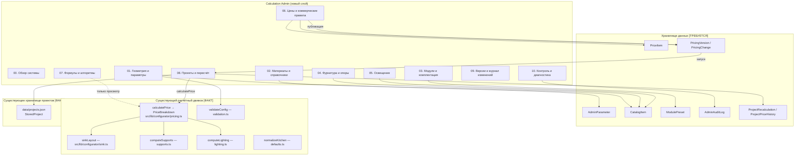
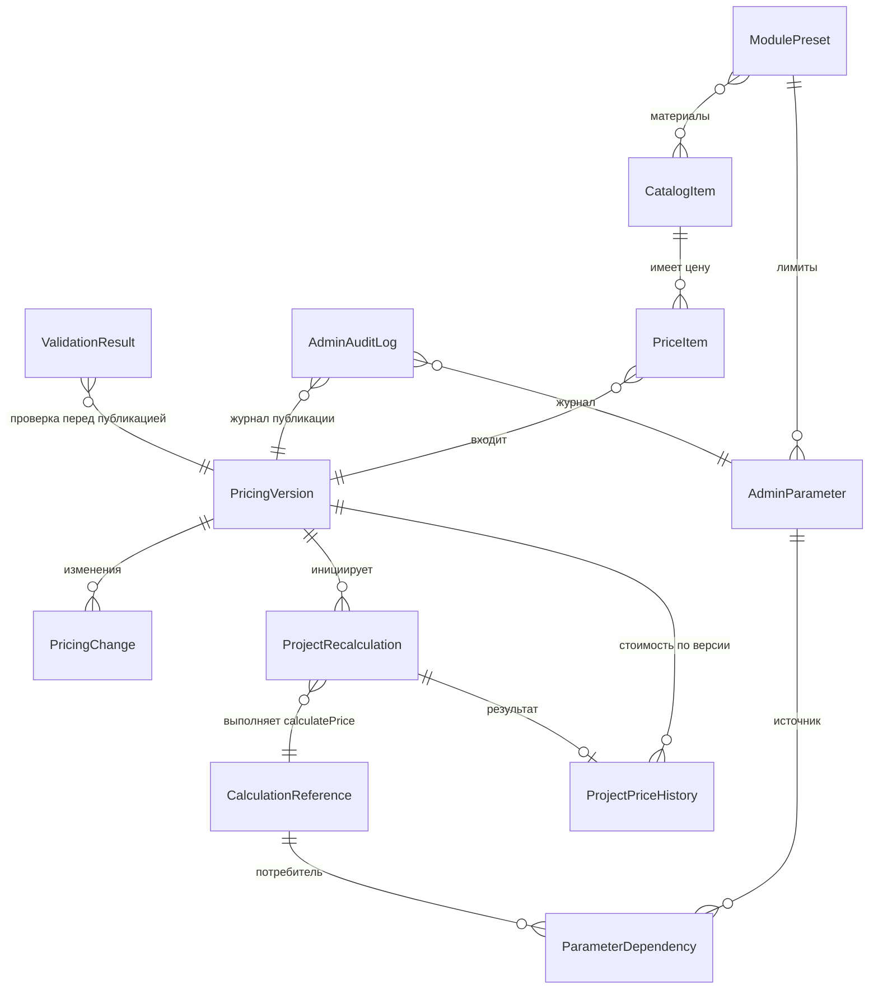
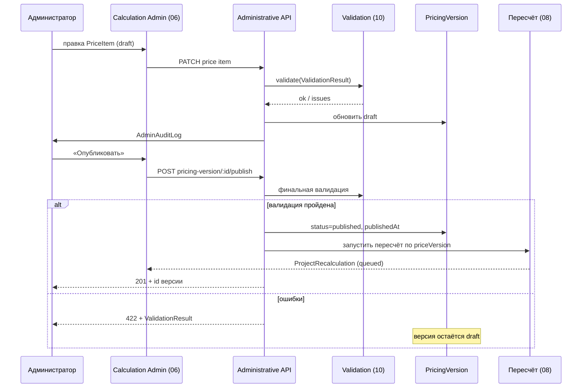
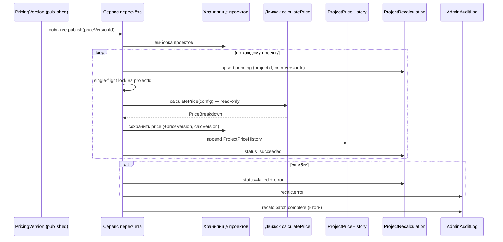
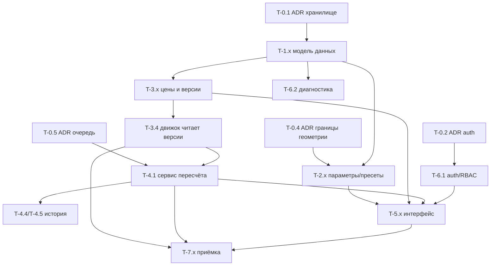

# CALCULATION ADMIN — Техническое задание

**Документ:** CALCULATION_ADMIN_TECHNICAL_SPECIFICATION.md
**Тип:** Техническое задание (ТЗ)
**Статус:** Проект на согласование
**Дата:** 2026-11-04
**Основание:** `CALCULATOR_TECHNICAL_AUDIT.md` (проверен по текущему состоянию репозитория), утверждённая архитектура Calculation Admin (раздел 2 настоящего ТЗ).
**Область:** административная техническая панель Calculation Admin для калькуляторов кухонь и шкафов FORMAKUB.

**Режим подготовки:** только исследование репозитория и создание настоящего документа. Исходный код, API, конфигурации, схемы и данные не изменялись. Физическая схема БД не проектируется (требуется отдельное согласование, см. раздел 12).

**Условные обозначения:**

| Маркер | Значение |
|---|---|
| **[ФАКТ]** | Подтверждено непосредственным чтением кода репозитория. |
| **[АУДИТ]** | Взято из `CALCULATOR_TECHNICAL_AUDIT.md` и перепроверено в рамках настоящего ТЗ. |
| **[ТРЕБУЕТСЯ]** | Требуется реализовать в рамках Calculation Admin. |
| **[ПРЕДПОЛОЖЕНИЕ]** | Проектировочное решение настоящего ТЗ, не является фактом о системе. |
| **[ВОПРОС]** | Открытый вопрос, требующий решения владельца проекта (раздел 12). |
| **не обнаружено** | Элемент отсутствует в репозитории. |

---

## Список сокращений

| Сокращение | Расшифровка |
|---|---|
| НР | Настоящее техническое задание |
| `KitchenConfig` / `WardrobeConfig` | Типы конфигураций кухни и шкафа (`src/lib/configurator/types.ts`) |
| `PriceBreakdown` | Структура результата расчёта стоимости |
| `StoredProject` | Структура сохранённого проекта (`src/lib/server/projects.ts`) |
| Zod | Библиотека валидации схем (`src/lib/configurator/schema.ts`) |
| ADR | Architecture Decision Record |

---

# Раздел 01. Общие положения

## 1.1. Назначение Calculation Admin

Calculation Admin — единая административная техническая панель централизованного управления расчётной системой калькулятора корпусной мебели FORMAKUB.

Панель обеспечивает управление входными параметрами расчётов (геометрия, ограничения, справочники, цены, коммерческие правила) при сохранении расчётной логики в программном коде.

**[ФАКТ]** Расчётная логика на сегодня находится в `src/lib/configurator/` (`pricing.ts`, `sink.ts`, `supports.ts`, `lighting.ts`, `defaults.ts`, `validation.ts`, `schema.ts`) и использует справочники из `src/content/` (`catalog.ts`, `pricing.ts`, `plinth.ts`, `supports.ts`, `lighting.ts`). Панель не переписывает этот слой, а управляет данными, которые в него подаются.

## 1.2. Цели создания

| № | Цель | Связь с аудитом |
|---|---|---|
| G1 | Централизовать управление ~148 параметрами и 118 ценовыми элементами, сейчас разнесёнными по 10+ файлам исходного кода. | **[АУДИТ]** Разделы 2 и 4 аудита. |
| G2 | Устранить необходимость деплоя кода для изменения цен и коммерческих правил. | **[АУДИТ]** Все цены находятся в `src/content/*.ts`. |
| G3 | Ввести версионирование данных, расчётного движка и прайса (`schemaVersion` / `calcVersion` / `priceVersion`). | **[ФАКТ]** Сегодня `config.version = 1` (литерал), `PRICING.version = "demo-2026-01"` (не сохраняется в проекте), версии расчётного движка нет. |
| G4 | Обеспечить автоматический пересчёт сохранённых проектов при публикации нового прайса с сохранением истории стоимости. | **[ФАКТ]** Сегодня `getProject` пересчитывает цену по текущему прайсу, история не сохраняется. |
| G5 | Сделать неиспользуемые и неподтверждённые параметры видимыми и корректно помеченными (аудит: 4 «мёртвых» поля, `source: "preliminary"`). | **[АУДИТ]** Разделы 6.5–6.8, 10 аудита. |
| G6 | Обеспечить аудируемость всех административных действий. | **[ФАКТ]** Журналирование административных действий отсутствует. |

## 1.3. Область применения

В область действия Calculation Admin входит **вся система** (зафиксировано архитектурным решением, раздел 2.1):

- калькулятор кухонь (`type: "kitchen"`);
- калькулятор шкафов (`type: "wardrobe"`);
- общие справочники (материалы, столешницы, фурнитура);
- общие ценовые позиции;
- коммерческие правила (минимальный заказ, округление, промокоды, коэффициенты).

## 1.4. Пользователи системы

| Роль | Описание | Наличие в системе |
|---|---|---|
| Администратор расчётов | Владелец цен, справочников, лимитов; публикует прайсы, запускает пересчёты. | **[ТРЕБУЕТСЯ]** Роли отсутствуют (**[ФАКТ]**). |
| Инженер/аудитор | Просмотр формул, зависимостей, диагностики без права изменения. | **[ТРЕБУЕТСЯ]**. |
| Владелец проекта | Утверждает ADR, архитектурные и коммерческие решения. | Вне системы. |
| Пользователь калькулятора | Не входит в Calculation Admin; использует публичный конфигуратор. | **[ФАКТ]** `src/app/configurator/[type]`. |

## 1.5. Границы ответственности панели

**Входит в ответственность панели:**
- управление параметрами, справочниками, пресетами, ценами, коммерческими правилами;
- версия прайса, публикация, пересчёт проектов, история стоимости;
- журнал административных действий, диагностика, валидация.

**Не входит:**
- изменение формул, функций, алгоритмов (**[АРХИТЕКТУРНОЕ РЕШЕНИЕ]**, раздел 2.3 ТЗ — только просмотр);
- редактирование конфигураций проектов пользователей;
- публичный интерфейс конфигуратора;
- управление лидами (`data/leads.json`, `/api/leads`) — вне описываемой области **[ПРЕДПОЛОЖЕНИЕ]**, требует подтверждения **[ВОПРОС]**.

---

# Раздел 02. Функциональная архитектура

## 2.1. Общая схема



## 2.2. Разделы панели

### Раздел 00. Обзор системы

| Поле | Содержание |
|---|---|
| Назначение | Сводная панель состояния расчётной системы. |
| Функциональность | Счётчики параметров/цен/версий, статус текущего прайса, статус фоновых пересчётов, последние изменения, результаты диагностики. |
| Входные данные | Агрегаты разделов 01–10. |
| Выходные данные | Дашборд-показатели (read-only). |
| Операции администратора | Просмотр; переходы в разделы. |
| Ограничения | Нет изменения данных. |
| Зависимости | 06, 08, 09, 10. |
| Критерии готовности | Отображаются фактические счётчики из хранилища; отсутствуют данные, не подтверждённые хранилищем. |

### Раздел 01. Геометрия и параметры

| Поле | Содержание |
|---|---|
| Назначение | Управление геометрическими константами и ограничениями. |
| Функциональность | Редактирование `KITCHEN_LIMITS` (**15 полей** — **[ФАКТ]** `src/content/catalog.ts:476–492`, поля 477–491; заявленные ранее «17 полей» — источник числа не найден, вопрос состава не закрыт), `WARDROBE_LIMITS` (17 полей), геометрических частей `SINK_RULES` (`minWidth/maxWidth/widthStep/standardWidths/mountEdge/innerMount/sinkStep/min-maxSinkWidth/Depth`), допусков опор (`MIN_LEG_SPACING_CM=8`, `PARTITION_SNAP_CM=4`, `MERGE_TOLERANCE_CM=1.5`), `LED_END_MARGIN_CM=2`. |
| Входные данные | Числовые/списочные значения, `AdminParameter`. |
| Выходные данные | Версия параметров + запись `AdminAuditLog`. |
| Операции администратора | Просмотр, редактирование с валидацией, откат. |
| Ограничения | **[ЦЕЛЕВОЕ ПОВЕДЕНИЕ]** (CA-T-004, Q6): редактирование геометрических параметров временно запрещено до устранения дублей и проверки зависимостей; ограничение касается **только редактирования геометрии** — прочие параметры и функции Calculation Admin не ограничиваются; ADR-04 оформляется отдельно. **[АУДИТ]** Запрещено выносить до устранения дублей: `EDGE_GAP/NEIGHBOR_GAP/DOOR_GAP` в `KitchenScene.tsx` (дубли `facadeEdgeGap/facadeNeighborGap/facadeInnerGap`), толщина 1.6 (дубли в `KitchenScene.tsx`/`WardrobeScene.tsx`), `bottleClearOffset` (дубль литерала `-32` в `KitchenPanel.tsx`), диапазоны 80/95/200 (литералы в `KitchenPanel.tsx`), `MIN_FLOOR_Y`, `MARGIN`. Zod-границы в `schema.ts` (width 15–200, height 40–280 и др.) должны синхронизироваться с редактируемыми значениями. |
| Зависимости | 03 (пресеты), 07 (формулы), 10 (валидация). |
| Критерии готовности | Изменение параметра проходит валидацию и попадает в `AdminParameter`; мёртвые параметры не отображаются как действующие (**[АУДИТ]** `KITCHEN_LIMITS.minCountertopMeters` не читается нигде). |

### Раздел 02. Материалы и справочники

| Поле | Содержание |
|---|---|
| Назначение | Управление общими справочниками. |
| Функциональность | `BODY_MATERIALS` (3 материала, ставки 5200/7600/9200 ₽/м², 11 декоров), `FACADE_MATERIALS` (5 материалов, 5600–18600 ₽/м², 17 декоров), `FACADE_STYLES` (3 стиля, множители 1.0/1.16/1.08), `COUNTERTOPS` (6 вариантов, 9500–29400 ₽/м), `PLINTH_MATERIALS` (5 материалов, 1600–6200 ₽/м + 10 исполнений с `rateDelta`), `PLINTH_MOUNTS` (2 варианта). |
| Входные данные | `CatalogItem`. |
| Выходные данные | Обновлённый справочник + `AdminAuditLog`. |
| Операции администратора | Создание/редактирование/архивирование записей, управление декорами и толщинами. |
| Ограничения | Идентификаторы (`id`) не переименовывать: на них ссылаются zod-enum и сохранённые проекты. **[АУДИТ]** Одинаковые ставки `ldsp_hpl`/`compact_hpl` (9500) и `porcelain`/`solid_wood` (29400) — требуют подтверждения перед публикацией. |
| Зависимости | 06 (цены), 10 (валидация). |
| Критерии готовности | Справочник редактируется без деплоя; сохранённые проекты валидны после изменений (см. раздел 04). |

### Раздел 03. Модули и комплектация

| Поле | Содержание |
|---|---|
| Назначение | Управление пресетами модулей и лимитами комплектации. |
| Функциональность | 8 пресетов `KITCHEN_MODULES` (`base`, `sink`, `hob`, `drawers`, `wall`, `tall`, `oven`, `bottle`): min/max/default по ширине/высоте/глубине, `defaultShelves`, `defaultDrawers`, `basePrice`, `zone`; лимиты комплектации (`maxSinkModules=1`, `maxShelvesPerModule=5`, `minDrawers=2`, `maxDrawers=4` и др.). |
| Входные данные | `ModulePreset`. |
| Выходные данные | Обновлённые пресеты + `AdminAuditLog`. |
| Операции администратора | Редактирование диапазонов и базовых цен пресетов. |
| Ограничения | Диапазоны пресетов не могут выходить за zod-границы `kitchenModuleSchema` (width 15–200, height 40–280, depth 20–80, shelves 0–10, drawers 0–6) без отдельного ADR. **[ФАКТ]** `KitchenPanel.tsx` содержит литералы `min=80 max=95` и `min=200` — рассинхрон возможен до их устранения. |
| Зависимости | 01, 06, 10. |
| Критерии готовности | Пресеты применяются при создании модулей; тесты на валидацию проходят. |

### Раздел 04. Фурнитура и опоры

| Поле | Содержание |
|---|---|
| Назначение | Управление фурнитурой и системами опор. |
| Функциональность | `HANDLES` (4 варианта: 780/560/1450/0 ₽), ставки петель/доводчиков/ push-to-open/направляющих (`PRICING.*`), `SUPPORT_SYSTEMS` (2 системы: `standard`, `heavy` — `edgeInset`, `maxSpan`, `maxLoad`, цены опор/клипс/винтов/анкеров), `MODULE_LOAD_KG` (8 типов модулей), `MODULE_LOAD_REFERENCE_WIDTH`. |
| Входные данные | `CatalogItem`, `AdminParameter`. |
| Выходные данные | Обновлённые справочники + `AdminAuditLog`. |
| Операции администратора | Редактирование цен и числовых параметров систем опор. |
| Ограничения | **[АУДИТ]** Всё содержимое `SUPPORT_SYSTEMS` и `MODULE_LOAD_KG` имеет `source: "preliminary"` — статус «не подтверждён инженерно» обязателен; редактирование возможно только с явным подтверждением и пометкой. |
| Зависимости | 01, 06, 10. |
| Критерии готовности | Параметры с статусом `preliminary` отображаются с пометкой; изменение фиксируется в журнале. |

### Раздел 05. Освещение

| Поле | Содержание |
|---|---|
| Назначение | Управление справочниками и ценами освещения. |
| Функциональность | `LED_VOLTAGES` (12/24 В), `LED_POWERS` (4 значения), `LED_COLOR_TEMPS` (5), 8 моделей `LED_STRIPS` (740–1900 ₽/м, `maxContinuousRunM`, `voltageDropPct`, `maxPsuW`), профили (3), рассеиватели (2), управление (3), БП: рейтинги (8) и цены (950–5600 ₽), заглушки/соединители/монтаж, `LED_PSU_MARGIN` (1.25/1.2). |
| Входные данные | `CatalogItem`, `AdminParameter`. |
| Выходные данные | Обновлённые справочники + `AdminAuditLog`. |
| Операции администратора | Редактирование цен и допусков. |
| Ограничения | `LED_STRIPS[].source = "preliminary"` — статус обязателен. **[АУДИТ]** Корректность подбора БП при `psuRequiredW > 400 Вт` не подтверждена — требует проверки до публикации изменений алгоритма (алгоритм в коде, не редактируется). |
| Зависимости | 06, 07, 10. |
| Критерии готовности | `computeLighting` возвращает обновлённую стоимость; эталонный расчёт проходит. |

### Раздел 06. Цены и коммерческие правила

| Поле | Содержание |
|---|---|
| Назначение | Управление всеми 118 ценовыми элементами, версиями прайса и коммерческими правилами. |
| Функциональность | Редактирование `PriceItem` (все ставки раздела 4 аудита); правил: `PRICING.rounding=100`, `PRICING.minOrder=45000`, `complexityPerExtraModule=0.02`, `complexityMax=1.12`, `bodyFactor=1.15`, `bodyDepthReference=60`; `PROMOS` (3 промокода); создание черновика `PricingVersion`, валидация, публикация. |
| Входные данные | `PriceItem`, `PricingVersion`. |
| Выходные данные | Опубликованная версия прайса + `PricingChange` + `AdminAuditLog`; запуск пересчёта (раздел 05 настоящего ТЗ). |
| Операции администратора | Редактирование цен → валидация → создание версии → публикация (с подтверждением) → инициация пересчёта. |
| Ограничения | **[АУДИТ]** Не отображать как действующие настройки 4 мёртвых поля: `PRICING.kitchen.plinthPerMeter`, `sinkPartition`, `underCabinetLightPerMeter`, `countertopDepthAllowance` — они не влияют на расчёт (**[ФАКТ]** подтверждено чтением `calculateKitchenPrice`). **[ФАКТ]** (CA-T-002/CA-T-007): эти 4 поля физически остаются в `src/content/pricing.ts:26, 27, 29, 33` и не читаются `calculateKitchenPrice`; `PRICING.wardrobe.plinthPerMeter` при этом используется (`src/lib/configurator/pricing.ts:492`); удаление полей относится к Q12 / Этапу 0 (поля из кода не удалялись, Q12 не закрыт). Публикация запрещена при ошибках валидации. |
| Зависимости | 02–05 (источники ставок), 08 (пересчёт), 09 (версии). |
| Критерии готовности | Публикация создаёт `PricingVersion`; изменение цены без деплоя отражается в `calculatePrice`; история изменений записана. |

### Раздел 07. Формулы и алгоритмы

| Поле | Содержание |
|---|---|
| Назначение | Просмотр расчётной логики без возможности изменения. |
| Функциональность | Реестр 17 основных формул (**[АУДИТ]** раздел 3 аудита) с путями файлов/функций, входами/выходами, зависимостями; карта «параметр → формула → результат → использование» (раздел 5 аудита). |
| Входные данные | Метаданные `CalculationReference`, `ParameterDependency` (создаются при разработке **[ТРЕБУЕТСЯ]**). |
| Выходные данные | Read-only представление. |
| Операции администратора | Только просмотр, фильтрация по параметру/формуле. |
| Ограничения | **[АРХИТЕКТУРНОЕ РЕШЕНИЕ]** редактирование формул запрещено. Никаких вычислений на стороне панели — источник истины только движок. |
| Зависимости | 01–06 (параметры, входы формул), 10. |
| Критерии готовности | Каждая формула указана с точным путём и функцией; ссылки на параметры кликабельны к разделу 01/06. |

### Раздел 08. Проекты и пересчёт

| Поле | Содержание |
|---|---|
| Назначение | Управление пересчётом сохранённых проектов. |
| Функциональность | Список проектов, запуск пересчёта (ручной/массовый по `priceVersion`), статусы `ProjectRecalculation`, история стоимости `ProjectPriceHistory`, повтор обработки ошибок. |
| Входные данные | `ProjectRecalculation`. |
| Выходные данные | Обновлённая стоимость в `StoredProject.price`, записи истории, статусы. |
| Операции администратора | Запуск, мониторинг, retry, просмотр истории проекта. |
| Ограничения | **[АРХИТЕКТУРНОЕ РЕШЕНИЕ]** (раздел 2.2) при пересчёте неизменны: геометрия (`config`), комплектация, материалы; изменяется только стоимость. Пересчёт выполняется только существующим `calculatePrice`. |
| Зависимости | 06 (публикация прайса), 09 (версии). |
| Критерии готовности | Полный цикл раздела 05 настоящего ТЗ; идемпотентность подтверждена тестами; ни одна конфигурация не изменена. |

### Раздел 09. Версии и журнал изменений

| Поле | Содержание |
|---|---|
| Назначение | Версионирование и аудит. |
| Функциональность | Управление `schemaVersion`, `calcVersion`, `priceVersion`; список `PricingVersion`/`PricingChange`; журнал `AdminAuditLog` (кто, что, когда, старое/новое значение). |
| Входные данные | Версии, записи журнала. |
| Выходные данные | История версий и действий. |
| Операции администратора | Просмотр, фильтр, экспорт (экспорт — **[ПРЕДПОЛОЖЕНИЕ]**). |
| Ограничения | **[АРХИТЕКТУРНОЕ РЕШЕНИЕ]** (раздел 2.4): публикация прайса не меняет `calcVersion`. Изменения архитектуры — только через ADR. |
| Зависимости | 06, 08, 10. |
| Критерии готовности | Каждое административное действие порождает запись журнала; версии независимы. |

### Раздел 10. Контроль и диагностика

| Поле | Содержание |
|---|---|
| Назначение | Валидация и техническая диагностика. |
| Функциональность | Запуск `validateConfig`/`isConfigValid` на эталонных конфигурациях; проверка связей `ParameterDependency`; обнаружение расхождений геометрии/визуализации (**[АУДИТ]** дубли зазоров, толщин, счётчика дверей); отчёт о мёртвых параметрах; счёт тестов (`npm run test`). |
| Входные данные | `ValidationResult`, результаты проверок. |
| Выходные данные | Отчёт диагностики, статусы. |
| Операции администратора | Запуск проверок, просмотр отчётов. |
| Ограничения | Диагностика read-only; не исправляет обнаруженные проблемы автоматически. |
| Зависимости | Все разделы. |
| Критерии готовности | Диагностика выявляет известные расхождения аудита и новые; результаты сохраняются. |

---

# Раздел 03. Модель данных

## 3.1. Общие замечания

- Описана **логическая** модель. Физическая схема БД не создаётся настоящим ТЗ (**[ВОПРОС]** — выбор СУБД, раздел 12).
- **[ФАКТ]** Текущее физическое хранилище — JSON-файлы: `data/projects.json` (`StoredProject[]`, на момент аудита массив пуст `[]`), `data/leads.json`, доступ через `src/lib/server/store.ts` (атомарная запись, in-process lock, лимит `slice(-2000)`).
- Сущности модели — **[ТРЕБУЕТСЯ]**: новых сущностей в коде нет.

## 3.2. Сущности

### AdminParameter

| Поле | Тип | Обяз. | Описание |
|---|---|---|---|
| `id` | string | да | Стабильный ключ, например `kitchen.limit.maxModules` (**[ПРЕДПОЛОЖЕНИЕ]** формат — утвердить). |
| `group` | enum | да | Принадлежность разделу панели (01–06). |
| `value` | string \| number \| boolean \| string[] | да | Текущее значение. |
| `valueType` | enum(`number`,`int`,`boolean`,`enum`,`string[]`) | да | Тип для валидации UI. |
| `unit` | string \| null | нет | Ед. изм. (см, мм, ₽/м², —). |
| `min` / `max` | number \| null | нет | Границы (должны быть ≤ zod-границ — см. 3.3). |
| `status` | enum(`active`,`dead`,`preliminary`,`readonly`,`pending_release`) | да | `dead` — не влияет на расчёт (**[АУДИТ]** 4 поля), `preliminary` — не подтверждён. **[ЦЕЛЕВОЕ ПОВЕДЕНИЕ]** (CA-T-004, PEND-01; дизайн §5.7/§6.1): `pending_release` — правка параметра, читаемого расчётным движком, принята, но **не влияет на расчёты до выпуска новой версии `calcVersion`**; после выпуска новой версии становится `active`. Оператор видит, что изменение принято, но ещё не действует. Переход `pending_release → active` выполняется только релизом `calcVersion` с записью в `AdminAuditLog`. Механизм не реализован. |
| `sourceRef` | string | да | Файл:константа, например `src/content/catalog.ts:KITCHEN_LIMITS`. |
| `version` | string | да | Версия значения (связь с `schemaVersion`). |
| `updatedAt` / `updatedBy` | timestamp / string | да | Метаданные изменения. |

Связи: 1:N → `ParameterDependency` (как потребитель), N:1 (как источник); 1:1 → запись `AdminAuditLog` на изменение.
Хранение: только через Administrative API; прямое изменение вне панели запрещено (п. 5.4).

### CatalogItem

| Поле | Тип | Обяз. | Описание |
|---|---|---|---|
| `id` | string | да | Идентификатор из справочника (не переименовывать). |
| `catalog` | enum(`bodyMaterial`,`facadeMaterial`,`facadeStyle`,`handle`,`countertop`,`plinthMaterial`,`plinthFinish`,`plinthMount`,`supportSystem`,`ledStrip`,`ledProfile`,`ledDiffuser`,`ledControl`,`ledPsu`,`sinkSize`,`promo`) | да | Исходный справочник (**[ЦЕЛЕВОЕ ПОВЕДЕНИЕ]** CA-T-004: `psu` → `ledPsu` согласно дизайну §6.2). |
| `label` | string | да | Отображаемое название. |
| `attrs` | object | да | Справочные атрибуты (ставки, множители, толщины, `rateDelta`, `finishes`…). |
| `status` | enum(`active`,`archived`,`preliminary`) | да | Статус. |
| `sortOrder` | int | нет | Порядок в UI. |
| `version` | string | да | Версия значения. |
| `updatedAt` / `updatedBy` | timestamp / string | да | Метаданные. |

Связи: 1:N → `PriceItem` (позиция может иметь цену); N:M с `ModulePreset` (материалы, допустимые в пресете).
Ограничения: `id` участвует в zod-enum сохранённых проектов — удаление только через архивирование.

### ModulePreset

| Поле | Тип | Обяз. | Описание |
|---|---|---|---|
| `id` | string | да | `base`/`sink`/`hob`/`drawers`/`wall`/`tall`/`oven`/`bottle` (**[ФАКТ]** 8 пресетов). |
| `family` | enum(`kitchen`,`wardrobe`) | да | Семейство. |
| `zone` | enum | да | Зона размещения. |
| `width` / `height` / `depth` | object{min,max,default} | да | Диапазоны в см. |
| `defaultShelves` / `defaultDrawers` | int | да | Дефолты комплектации. |
| `basePrice` | number | да | Базовая цена корпуса пресета (**[ФАКТ]** 5000–15800 ₽). |
| `status` | enum(`active`,`archived`) | да | Статус. |
| `version` / `updatedAt` / `updatedBy` | — | да | Метаданные. |

Связи: N:M → `CatalogItem` (материалы); 1:N → `AdminParameter` (лимиты комплектации); N:1 → `PriceItem` (`basePrice`).
Ограничения: границы ≤ zod `kitchenModuleSchema`.

### PriceItem

| Поле | Тип | Обяз. | Описание |
|---|---|---|---|
| `id` | string | да | Стабильный ключ ставки (напр. `kitchen.hingePerDoor`). |
| `scope` | enum(`kitchen`,`wardrobe`,`shared`) | да | Область. |
| `label` | string | да | Название. |
| `unit` | enum(`RUB`,`RUB_PER_SQM`,`RUB_PER_M`,`RUB_PER_PCS`,`RUB_PER_LINM`,`FACTOR`) | да | Ед. изм. |
| `usage` | enum(`used`,`unused`) | да | **[АУДИТ]** 4 поля имеют `unused` и не отображаются как настройки (требование 5.9). |
| `sourceRef` | string | да | `src/content/pricing.ts:PRICING.kitchen.shelf` и т.п. |
| `updatedAt` / `updatedBy` | — | да | Метаданные. |

**[ЦЕЛЕВОЕ ПОВЕДЕНИЕ]** (CA-T-004, X-3; дизайн §6.4): поле `amount` в определении ставки отсутствует — сумма хранится в снимке версии `PricingVersion.snapshot[]` (`{priceItemId, amount}`); поле `versionId` исключено — версия является атрибутом `PricingVersion`, а не ставки.

Связи: N:1 → `PricingVersion`; 1:N → `PricingChange`.

### PricingVersion

| Поле | Тип | Обяз. | Описание |
|---|---|---|---|
| `id` | string | да | Идентификатор версии (**[ПРЕДПОЛОЖЕНИЕ]** `price-YYYY.MM.N`). |
| `label` | string | да | Название (напр. `demo-2026-01` — **[ФАКТ]** текущее значение `PRICING.version`). |
| `status` | enum(`draft`,`published`,`superseded`) | да | Статус жизненного цикла. |
| `snapshot` | array[{priceItemId, amount}] | да | **[ЦЕЛЕВОЕ ПОВЕДЕНИЕ]** (CA-T-004, X-2; дизайн §6.5) полный снимок ставок — `{priceItemId, amount}`, снимок, не ссылки (для воспроизводимости); заменяет поле `items: PriceItem[]`. |
| `rules` | object | да | Коммерческие правила снимком (`rounding`, `minOrder`, `complexityPerExtraModule`, `complexityMax`, `bodyFactor`, `bodyDepthReference`, …). |
| `promos` | array | да | Промокоды снимком. |
| `createdAt` / `createdBy` | — | да | Метаданные. |
| `publishedAt` / `publishedBy` | — | при `published` | Метаданные публикации. |
| `notes` | string | нет | Комментарий. |

Связи: 1:N → `PriceItem`, `PricingChange`, `ProjectRecalculation`.
Ограничения: опубликованная версия неизменяема; изменение → новая `draft`.

### PricingChange

| Поле | Тип | Обяз. | Описание |
|---|---|---|---|
| `id` | string | да | Идентификатор. |
| `versionId` | string | да | Версия прайса. |
| `priceItemId` | string | да | Ставка. |
| `field` | enum(`amount`,`label`,`unit`,`usage`) | да | Изменённое поле. |
| `oldValue` / `newValue` | json | да | До/после. |
| `createdAt` / `createdBy` | — | да | Метаданные. |

### CalculationReference

| Поле | Тип | Обяз. | Описание |
|---|---|---|---|
| `id` | string | да | Идентификатор формулы. |
| `name` | string | да | Название (напр. `calculateKitchenPrice`). |
| `fileRef` | string | да | Путь:функция (`src/lib/configurator/pricing.ts:calculateKitchenPrice`). |
| `description` | string | да | Назначение. |
| `inputs` / `outputs` | string[] | да | Входные/выходные данные. |
| `dependsOnParamIds` | string[] | да | Зависимые `AdminParameter`/`PriceItem`. |
| `editable` | `false` | да | **[АРХИТЕКТУРНОЕ РЕШЕНИЕ]** всегда `false`. |
| `source` | enum(`code`,`audit`) | да | Источник описания. |

Хранение: формируется из реестра аудита и кода; обновляется только при изменении кода (деплой), не администратором.

### ParameterDependency

| Поле | Тип | Обяз. | Описание |
|---|---|---|---|
| `id` | string | да | Идентификатор связи. |
| `sourceType` / `sourceId` | enum / string | да | Источник (параметр/ставка/пресет). |
| `targetType` / `targetId` | enum / string | да | Потребитель (формула/визуализация/валидация). |
| `effect` | enum(`price`,`geometry`,`validation`,`visualization`,`none`) | да | Характер влияния; `none` — мёртвый параметр. |
| `syncRisk` | boolean | да | **[АУДИТ]** `true` для продублированных значений (зазоры, 1.6, 3.2/32, 80/95). |

Используется разделами 07 и 10.

### ProjectRecalculation

| Поле | Тип | Обяз. | Описание |
|---|---|---|---|
| `id` | string | да | Идентификатор задания. |
| `projectId` | string | да | Проект (`StoredProject.id`). |
| `priceVersionId` | string | да | Версия прайса для пересчёта. |
| `calcVersion` | string | да | Версия движка на момент пересчёта. |
| `status` | enum(`pending`,`running`,`completed`,`failed`,`cancelled`) | да | Статус (**[ЦЕЛЕВОЕ ПОВЕДЕНИЕ]** CA-T-004, X-1: `succeeded` → `completed` согласно дизайну §6.9/§14.4). |
| `attempt` | int | да | Номер попытки. |
| `oldPrice` / `newPrice` | number | да | До/после. |
| `error` | string \| null | при `failed` | Текст ошибки. |
| `startedAt` / `finishedAt` | timestamp | нет | Тайминги. |
| `createdAt` / `createdBy` | — | да | Метаданные. |

Ограничения: **[ЦЕЛЕВОЕ ПОВЕДЕНИЕ]** (CA-T-004, X-4; дизайн §6.9) идемпотентность — U(`projectId`, `toPriceVersionId`, `operationId`) в пределах операции. Примечание: `toPriceVersionId`/`operationId` вводятся вместе с `RecalculationBatch` (дизайн §6.13) — в настоящей модели `priceVersionId` и сущность батча отсутствуют (см. остаточные несогласованности отчёта CA-T-007).

### ProjectPriceHistory

| Поле | Тип | Обяз. | Описание |
|---|---|---|---|
| `id` | string | да | Идентификатор записи. |
| `projectId` | string | да | Проект. |
| `priceVersionId` | string | да | Версия прайса. |
| `calcVersion` | string | да | Версия движка. |
| `price` | number | да | Итоговая стоимость после расчёта. |
| `breakdown` | json | нет | Снимок `PriceBreakdown` (**[ПРЕДПОЛОЖЕНИЕ]** — утвердить, влияет на объём). |
| `computedAt` | timestamp | да | Момент расчёта. |
| `jobId` | string | да | Связь с заданием (`ProjectRecalculation.id`) — **[ЦЕЛЕВОЕ ПОВЕДЕНИЕ]** CA-T-004, X-5: `recalculationId` → `jobId` согласно дизайну §6.10. |

Ограничения: append-only; удаление только по регламенту retention (**[ВОПРОС]**).

### AdminAuditLog

| Поле | Тип | Обяз. | Описание |
|---|---|---|---|
| `id` | string | да | Идентификатор. |
| `action` | enum(`param.update`,`catalog.update`,`preset.update`,`price.update`,`price.publish`,`project.recalc.run`,…) | да | Действие. |
| `entityType` / `entityId` | enum / string | да | Объект. |
| `oldValue` / `newValue` | json \| null | нет | Снимки до/после. |
| `actorId` / `actorRole` | string / enum | да | Кто выполнил. |
| `result` | enum(`ok`,`denied`,`error`) | да | **[ЦЕЛЕВОЕ ПОВЕДЕНИЕ]** CA-T-004, X-7 (дизайн §6.11): итог действия, включая отказы прав. |
| `requestId` | string | нет | Трассировка. |
| `createdAt` | timestamp | да | Когда. |

Ограничения: append-only, без API удаления.

### ValidationResult

| Поле | Тип | Обяз. | Описание |
|---|---|---|---|
| `id` | string | да | Идентификатор прогона. |
| `scope` | enum(`parameter`,`catalog`,`preset`,`price`,`config`,`dependency`) | да | Область проверки. |
| `targetId` | string \| null | нет | Объект проверки. |
| `passed` | boolean | да | Итог. |
| `issues` | array{code,message,path,severity} | да | Ошибки (**[ФАКТ]** формат близок к `ValidationIssue[]` из `validation.ts`). |
| `createdAt` | timestamp | да | Когда. |

## 3.3. ERD



**Подпись к ERD:** Логическая модель. Физических FK нет (JSON-хранилище); целостность обеспечивается валидацией при записи и сверкой (§6.8, п. 7).

## 3.4. Правила хранения

1. Версии и снимки append-only; редактирование только черновиков.
2. `sourceRef` обязателен для трассировки к исходному коду (**[ФАКТ]** требуется, т.к. источник истины — `src/content/*.ts` до полного выноса данных).
3. Существующие `data/projects.json` не модифицируются форматом настоящим ТЗ.
4. Физический носитель и формат — отдельный ADR (раздел 12).

---

# Раздел 04. Версионирование

## 4.1. Три независимые версии

| Версия | Область | Триггер изменения | **[ФАКТ]** текущее состояние |
|---|---|---|---|
| `schemaVersion` | Структура данных конфигурации (Zod-схемы, типы). | Изменение структуры `KitchenConfig`/`WardrobeConfig`. | Нет отдельного поля; есть `config.version = 1` (литерал в `types.ts`/`schema.ts`). |
| `calcVersion` | Расчётный движок (формулы, алгоритмы). | Деплой кода с изменением `pricing/sink/supports/lighting/validation`. | Отсутствует. |
| `priceVersion` | Набор цен и коммерческих правил. | Публикация в Calculation Admin. | `PRICING.version = "demo-2026-01"` — не сохраняется в проекте. |

**[АРХИТЕКТУРНОЕ РЕШЕНИЕ]** (раздел 2.4): изменение `priceVersion` **не** влечёт изменение `calcVersion` и наоборот.

## 4.2. Правила создания версий

1. `priceVersion` создаётся только в Calculation Admin при публикации; ранее опубликованная версия неизменяема (`superseded`).
2. `calcVersion` присваивается сборке и попадает в `ProjectRecalculation`/`ProjectPriceHistory`.
3. `schemaVersion` создаётся при деплое, изменяющем структуру; обязан сопровождаться миграцией совместимости (см. 4.4).
4. Изменение архитектурных правил версионирования — только через ADR (раздел 2.5).

## 4.3. Публикация прайса



## 4.4. Совместимость старых проектов

**[ФАКТ]** Механизмы, существующие сегодня (используются повторно):
- Zod `preprocess` с `COUNTERTOP_LEGACY_MAP` (миграция `laminate`→`compact_hpl`, `stone`→`porcelain`);
- optional-поля с `.default(...)` в `schema.ts`;
- идемпотентная нормализация `normalizeKitchen`/`normalizePlinthOptions`/`normalizeLighting`/`normalizeSupportSettings`/`normalizeSinkModule`;
- тесты `migration.test.ts`.

Правила для Calculation Admin:
1. Новые поля версий — только `.optional().default(...)`; обязательных полей не добавлять (**[ФАКТ]** `strictObject` отклонит незнакомые поля у старых проектов).
2. Отсутствие `schemaVersion` трактовать как `1`; отсутствие `priceVersion` — как текущий `demo-2026-01`; отсутствие `calcVersion` — как версию сборки на момент записи.
3. Несовпадение `priceVersion` проекта с опубликованной не блокирует чтение: показ обеих стоимостей (сохранённая / актуальная).
4. Миграция данных — только после ADR (**[ВОПРОС]**, раздел 12).

## 4.5. Обработка отсутствующих версий

| Ситуация | Поведение |
|---|---|
| У проекта нет `priceVersion` | Трактовать как первый известный прайс (`demo-2026-01`); при пересчёте записать историю с фактической версией. |
| Нет `calcVersion` | **[ЦЕЛЕВОЕ ПОВЕДЕНИЕ]** (CA-T-004, CA-Q-001; дизайн §5.7): молчаливая подмена старого движка новым **запрещена**; автоматический пересчёт **блокируется** до штатного перехода; первое определение версии — только контролируемая операция (`retro_certification`/`engine_migration`) с записью в историю (`prevCalcVersion`). Физический механизм хранения сборок и глубина хранения определяются отдельно (ADR-03). |
| Нет `schemaVersion` | `= 1` (**[ФАКТ]** соответствует существующему `config.version = 1`). |
| Опубликованной версии прайса нет | Пересчёт невозможен; панель показывает статус «нет активного прайса». |

## 4.6. Защита от потери данных

1. Публикация версии атомарна: либо `published` + запуск пересчёта, либо откат.
2. Записи истории append-only.
3. **[ФАКТ]** Риск: `docker-compose.yml` не содержит volume для `/app/data` — пересоздание контейнера теряет `data/*.json`. Устранение — отдельная задача/ADR (раздел 11, T-0.3; раздел 12).
4. **[ФАКТ]** `store.ts` хранит максимум 2000 последних проектов (`slice(-2000)`, `src/lib/server/projects.ts:48`): при достижении лимита **старейший проект удаляется молча** — без архива, журнала и диагностики; 2001-й проект не сохраняется (проверено CA-T-002/CA-T-007). Лимит нужно учитывать при массовом пересчёте.
   **[ЦЕЛЕВОЕ ПОВЕДЕНИЕ]** (CA-T-004, Q14 — утверждено владельцем 2026-11-06; **не реализовано**): основная коллекция содержит максимум 2000 проектов; при вытеснении старые проекты **архивируются**; финансовая история и история пересчётов сохраняются; безвозвратное автоматическое удаление запрещено; физическая модель архива определяется отдельно в ADR-01.

---

# Раздел 05. Автоматический пересчёт проектов

## 5.1. Жизненный цикл

| № | Шаг | Описание | Ответственный компонент |
|---|---|---|---|
| 1 | Изменение цен | Редактирование `PriceItem` в черновике `PricingVersion` (раздел 06 панели). | Administrative API |
| 2 | Проверка корректности | Валидация ставок: типы, диапазоны, отсутствие `unused`-полей в качестве активных, целостность идентификаторов → `ValidationResult`. | Validation |
| 3 | Создание версии | Фиксация полного снимка ставок в `PricingVersion` (`draft`). | Administrative API |
| 4 | Публикация | `draft` → `published`; `AdminAuditLog`; запуск цепочки 5+. | Administrative API |
| 5 | Поиск затронутых проектов | Выборка всех `StoredProject` (обоих типов `kitchen`/`wardrobe`). | Пересчёт |
| 6 | Постановка в очередь | Создание `ProjectRecalculation` (`pending`) для каждого проекта, уникальность `(projectId, priceVersionId)`. | Пересчёт |
| 7 | Пересчёт | Вызов **существующего** `calculatePrice(config)` (**[ФАКТ]** `src/lib/configurator/pricing.ts`); для кухонь дополнительно проходят `sinkLayout`/`computeSupports`/`computeLighting`. Конфигурация не изменяется. | Движок (read-only) |
| 8 | Сохранение новой стоимости | Обновление только `StoredProject.price` (+версии); `config` не трогается. | Хранилище проектов |
| 9 | Запись истории | `ProjectPriceHistory` (append-only) со связью `recalculationId`. | Хранилище истории |
| 10 | Обработка ошибок | `failed` + текст ошибки; остальные задания продолжаются (частичные ошибки допустимы). | Пересчёт |
| 11 | Повторная обработка | Ручной/автоматический retry только для `failed`; `attempt` инкрементируется; дедупликация по `(projectId, priceVersionId)`. | Пересчёт |

## 5.2. Диаграмма последовательности



## 5.3. Требования к обработке

| Требование | Реализация |
|---|---|
| **Идемпотентность** | Ключ `(projectId, priceVersionId)`: повторный запуск той же публикации не создаёт дублей — задание переиспользуется, пересчёт при `succeeded` пропускается. |
| **Защита от параллельного пересчёта** | Single-flight lock на `projectId`: второе задание для того же проекта ставится в `pending` до завершения текущего. Батч запускается только если нет активного батча для той же `priceVersion` (статус batch-задания). **[ПРЕДПОЛОЖЕНИЕ]** блокировка in-process приемлема при одном инстансе (**[ФАКТ]** текущая архитектура — один контейнер); для нескольких инстансов требуется ADR (раздел 12). |
| **Частичные ошибки** | Ошибка одного проекта не останавливает батч; статусы независимы; итог батча — `succeeded/failed/total`. |
| **Повторные запуски** | Retry с ограничением попыток (**[ВОПРОС]** максимум — утвердить), экспоненциальная задержка **[ПРЕДПОЛОЖЕНИЕ]**; ручной retry из раздела 08. |
| **Контроль завершения** | Счётчики батча в `ProjectRecalculation`: `total`, `pending`, `running`, `succeeded`, `failed`; завершение = нет `pending/running`; панель отображает прогресс и позволяет досрочно остановить (**[ПРЕДПОЛОЖЕНИЕ]**). |
| **Гарантия неизменности конфигурации** | Пересчёт читает `config` и пишет только цену; тест-защита: сравнение `config` до/после (раздел 09). |

## 5.4. Связь с существующим поведением

**[ФАКТ]** (проверено CA-T-002/CA-T-007 по коду, 2026-11-06): `getProject` (`src/lib/server/projects.ts:60–72`) при выдаче проекта пересчитывает цену по текущему прайсу (пересчёт — строка 70); сохранённый `StoredProject.price` и `updatedAt` при этом **не обновляются**; проект, не прошедший текущий `validateConfig`, превращается в `null` (строка 65) и возвращает 404 (`src/app/api/projects/[id]/route.ts:23–28`). Это входит в противоречие с требованием хранить историю: источником истории должна быть `ProjectPriceHistory`, а не пересчёт при чтении.

**[ЦЕЛЕВОЕ ПОВЕДЕНИЕ]** (CA-T-004, Q5 — утверждено владельцем 2026-11-06; реализация — T-4.5/CA-T-413, **ещё не реализована**):
- GET возвращает сохранённый снимок стоимости проекта;
- GET не запускает пересчёт и не изменяет проект;
- пересчёт выполняется отдельной операцией;
- результат пересчёта сохраняется в проекте;
- история пересчётов хранится отдельно.

Согласование поведения `getProject` получено в рамках CA-T-004 (Q5); изменение существующего API выполняется задачей T-4.5.

---

# Раздел 06. API

## 6.1. Существующие API (проверены)

**[ФАКТ]** Полный перечень маршрутов `src/app/api/`:

| Метод | Путь | Назначение | Защита |
|---|---|---|---|
| POST | `/api/projects` | Сохранение проекта: Zod-валидация → `calculatePrice` → запись `StoredProject`. | Rate-limit in-memory (6 запросов / 10 мин), проверка content-type. |
| GET | `/api/projects/[id]` | Выдача проекта (с пересчётом цены). | Валидация id, 404 при отсутствии. |
| POST | `/api/leads` | Создание лида. | Same-origin check, rate-limit. |

**Общие факты об API:**
- Авторизации, сессий, ролей, API-ключей **не обнаружено** (проверено: `src/**` — нет `auth/session/cookie/role/admin`, `middleware.ts` отсутствует, в `package.json` нет auth-библиотек).
- `next.config.ts`: security-заголовки, `X-Robots-Tag: noindex` для `/api/*`.
- Rate-limit — **in-process** `Map` (`src/lib/server/rate-limit.ts`), не работает при нескольких инстансах.

Вывод: **существующие API не имеют административного слоя; новые endpoints создаются с нуля, на существующих не основываются**, кроме переиспользования Zod-схем и `calculatePrice`.

## 6.2. Проектируемые Administrative API

Префикс: `/api/admin/*` **[ПРЕДПОЛОЖЕНИЕ]**. Все endpoints — **[ТРЕБУЕТСЯ]**. Права: см. раздел 08 (RBAC обязателен до эксплуатации).

### Управление параметрами

| Метод | Путь | Назначение | Вход | Ответ | Ошибки |
|---|---|---|---|---|---|
| GET | `/api/admin/parameters` | Список параметров | query: `group`, `status` | `AdminParameter[]` | 401, 403 |
| GET | `/api/admin/parameters/:id` | Карточка параметра | — | `AdminParameter` + `ParameterDependency[]` | 404 |
| PATCH | `/api/admin/parameters/:id` | Редактирование | `{value, expectedVersion}` | обновлённый объект | 409 (конфликт версии), 422 (`ValidationResult`) |
| GET | `/api/admin/parameters/:id/history` | История значений | — | `AdminAuditLog[]` | 404 |

### Управление справочниками

| Метод | Путь | Назначение | Вход | Ответ | Ошибки |
|---|---|---|---|---|---|
| GET | `/api/admin/catalogs` | Перечень справочников | — | список каталогов + счётчики | 401 |
| GET | `/api/admin/catalogs/:catalog/items` | Элементы | query: `status` | `CatalogItem[]` | 404 |
| POST | `/api/admin/catalogs/:catalog/items` | Создание | `CatalogItem` | 201 | 422 |
| PATCH | `/api/admin/catalogs/:catalog/items/:id` | Редактирование | атрибуты | объект | 409, 422 |
| POST | `/api/admin/catalogs/:catalog/items/:id/archive` | Архивирование | — | объект | 409 (ссылки в проектах) |

### Управление модулями (пресеты)

| Метод | Путь | Назначение | Вход | Ответ | Ошибки |
|---|---|---|---|---|---|
| GET | `/api/admin/module-presets` | Список | query: `family` | `ModulePreset[]` | 401 |
| GET | `/api/admin/module-presets/:id` | Карточка | — | объект + зависимости | 404 |
| PATCH | `/api/admin/module-presets/:id` | Редактирование | диапазоны/дефолты/`basePrice` | объект | 422 (границы zod) |

### Управление ценами и версиями

| Метод | Путь | Назначение | Вход | Ответ | Ошибки |
|---|---|---|---|---|---|
| GET | `/api/admin/price-items` | Список ставок | query: `scope`, `usage` | `PriceItem[]` | 401 |
| PATCH | `/api/admin/price-items/:id` | Правка в черновике | `{amount,…}` | объект | 422 |
| GET | `/api/admin/pricing-versions` | Версии прайса | query: `status` | `PricingVersion[]` | 401 |
| POST | `/api/admin/pricing-versions` | Новый черновик | `{label, fromVersionId?}` | 201 | 409 |
| GET | `/api/admin/pricing-versions/:id` | Снимок версии | — | версия + `PriceItem[]` | 404 |
| POST | `/api/admin/pricing-versions/:id/validate` | Валидация | — | `ValidationResult` | 404 |
| POST | `/api/admin/pricing-versions/:id/publish` | Публикация | — | 201 + запуск пересчёта | **422** (валидация), 409 |
| GET | `/api/admin/pricing-versions/:id/changes` | Diff ставок | — | `PricingChange[]` | 404 |

### Просмотр алгоритмов

| Метод | Путь | Назначение | Вход | Ответ | Ошибки |
|---|---|---|---|---|---|
| GET | `/api/admin/calculations` | Реестр формул | query: `family` | `CalculationReference[]` | 401 |
| GET | `/api/admin/calculations/:id` | Карточка формулы | — | формула + `ParameterDependency[]` | 404 |

*Изменяющих методов в этой группе нет — **[АРХИТЕКТУРНОЕ РЕШЕНИЕ]**.*

### Пересчёты

| Метод | Путь | Назначение | Вход | Ответ | Ошибки |
|---|---|---|---|---|---|
| POST | `/api/admin/recalculations` | Запуск батча | `{priceVersionId, filter?}` | 202 + batch id | 409 (активный батч), 422 |
| GET | `/api/admin/recalculations` | Список батчей | query: `status` | агрегаты | 401 |
| GET | `/api/admin/recalculations/:id` | Статус батча | — | счётчики, прогресс | 404 |
| POST | `/api/admin/recalculations/:id/retry` | Retry failed | — | 202 | 404, 409 |
| POST | `/api/admin/recalculations/:id/cancel` | Остановка | — | 202 | 409 |
| GET | `/api/admin/recalculations/:id/items` | Задания батча | query: `status` | `ProjectRecalculation[]` | 404 |

### История стоимости проектов

| Метод | Путь | Назначение | Вход | Ответ | Ошибки |
|---|---|---|---|---|---|
| GET | `/api/admin/projects` | Список проектов | query: `type`, `page` | краткие записи | 401 |
| GET | `/api/admin/projects/:id/price-history` | История стоимости | — | `ProjectPriceHistory[]` | 404 |
| POST | `/api/admin/projects/:id/recalculate` | Пересчёт одного | `{priceVersionId}` | 202 | 409 |

### Журнал и диагностика

| Метод | Путь | Назначение | Вход | Ответ | Ошибки |
|---|---|---|---|---|---|
| GET | `/api/admin/audit-log` | Журнал | query: `action`, `actor`, `date range` | `AdminAuditLog[]` | 401 |
| GET | `/api/admin/diagnostics` | Диагностика | — | отчёт (мёртвые параметры, `preliminary`, тесты, целостность) | 401 |
| POST | `/api/admin/diagnostics/run` | Запуск проверок | `{scope}` | `ValidationResult[]` | 429 (rate-limit) |

## 6.3. Общие требования к API

1. Все ответы — обёртка `{ok, data|error}` по образцу существующих маршрутов **[ФАКТ]**.
2. Zod-валидация входа на каждом изменяющем методе.
3. Идемпотентные PATCH — через `expectedVersion` (optimistic locking).
4. Rate-limit для изменяющих методов (переиспользовать принцип `rate-limit.ts`, **[ФАКТ]** in-process).
5. Каждый изменяющий вызов пишет `AdminAuditLog`.
6. Отсутствие прав → 403; отсутствие авторизации в системе на момент написания ТЗ — **блокер эксплуатации** (раздел 12).

---

# Раздел 07. Интерфейс

> Описание структуры без дизайна и frontend-кода.

## 7.1. Навигация

```
Calculation Admin
├── 00. Обзор системы            (дашборд)
├── 01. Геометрия и параметры    (дерево групп → таблица параметров)
├── 02. Материалы и справочники  (список справочников → таблица элементов)
├── 03. Модули и комплектация    (пресеты → карточка пресета)
├── 04. Фурнитура и опоры
├── 05. Освещение
├── 06. Цены и коммерческие правила (таблица ставок + версии прайса)
├── 07. Формулы и алгоритмы      (read-only реестр)
├── 08. Проекты и пересчёт       (проекты → батчи → история)
├── 09. Версии и журнал          (версии + audit log)
└── 10. Контроль и диагностика
```

## 7.2. Элементы по типам страниц

| Тип | Назначение | Разделы |
|---|---|---|
| Дашборд | Счётчики, статус прайса, прогресс батчей, последние события. | 00 |
| Таблица | Списки параметров/элементов/цен/проектов/журнала: колонки, сортировка, пагинация. | 01–06, 08, 09 |
| Карточка параметра | Значение, единица, границы, `sourceRef`, статус (`active/dead/preliminary`), зависимости, история. | 01–06 |
| Форма редактирования | Поле значения + подтверждение изменений; индикатор конфликта версии. | 01–06 |
| Diff-представление | Сравнение `PricingVersion`: старое/новое значение. | 06, 09 |
| Read-only реестр | Формулы: путь, функция, вход/выход, ссылки на параметры. | 07 |
| Монитор батча | Прогресс `pending/running/succeeded/failed`, кнопки retry/cancel. | 08 |
| Отчёт диагностики | Список `ValidationResult` с severity. | 10 |

## 7.3. Общие требования

- **Фильтры:** по `group`, `status`, `scope`, `family`, датам, действию в журнале.
- **Поиск:** по `id`, `label`, `sourceRef`, названию формулы.
- **Статусы:** обязательные маркеры `active` / `dead` (неактивная настройка не выглядит действующей — требование 5.9) / `preliminary` (не подтверждено — требование 5.10) / `draft` / `published` / статусы пересчёта.
- **Уведомления:** результат публикации, завершение батча, ошибки.
- **Подтверждение изменений:** обязательно для публикации прайса, архивирования элементов, запуска массового пересчёта (диалог с показом затронутых проектов и diff).
- **Просмотр истории:** из карточки любого объекта — связанные `AdminAuditLog`/`PricingChange`.
- Дизайн-система и компоненты — вне ТЗ; использовать существующие UI-примитивы проекта при реализации **[ПРЕДПОЛОЖЕНИЕ]**.

---

# Раздел 08. Безопасность и права доступа

## 8.1. Фактическое состояние (проверено)

**[ФАКТ]** Авторизации в системе нет:
- в `src/**` не найдены `auth`, `session`, `cookie`, `role`, `admin`;
- `middleware.ts` отсутствует;
- в `package.json` нет auth-провайдеров;
- API защищены только rate-limit и same-origin-проверкой;
- `.env.example` не содержит секретов авторизации.

**Вывод: существующая «защита» для административных функций НЕ подходит и не может быть расширена — требуется отдельное решение (ADR, раздел 12).**

## 8.2. Требования

| № | Требование | Статус |
|---|---|---|
| S1 | Авторизация обязательна для всех `/api/admin/*` и страниц панели до первого использования. | **[ТРЕБУЕТСЯ]** |
| S2 | Роли (минимум): `calc-admin` (полный доступ к параметрам/ценам/публикации/пересчёту), `calc-viewer` (просмотр формул, диагностики, истории). Расширение ролей — **[ВОПРОС]**. | **[ТРЕБУЕТСЯ]** |
| S3 | Разграничение: публикация прайса и массовый пересчёт — только `calc-admin`. | **[ТРЕБУЕТСЯ]** |
| S4 | Защита API: аутентификация на каждом маршруте, отказ по умолчанию (deny by default). | **[ТРЕБУЕТСЯ]** |
| S5 | Валидация: Zod на входе, ограничение диапазонов ≤ существующим zod-границам. | **[ТРЕБУЕТСЯ]** |
| S6 | Аудит: каждое изменение → `AdminAuditLog` (кто, что, до/после, requestId). | **[ТРЕБУЕТСЯ]** |
| S7 | Защита от некорректной публикации: запрет публикации при `ValidationResult.passed=false`; обязательное подтверждение с показом diff и числа затронутых проектов; optimistic locking версии. | **[ТРЕБУЕТСЯ]** |
| S8 | CSRF/origin: переиспользовать принцип `isSameOrigin` из `/api/leads` **[ФАКТ]** для изменяющих методов. | **[ТРЕБУЕТСЯ]** |
| S9 | Отсутствие секретов в репозитории, переменные окружения для ключей. | **[ТРЕБУЕТСЯ]** |

**[ПРЕДПОЛОЖЕНИЕ]** Предлагаемый механизм (требует утверждения): отдельная сессия/`httpOnly`-cookie или API-ключ + middleware-маршрут. Выбор — **[ВОПРОС]** (раздел 12); до выбора раздел 08 остаётся незакрытым.

---

# Раздел 09. Тестирование

## 9.1. Обязательные тесты

**[ФАКТ]** Базовый набор сегодня: 6 файлов / 116 тестов (`pricing`, `sink`, `supports`, `lighting`, `validation`, `migration`) — существует и переиспользуется как регрессионный.

| № | Направление | Что проверяется | Критерий |
|---|---|---|---|
| TT1 | Параметры | Запись `AdminParameter` → валидация границ → применение в расчёте/валидации. | Значение из панели используется движком, ошибок валидации нет. |
| TT2 | Справочники | CRUD `CatalogItem`, архивирование, влияние на `bodyRate/facadeRate/styleMultiplier/plinthRatePerMeter`. | Расчёт возвращает новые ставки; проекты со старыми id валидны. |
| TT3 | Цены | Правка `PriceItem` → `calculateKitchenPrice`/`calculateWardrobePrice`. | Изменение отражается в `PriceBreakdown`. |
| TT4 | Версионирование | Создание/публикация `PricingVersion`, иммутабельность опубликованной, независимость `priceVersion`/`calcVersion`. | Правила раздела 04 соблюдены. |
| TT5 | Совместимость старых проектов | Загрузка проектов без версий, легаси-маппинг, `normalizeKitchen`; расширение полей optional-полями. | `migration.test.ts` + новые кейсы проходят. |
| TT6 | Эталонный расчёт кухни | Фиксированные конфигурации → эталонный `PriceBreakdown` (golden). | Совпадение итога и строк разбора. |
| TT7 | Эталонный расчёт шкафа | То же для `calculateWardrobePrice`. | Совпадение эталона. |
| TT8 | Автоматический пересчёт | Полный цикл публикации → батч → история. | Все затронутые проекты получили новую цену, история записана, `config` байт-в-байт неизменен. |
| TT9 | Повторная обработка ошибок | Инъекция ошибки в часть проектов → retry. | Идемпотентность `(projectId, priceVersionId)`, без дублей истории, дожатие до `succeeded`. |
| TT10 | Зависимости | `ParameterDependency`: изменение параметра помечает затронутые формулы/визуализацию; `syncRisk`-параметры. | Карта соответствует разделу 5 аудита. |
| TT11 | Права доступа | `calc-viewer` не может изменять/публиковать; неаутентифицированный запрос → 401/403; публикация с ошибками → 422. | Отказы получены во всех негативных сценариях. |

## 9.2. Нефункциональные проверки тестами

- Конкурентный запуск двух батчей → второй получает 409 (защита от параллельного пересчёта).
- Оптимистическая блокировка: два администратора → второй получает 409.
- Идемпотентный повтор publish → не создаёт вторую активную версию.

## 9.3. Текущие команды

**[ФАКТ]** `npm run typecheck`, `npm run lint`, `npx vitest run` (или `npm run test`) — существуют и используются для регрессии при реализации.

---

# Раздел 10. Нефункциональные требования

| № | Область | Требование | Основание |
|---|---|---|---|
| NF1 | Производительность | Читальные запросы панели — без видимых задержек для администратора; точные пороги (мс) — **требуют согласования [ВОПРОС]**, SLA не изобретаются. | Требование 6.10 ТЗ |
| NF2 | Производительность пересчёта | Время массового пересчёта зависит от числа проектов; лимит хранилища — 2000 проектов **[ФАКТ]**; целевое время батча — **[ВОПРОС]**. | `store.ts` `slice(-2000)` |
| NF3 | Надёжность | Публикация атомарна; батч переживает частичные ошибки; retry обязан дожат failed-задания. | Раздел 05 |
| NF4 | Целостность данных | `config` проекта не изменяется пересчётом (защита тестом); истории append-only; optimistic locking. | Архитектурное решение 2.2 |
| NF5 | Масштабирование | **[ФАКТ]** Текущая схема — один инстанс (in-process rate-limit/локи, JSON-хранилище). Горизонтальное масштабирование требует ADR (БД + внешняя очередь) — **[ВОПРОС]**. | `rate-limit.ts`, `store.ts`, `docker-compose.yml` |
| NF6 | Журналирование | Все административные действия — `AdminAuditLog`; ротация/retention — **[ВОПРОС]**. | Требование 5.8 |
| NF7 | Восстановление | **[ФАКТ]** Риск: `docker-compose.yml` без volume → потеря `data/*.json`; требует backup-регламента — **[ВОПРОС]**. | `docker-compose.yml` |
| NF8 | Поддерживаемость | Расчётная логика не дублируется (**[АРХИТЕКТУРНОЕ РЕШЕНИЕ]** 5.1–5.3); второго движка нет; эталонные тесты обязательны. | Требования 5.1–5.3 |
| NF9 | Наблюдаемость | Статусы батчей, счётчики, `requestId` в логах, отчёт диагностики. | Разделы 05, 10 |
| NF10 | Совместимость | Старые проекты без версий загружаются (правила раздела 04). | Требование 5.5 |

---

# Раздел 11. План реализации

## 11.1. WBS


## 11.2. Задачи

### Фаза 0. Подготовка и ADR

| ID | Задача | Описание | Зависимости | Ожидаемый результат | Критерии готовности | Тесты | Модули |
|---|---|---|---|---|---|---|---|
| T-0.1 | ADR-01: хранилище Calculation Admin | Выбор носителя для `AdminParameter`/`CatalogItem`/`PriceItem`/`PricingVersion`/логов (JSON vs БД) с учётом `store.ts` и требований конкурентности. | — | Утверждённый ADR | ADR подписан владельцем | — | `src/lib/server/*` |
| T-0.2 | ADR-02: авторизация и роли | Выбор auth-механизма (сейчас отсутствует), роли, хранение сессий. | — | Утверждённый ADR | ADR подписан | — | `middleware`, `/api/admin/*` |
| T-0.3 | ADR-03: persistence рантайма | Volume/бэкап для `data/*.json` (факт: volume нет). | — | Решение о volume/бэкапе | Решение реализовано инфраструктурно | — | `docker-compose.yml` |
| T-0.4 | ADR-04: границы редактируемой геометрии | Какие параметры раздела 01 выносить сразу, какие — после устранения дублей (аудит 6.1–6.4, 6.9). | — | Реестр «выносить / не выносить» | Реестр утверждён | — | — |
| T-0.5 | ADR-05: очередь пересчёта | In-process vs внешняя очередь (зависит от топологии инстансов). | T-0.1 | Выбор механизма очереди | ADR подписан | — | — |

### Фаза 1. Модель данных и версии

| ID | Задача | Описание | Зависимости | Ожидаемый результат | Критерии готовности | Тесты | Модули |
|---|---|---|---|---|---|---|---|
| T-1.1 | Схемы сущностей | Zod-схемы 12 сущностей раздела 03 (логические). | T-0.1 | Схемы + типы | Валидация эталонных записей | unit | новое хранилище |
| T-1.2 | Репозиторий административных данных | CRUD поверх выбранного носителя. | T-1.1 | Репозиторий | CRUD проходит | unit | — |
| T-1.3 | `schemaVersion`/`calcVersion`/`priceVersion` в модели | Optional-поля с дефолтами (правила раздела 04), без нарушения старых проектов. | T-1.1 | Поля + правила трактовки | Старые проекты без полей валидны | `migration`-тесты | `schema.ts`, `types.ts` **(изменение — в рамках реализации Admin)** |
| T-1.4 | Аудит-журнал | `AdminAuditLog`: запись на каждое изменение. | T-1.2 | Журнал | Записи создаются, append-only | unit | — |
| T-1.5 | Реестр зависимостей | `ParameterDependency` на основе раздела 5 аудита, включая `syncRisk`. | T-1.1 | Карта | Покрытие всех формул аудита | unit, TT10 | — |

### Фаза 2. API параметров и справочников

| ID | Задача | Описание | Зависимости | Ожидаемый результат | Критерии готовности | Тесты | Модули |
|---|---|---|---|---|---|---|---|
| T-2.1 | API параметров | CRUD `AdminParameter` (раздел 06). | T-1.2, T-1.4 | Endpoints | Валидация границ, журнал | integration | `/api/admin/parameters` |
| T-2.2 | API справочников | CRUD `CatalogItem` + архивирование. | T-1.2 | Endpoints | Архив вместо удаления | integration | `/api/admin/catalogs` |
| T-2.3 | API пресетов модулей | CRUD `ModulePreset` с проверкой zod-границ. | T-1.2, T-0.4 | Endpoints | Границы не превышаются | integration | `/api/admin/module-presets` |
| T-2.4 | Импорт текущих справочников | Перенос `src/content/*` в модель данных (read-only импорт) либо синхронизация — по ADR-01. | T-0.1, T-1.2 | Источник данных панели | Данные панели идентичны `src/content/*` | snapshot | `src/content/*` |

### Фаза 3. Цены и версии прайса

| ID | Задача | Описание | Зависимости | Ожидаемый результат | Критерии готовности | Тесты | Модули |
|---|---|---|---|---|---|---|---|
| T-3.1 | API ставок | CRUD `PriceItem`, пометка `usage=unused` для 4 мёртвых полей. | T-2.4 | Endpoints | Мёртвые поля не выглядят активными | integration, TT3 | `/api/admin/price-items` |
| T-3.2 | Версии прайса | Создание draft, снимок ставок, diff (`PricingChange`). | T-3.1 | Версии | Draft воспроизводим, diff корректен | unit, TT4 | `/api/admin/pricing-versions` |
| T-3.3 | Валидация и публикация | `validate` → `publish` c запретом при ошибках. | T-3.2 | Публикация | 422 при ошибках, иначе 201 | integration, TT11 | — |
| T-3.4 | Подключение движка к версиям | Обеспечить, чтобы `calculatePrice` читал активную версию **без дублирования логики** (способ — по ADR-01). | T-3.3, T-0.1 | Актуальные цены из панели | Эталонные расчёты не изменились при тех же данных | TT6, TT7 | `pricing.ts`, `content/pricing.ts` |

### Фаза 4. Пересчёт проектов

| ID | Задача | Описание | Зависимости | Ожидаемый результат | Критерии готовности | Тесты | Модули |
|---|---|---|---|---|---|---|---|
| T-4.1 | Сервис пересчёта | Цикл раздела 05: выборка → `ProjectRecalculation` → `calculatePrice` → история. | T-0.5, T-3.3 | Сервис | `config` не изменяется (тест) | TT8 | `src/lib/server/*` |
| T-4.2 | Идемпотентность и локи | Уникальность `(projectId, priceVersionId)`, single-flight, batch-статус. | T-4.1 | Защита | Повторный запуск не дублирует | TT9, параллельные сценарии | — |
| T-4.3 | Retry и мониторинг | Retry failed, прогресс, cancel. | T-4.1 | Операционность | Дожатие failed до succeeded | TT9 | — |
| T-4.4 | История стоимости | `ProjectPriceHistory`, API выдачи истории. | T-4.1 | История | Append-only, связи с батчем | unit | `/api/admin/projects` |
| T-4.5 | Пересмотр поведения `getProject` | **[ФАКТ]** текущий пересчёт при чтении конфликтует с историей; согласовать новое поведение. | T-4.4, **[ВОПРОС]** | Согласованное поведение выдачи | Нет скрытого пересчёта без записи истории | integration | `src/lib/server/projects.ts` |

### Фаза 5. Интерфейс панели

| ID | Задача | Описание | Зависимости | Ожидаемый результат | Критерии готовности | Тесты | Модули |
|---|---|---|---|---|---|---|---|
| T-5.1 | Каркас и навигация | Разделы 00–10, маршрутизация. | T-2.1, T-0.2 | Оболочка | Все разделы доступны, доступ защищён | e2e-смоук | `src/app/admin/*` **[ПРЕДПОЛОЖЕНИЕ]** |
| T-5.2 | Таблицы и карточки параметров/справочников | Фильтры, поиск, статусы, форма редактирования. | T-5.1, T-2.x | CRUD UI | Статусы `dead/preliminary` видны | e2e | — |
| T-5.3 | Раздел цен и версий | Таблица ставок, diff, публикация с подтверждением. | T-3.x, T-5.1 | UI цен | Подтверждение показывает diff и число проектов | e2e | — |
| T-5.4 | Раздел формул | Read-only реестр `CalculationReference`. | T-1.5, T-5.1 | UI формул | Нет изменяющих действий | e2e | — |
| T-5.5 | Раздел пересчёта и истории | Монитор батчей, история проекта. | T-4.x, T-5.1 | UI пересчёта | Прогресс и retry доступны | e2e | — |
| T-5.6 | Обзор и диагностика | Дашборд, отчёты. | все, T-6.2 | UI 00/10 | Показатели из фактических данных | e2e | — |

### Фаза 6. Безопасность и диагностика

| ID | Задача | Описание | Зависимости | Ожидаемый результат | Критерии готовности | Тесты | Модули |
|---|---|---|---|---|---|---|---|
| T-6.1 | Auth и RBAC | Авторизация всех admin-маршрутов, роли. | T-0.2 | Защита | Отказ по умолчанию | TT11 | middleware |
| T-6.2 | Диагностика | Отчёты: мёртвые/неподтверждённые параметры, `syncRisk`, целостность версий, прогон тестов. | T-1.5 | Диагностика | Известные расхождения аудита выявляются | unit | `/api/admin/diagnostics` |
| T-6.3 | Регрессионная обвязка | Golden-расчёты кухни/шкафа, защита неизменности `config`. | T-3.4, T-4.1 | Эталоны | 116 существующих тестов + новые проходят | полный прогон | тесты |

### Фаза 7. Приёмка

| ID | Задача | Описание | Зависимости | Ожидаемый результат | Критерии готовности | Тесты | Модули |
|---|---|---|---|---|---|---|---|
| T-7.1 | Приёмка разделов панели | Проверка разделов 00–10 по критериям раздела 02. | PH5, PH6 | Акт | Все критерии закрыты | чек-лист | — |
| T-7.2 | Приёмка пересчёта | Полный цикл на реальных данных. | T-4.x | Акт | 0 потерь конфигураций, история полна | TT8, TT9 | — |
| T-7.3 | Регрессия | `typecheck`, `lint`, `vitest` без ухудшений. | все | Отчёт | 116+ тестов прошли | CI | — |

## 11.3. Матрица зависимостей

| Задача | Зависит от | Блокирует |
|---|---|---|
| T-0.1…T-0.5 (ADR) | решение владельца | Фазы 1–4 |
| T-1.1 | T-0.1 | T-1.2…T-1.5 |
| T-2.1…T-2.3 | T-1.2, T-1.4, T-0.4 | Фаза 5 |
| T-2.4 | T-0.1 | T-3.1 |
| T-3.1 | T-2.4 | T-3.2, T-3.3 |
| T-3.4 | T-3.3 | T-6.3 |
| T-4.1 | T-0.5, T-3.3 | T-4.2…T-4.5 |
| T-4.5 | T-4.4, **[ВОПРОС]** | Финальная приёмка истории |
| T-5.x | Фазы 2–4, T-6.1 | T-7.1 |
| T-6.1 | T-0.2 | T-5.x (в части доступа) |
| T-7.x | Фазы 1–6 | — |



## 11.4. Критерии приёмки ТЗ и будущей реализации

1. Все 11 разделов панели (00–10) описаны и реализованы (**[КРИТЕРИЙ]** раздел 02).
2. Логическая модель 12 сущностей согласована; физическая схема вынесена в ADR.
3. Механизм пересчёта реализован без изменения конфигураций (тест TT8).
4. API определены; существующие `/api/projects` не нарушены без отдельного согласования (T-4.5).
5. План реализации содержит зависимости (матрица 11.3).
6. Реестр рисков/вопросов (раздел 12) актуален; закрытые вопросы отмечены.
7. Факты отделены от предположений (маркеры в начале документа).
8. Исходный код и конфигурации при подготовке ТЗ не изменялись (**[КРИТЕРИЙ]** — подтверждено в финальном отчёте).

---

# Раздел 12. Реестр рисков и открытых вопросов

## 12.1. Технические риски

| ID | Риск | Основание | Влияние | Меры |
|---|---|---|---|---|
| R-01 | Отсутствие авторизации: admin-API был бы публичным | **[ФАКТ]** auth не найден | Критическое | T-0.2/T-6.1 до публикации панели |
| R-02 | JSON-хранилище и in-process локи не выдерживают нескольких инстансов | **[ФАКТ]** `store.ts`, `rate-limit.ts`, один контейнер | Высокое | ADR-01/ADR-05 |
| R-03 | Потеря `data/*.json` при пересоздании контейнера | **[ФАКТ]** volume в `docker-compose.yml` нет | Критическое | ADR-03 |
| R-04 | Пересчёт при чтении (`getProject`) подрывает историю цен | **[ФАКТ]** `projects.ts` | Высокое | T-4.5 + вопрос владельцу |
| R-05 | Рассинхрон геометрии и визуализации при редактировании параметров | **[АУДИТ]** дубли 6.1–6.4, 6.9 | Высокое | ADR-04, требование 5.4 |
| R-06 | Массовый пересчёт упирается в лимит 2000 проектов | **[ФАКТ]** `slice(-2000)` | Среднее | Вопрос объёма/хранилища |
| R-07 | zod-`strictObject` ломает чтение при новых обязательных полях | **[ФАКТ]** `schema.ts` | Высокое | Правила раздела 04.4 |
| R-08 | `preliminary`-данные (опоры, LED, `MODULE_LOAD_KG`) публикуются как подтверждённые | **[АУДИТ]** `source: "preliminary"` | Высокое | Требование 5.10, статус в модели |
| R-09 | Публикация «мёртвых» полей вводит администратора в заблуждение | **[АУДИТ]** 6.5–6.8 | Среднее | `usage=unused`, требование 5.9 |
| R-10 | Идентификаторы справочников изменятся → старые проекты невалидны | **[ФАКТ]** zod-enum | Высокое | Архивирование вместо удаления |
| R-11 | Второй механизм расчёта цены при «удобстве» панели | Риск процесса | Критическое | Требования 5.1–5.3, golden-тесты TT6/TT7 |
| R-12 | Отсутствие SLA и порогов производительности | Нет данных | Среднее | Согласование NF1/NF2 |

## 12.2. Проблемы текущего калькулятора и противоречия аудита

**[АУДИТ]** (перепроверены в рамках ТЗ):

1. Дублирование счётчика дверей: `doorCountForWidth` (`pricing.ts`) vs `doorCount` (`KitchenScene.tsx`), порог 60 см дважды.
2. Зазоры фасадов продублированы: `facadeEdgeGap/facadeNeighborGap/facadeInnerGap` (`sink.ts`) vs `EDGE_GAP/NEIGHBOR_GAP/DOOR_GAP` (`KitchenScene.tsx`); третий зазор `facadeGap = 0.25`.
3. Толщина 1.6 см продублирована литералом в `KitchenScene.tsx`; в `WardrobeScene.tsx` — `sectionWidth − 2.8` при `WARDROBE_LIMITS.carcassThickness = 2`.
4. `bottleClearOffset = 3.2` (см) vs литерал `−32` (мм) в `KitchenPanel.tsx` (3 места).
5. `PRICING.kitchen.plinthPerMeter` не используется (кухня считает через `content/plinth.ts`).
6. `PRICING.kitchen.sinkPartition` не начисляется, поле модели `sinkPartition` очищается нормализацией.
7. `PRICING.kitchen.underCabinetLightPerMeter` не используется (заменён `computeLighting`).
8. `PRICING.kitchen.countertopDepthAllowance` не используется.
9. Диапазоны высот 80/95 и 200 — литералы `KitchenPanel.tsx` помимо `KITCHEN_MODULES`.
10. Одинаковые ставки: `ldsp_hpl`/`compact_hpl` = 9500 ₽/м; `porcelain`/`solid_wood` = 29400 ₽/м — требует проверки.
11. `KITCHEN_LIMITS.minCountertopMeters` не читается нигде.
12. `plinthHeight` и `countertopThickness` влияют на 2D/подсветку, но не на цену.
13. `getProject` пересчитывает цену → снимок в `projects.json` не используется для показа.

**Статус в рамках ТЗ:** не исправляются (запрет раздела 7), фиксируются как входные данные ADR-04 и задач диагностики T-6.2.

## 12.3. Недостающие данные и справочники

**[АУДИТ]** — «не обнаружено» в репозитории:
- каталоги моек и сифонов (есть только вырез `sinkCutout` 3800 ₽);
- смесители;
- встроенная техника с паспортными габаритами;
- кромка фасадов;
- системы ящиков (бренды/длина направляющей);
- петли по производителям;
- декоративные торцы/профили;
- отдельные статьи работ (сборка/доставка) и НДС/логистика;
- инженерные подтверждения для опор/LED (`preliminary`).

## 12.4. Открытые вопросы владельцу проекта

| № | Вопрос | Связано с |
|---|---|---|
| Q-01 | Какая СУБД/хранилище для Calculation Admin (JSON, SQLite, Postgres) и что делать с `data/projects.json`? | T-0.1, R-02, R-03 |
| Q-02 | Какой механизм авторизации и какие роли кроме `calc-admin`/`calc-viewer`? | T-0.2, R-01 |
| Q-03 | Один инстанс приложения или несколько (влияет на локи и очередь)? | T-0.5, NF5 |
| Q-04 | Согласовать ли пересмотр поведения `getProject` (сейчас пересчёт при чтении)? | T-4.5, R-04 |
| Q-05 | Какие геометрические параметры разрешено редактировать сразу, а какие после устранения дублей? | ADR-04, R-05 |
| Q-06 | Судьба 4 неиспользуемых полей: удалить (изменение кода) или пометить `usage=unused`? | Р-09, требование 5.9 |
| Q-07 | Что делать с `preliminary`-параметрами: только просмотр или редактирование с подтверждением? | R-08, требование 5.10 |
| Q-08 | Ставки 9500/9500 и 29400/29400 — намеренно или ошибка данных? | Аудит 6.10 |
| Q-09 | Объём retention истории цен и журналов; нужен ли `breakdown` в истории (влияет на объём)? | NF6, `ProjectPriceHistory` |
| Q-10 | Целевые SLA: время публикации, время массового пересчёта, пороги производительности. | NF1, NF2, R-12 |
| Q-11 | Включать ли лиды/другие данные в область панели? | Раздел 01.5 |
| Q-12 | Порядок восстановления `data/*.json` (backup-регламент). | ADR-03, NF7 |
| Q-13 | Очередь: in-process или Redis/BullMQ? | T-0.5 |
| Q-14 | Подтверждённые инженерные значения для опор/LED (сейчас `preliminary`). | R-08 |

**Архитектурные решения, требующие отдельного ADR** (самостоятельно не принимаются, раздел 2.5): Q-01, Q-02, Q-03, Q-04, Q-05, Q-13.

---

## Приложение A. Соответствие требованиям заказчика

| Требование | Где раскрыто |
|---|---|
| Не дублировать расчётную логику (5.1) | Разделы 02 (07), 06 (только просмотр), 11 (T-3.4, T-6.3), R-11 |
| Не создавать второй механизм цены (5.2) | T-3.4, TT6/TT7, R-11 |
| Использовать существующий движок (5.3) | Разделы 02 (08), 05.1 (шаг 7) |
| Не допускать рассинхрона геометрии и визуализации (5.4) | ADR-04, п. 01 «Ограничения», TT10, R-05 |
| Сохранить совместимость проектов (5.5) | Раздел 04.4, TT5 |
| Не терять конфигурацию при пересчёте (5.6) | Раздел 05.3, TT8, NF4 |
| Разделить версии (5.7) | Раздел 04, архитектурное решение 2.4 |
| Журналировать изменения (5.8) | `AdminAuditLog`, T-1.4, NF6 |
| Не показывать неиспользуемые параметры как настройки (5.9) | `usage=unused`, 4 поля аудита 6.5–6.8 |
| Помечать неподтверждённые параметры (5.10) | `status=preliminary`, раздел 04 панели |

**Ограничения соблюдены:** программный код не написан (только Markdown), существующие компоненты/API/БД/конфигурации не изменены, зависимости не устанавливались, ошибки не исправлялись, миграции не создавались, реализация не начиналась. Архитектура не менялась — все потенциальные изменения вынесены в ADR раздела 12.
