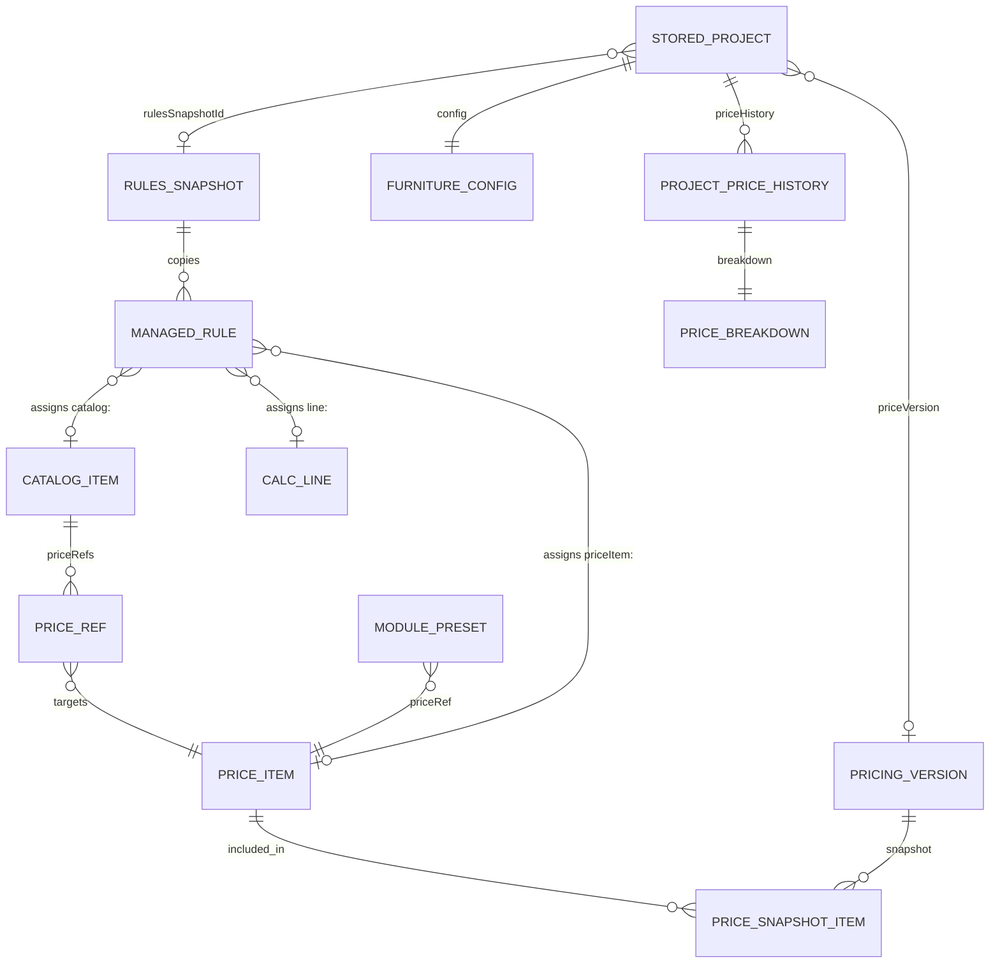
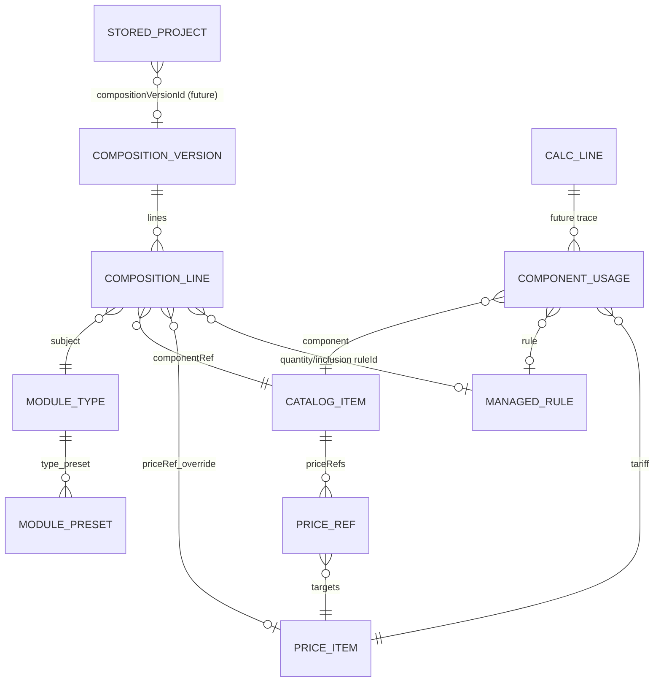

# COMPONENT DOMAIN MODEL PROPOSAL

**Статус:** архитектурное исследование и предложение; управляемый состав реализован и отремонтирован по Q1–Q8 (см. §17–§18).
**Дата:** 2026-11-13
**Область:** Calculation Admin, Reference Data, Managed Rules, расчётный контракт.
**Связанные документы:** `CALCULATION_ADMIN_TECHNICAL_SPECIFICATION.md`, `ADR-06-ENGINE-CONTRACT.md`, `ADR-07-MANAGED-ASSEMBLY-RULES.md`, `CALCULATION_ADMIN_DATA_AND_VERSIONING_DESIGN.md`, `MODULE_AND_COMPONENT_INVENTORY.md`, `CALCULATION_ADMIN_CATALOG_MODEL.md`.

> В документе используются обозначения: **[ФАКТ]** — проверено по коду/данным; **[ВЫВОД]** — следствие; **[ПРЕДЛОЖЕНИЕ]** — проектное решение, не утверждённое; **[ВОПРОС]** — требует решения владельца. Документ не меняет код, БД, API, формулы, Engine, конфигурацию и версии.

---

## 1. Краткое резюме текущего состояния

**Фактическая модель уже содержит:**

- универсальный справочник `CatalogItem` с `catalog`-типом, `attrs`, `priceRefs`, статусом и версией;
- `ModulePreset` — диапазоны/дефолты/`priceRef` для кухонных типов модулей; **пресетов шкафа в bootstrap нет**, шкаф — конфигурация из 1–2 секций;
- `PriceItem` — идентичность тарифа (без суммы) и `PricingVersion.snapshot` — суммы тарифов;
- `ManagedRule` + `RulesSnapshot` — управляемые нормы с draft/publish и неизменяемым снимком;
- `StoredProject` — конфигурация, цена, версии, пины и `priceHistory` (**PriceBreakdown**, не CalculationBreakdown);
- административный read-model `MODULE_COMPOSITION`, который **описывает** состав 8 кухонных типов, но **не хранится**, **не версионируется** и **не участвует в расчёте**.

**Главный вывод:** физический компонент, норма его использования и тариф в текущей системе не являются тремя независимыми сущностями. Компонент часто отсутствует как объект (петли, направляющие, кромка, крепёж), норма находится в коде или в узком наборе Managed Rules, а тариф — в `PriceItem`/`PricingVersion.snapshot`. `MODULE_COMPOSITION` — полезное представление, но не источник истины.

**Рекомендация в одном абзаце:** не создавать параллельную «модель компонентов». Использовать `CatalogItem` как мастер компонентов и `PriceItem` как мастер тарифов, `ManagedRule` — как мастер норм. Если состав модулей должен стать управляемым и версионируемым, добавить **один** новый агрегат `CompositionVersion` (с встроенными `CompositionLine`), который ссылается на компоненты, тарифы и правила, но не дублирует ни количества, ни цены, ни формулы. Полная расчётная трассировка требует отдельного решения и изменения контракта; в текущей модели её нет.

---

## 2. Что изучено

| Область | Файлы |
|---|---|
| Схемы админ-сущностей | `src/lib/admin/schema.ts` |
| Хранение/сервисы | `src/lib/server/store.ts`, `src/lib/admin/catalogs.ts`, `presets.ts`, `price-items.ts`, `pricing.ts`, `managed-rules.ts` |
| Источники content | `src/content/catalog.ts`, `pricing.ts`, `plinth.ts`, `supports.ts`, `lighting.ts` |
| Контракт расчёта | `src/lib/configurator/contract.ts`, `types.ts`, `versions.ts` |
| Разрешение входов | `src/lib/server/data-resolver.ts` |
| Движок | `src/lib/configurator/engine.ts` |
| Отображение и сохранение | `src/lib/configurator/display-adapter.ts`, `src/lib/server/projects.ts` |
| Managed Rules | `src/lib/admin/managed-rules.ts`, `managed-rules-seed.ts`, `rules-diagnostics.ts`, ADR-07 |
| Админ read-models | `src/lib/admin/catalog-model.ts`, `data-sources.ts`, `calculation-inspector.ts`, `dependency-map.ts`, `display-metadata.ts` |
| Реестры/инвентаризация | `docs/CALCULATION_ADMIN/MODULE_AND_COMPONENT_INVENTORY.md`, `MODULE_BOM_CATALOG.md`, `CALCULATION_ADMIN_CATALOG_MODEL.md` |

Код и данные в рамках исследования **не изменялись**.

---

## 3. Существующие сущности

### 3.1. Сводная таблица

| Сущность | Где объявлена | Где хранится | Кто создаёт | Кто использует | Источник истины | В расчёте |
|---|---|---|---|---|---|---|
| `CatalogItem` | `src/lib/admin/schema.ts` (`catalogItemSchema`) | `catalog-items.json` через Storage Adapter | bootstrap/import; `createCatalogItem` (HTTP POST `/api/admin/catalogs/[catalog]/items`) | Admin UI, `DataResolver`, версии/пины | **да** для выбранных справочников | только явно выбранные позиции (материалы, фасады, ручки, столешница, цоколь, опоры, LED) |
| `ModulePreset` | `src/lib/admin/schema.ts` | `module-presets.json` | только bootstrap из `KITCHEN_MODULES`; POST отсутствует | Admin UI, `DataResolver`, Engine | **да** для диапазонов/дефолтов/basePrice | да, через `CalculationInputs.presets` |
| `PriceItem` | `src/lib/admin/schema.ts` | `price-items.json` | **только** импорт/bootstrap (`create` в API отсутствует) | Admin UI, `PricingVersion`, Engine через snapshot | **да** для идентичности тарифа | да: `priceItemId → snapshot.amount` |
| `PricingVersion` | `src/lib/admin/schema.ts` | `pricing-versions.json` | импорт/bootstrap, draft/publish | Admin UI, `DataResolver`, Engine | **да** для сумм тарифов и коммерческих правил | да: `priceSnapshot` |
| `ManagedRule` | `src/lib/admin/managed-rules.ts` | `managed-rules.json` | draft API + seed (27 правил) | Admin UI, публикация, диагностика, Engine (только нормы 1.1/1.2) | **да** для норм, но не универсальный evaluator | частично: только `rule-wardrobe-hinge-*`/`rule-wardrobe-facade-density-*` |
| `RulesSnapshot` | `src/lib/admin/managed-rules.ts` | `rules-snapshots.json` | публикация выбранных draft | DataResolver, диагностика, Engine | **да** для опубликованных норм | да: `inputs.rulesSnapshot` |
| `StoredProject` | `src/lib/configurator/types.ts` | `projects.json` | создание проекта/пересчёт | Admin UI, Inspector | **да** для сохранённого результата | нет (результат расчёта) |
| `MODULE_COMPOSITION` | `src/lib/admin/catalog-model.ts` | **не хранится** (код) | вручную в коде | Admin UI (`/admin/modules`), тесты | **нет**, производное представление | **нет** |

### 3.2. Фактические поля (только существующие)

**`CatalogItem`**
`id`, `catalog` (закрытый enum 16 значений), `label`, `attrs`, `priceRefs?` (legacy `string[]` или role→`PriceItem.id`), `status` (`active|archived|preliminary`), `sortOrder?`, `version`, `createdAt`, `updatedAt`, `updatedBy`.
**Нет:** `sourceRef`, `groupId`, отдельного `componentType`, вложенных групп, числовых характеристик, кроме `attrs`.

**`ModulePreset`**
`id`, `family` (`kitchen|wardrobe`), `zone`, `width/height/depth` (`min|max|default`), `defaultShelves`, `defaultDrawers`, `priceRef`, `status` (`active|archived`), `version`, `updatedAt`, `updatedBy`.
**Нет:** состава, компонентов, норм, ссылок на ManagedRule.

**`PriceItem`**
`id`, `scope` (`kitchen|wardrobe|shared`), `label`, `unit` (6 значений), `usage` (`used|unused`), `status` (`active|archived`), `editable`, `sourceRef`, `groupId?`, `createdAt`, `updatedAt`, `updatedBy`.
**Нет:** суммы (она в `PricingVersion.snapshot`), типа компонента, ссылки на компонент.

**`PricingVersion`**
`id`, `label`, `status` (`draft|published|superseded`), `snapshot[]` (`priceItemId, amount`), `rules` (rounding/minOrder/…), `promos[]`, `signedAdjustments?`, `baseSchema`, `publishedSeq?`, `disclaimer?`, `notes?`, `createdAt`, `createdBy`, `publishedAt?`, `publishedBy?`.
**Нет:** состава модулей, компонентов, норм комплектации.

**`ManagedRule`**
`id`, `name`, `description`, `category` (`quantity|purpose|norm|condition`), `scope` (`kitchen|wardrobe|shared`), `condition` (whitelist), `assigns` (**одиночное**: `catalog:<kind>:<id>` | `priceItem:<id>` | `line:<CalculationLineId>`), `value`, `valueType`, `unit?`, `status` (`draft|published|archived`), `sourceRef`, `source` (`preliminary|datasheet|owner_confirmed`), `affects[]` (`price|quantity`), `version`, timestamps, `updatedBy`.
**Нет (по ADR-07 Q7-13):** `code`, `appliesToCatalogIds`, массива `assigns`, встроенной трассировки, отдельной связи «модуль → компонент».

**`RulesSnapshot`**
`id`, `publishedSeq`, `rules[]` (полные копии), `contentHash`, `createdAt`, `createdBy`, `publishedAt`, `publishedBy`. Неизменяем.

**`StoredProject`**
`id`, `config`, `schemaVersion?`, `calcVersion?`, `priceVersion?`, `rulesSnapshotId?`, `pins?` (`catalogVersions`, `presetVersions`), `priceHistory?`, `price`, timestamps.
`ProjectPriceHistory`: `id`, `projectId`, `operationId`, `reason`, `fromPriceVersionId`, `toPriceVersionId`, `schemaVersion`, `calcVersion`, `oldPrice`, `newPrice`, `delta`, `breakdown` (**PriceBreakdown**), `breakdownVersion`, `requestFingerprint`, `requestFingerprintVersion`, `computedAt`.

**`MODULE_COMPOSITION` (админ read-model)**
`type`, `label`, `zone`, `status`, `components[]`: `id`, `label`, `relation` (`required|conditional|optional|alternative`), `condition`, `quantitySource` (текст), `unit`, `priceItemIds[]`, `priceReference?`, `catalog?`, `evidence`.
**Нет:** хранения, версии, пина, runtime-проверки, участия в `CalculationInputs`.

### 3.3. Что считается источником истины

| Данные | Источник истины | Производные представления |
|---|---|---|
| Материалы/фасады/столешницы/цоколь/ручки/опоры/LED | `CatalogItem` + `PriceItem` | `CATALOG_GROUPS`, `data-sources.ts`, карточки админки |
| Диапазоны/дефолты модулей | `ModulePreset` | `MODULE_COMPOSITION` (только подписи и состав) |
| Тарифная идентичность | `PriceItem` | `import spec`, `dependency-map` |
| Сумма тарифа | `PricingVersion.snapshot` | `PriceBreakdown`, diff, prices board |
| Нормы | `ManagedRule` (draft) / `RulesSnapshot` (published) | `rules-diagnostics`, seed status, Inspector (статическая связь) |
| Конфигурация/результат проекта | `StoredProject` | Inspector, projects page, history |
| Формулы и количества в коде | `src/lib/configurator/engine.ts` и связанные модули | `FORMULA_REGISTRY`, `MAP_ROWS` |
| «Почему такая цена» | **нет полного источника** | Inspector показывает только доступное |

`src/content/*` — источник **начального импорта** и тестовых/golden-сценариев; runtime-истиной для админки является Storage Adapter. Это соответствует `CALCULATION_ADMIN_DATA_AND_VERSIONING_DESIGN.md` и bootstrap-контракту.

---

## 4. Фактическая цепочка расчёта и потери информации

### 4.1. Цепочка

```
FurnitureConfig (modules/sections)
  → DataResolver: active/pinned CatalogItem + ModulePreset + PricingVersion.snapshot + RulesSnapshot
  → CalculationInputs
  → Engine.calculatePrice / calculateBreakdown
  → CalculationBreakdown (агрегированные строки)
  → Display Adapter (DisplayMetadata)
  → PriceBreakdown (label/detail/amount)
  → StoredProject.price + ProjectPriceHistory.breakdown
```

### 4.2. Что есть на каждом этапе

| Этап | ID компонента | Количество | Ед. | Тариф | Правило | Стоимость | Источник |
|---|---|---|---|---|---|---|---|
| `ModulePreset` | `id` типа | нет | нет | `priceRef` (только basePrice) | нет | нет (сумма в snapshot) | `version`, `updatedBy` |
| `CalculationInputs` | `presets[]`, `catalogs[]` | нет (только config) | нет | `priceSnapshot` | `rulesSnapshot?` | нет | пины/версии |
| Engine (локально) | тип модуля, выбранный CatalogItem | локальные переменные | локально | `price(map, id)` | только нормы петель/плотности | локальные суммы | код |
| `CalculationBreakdown` | **нет** component id | агрегаты в некоторых строках (`doors`, `legs`, `moduleCount`) | **нет** | **нет `priceItemId`** | **нет `ruleId`** | `lines[].amount` | **нет** |
| `PriceBreakdown` | **нет**, даже `line.id` потерян | нет | нет | нет | нет | `label/detail/amount` | нет |
| `ProjectPriceHistory` | нет | нет | нет | нет | нет | `PriceBreakdown` | `calcVersion`/`priceVersion` |
| `CalculationResult.usedPriceItems` | — | — | — | объявлено, но **никогда не заполняется** | — | — | — |

### 4.3. Где именно теряется состав

1. **На входе:** для петель, направляющих, кромки, подъёмных механизмов, крепежа и навесов в `CatalogItem` нет компонентов; есть только `PriceItem`-ставки или вообще ничего (`DataResolver` не получает такие объекты).
2. **В `CalculationInputs`:** нет группы «состав модуля». Передаются только пресеты, выбранные глобальные справочники, snapshot и rules snapshot.
3. **В Engine:** цикл по модулям накапливает `bodyCost`, `frontsCost`, `fittingsCost`, `optionsCost`; петли/доводчики/ручки/направляющие суммируются в `fittingsCost`, полки/столешница/опоры/цоколь/свет — в `optionsCost`. После выхода из цикла остаются только агрегаты; локальная привязка «модуль → компонент → количество» исчезает.
4. **В `CalculationBreakdown`:** строки агрегированы по категориям (`kitchen.body`, `kitchen.fronts`, `kitchen.fittings`, `kitchen.options`, …). В типе строки нет `componentId`, `quantity`, `unit`, `priceItemId`, `ruleId`.
5. **В Display Adapter:** `toPriceBreakdown` превращает `CalculationLine` в `PriceLine` (`label`, `amount`, `detail`), **отбрасывая `id`**.
6. **В хранении:** `StoredProject.price` и `ProjectPriceHistory.breakdown` — это `PriceBreakdown`, а не `CalculationBreakdown`; восстановить строки и тем более компоненты из них нельзя.
7. **В версиях:** `ProjectPins` фиксирует только `catalogVersions` и `presetVersions`; версии состава модулей не существует.

### 4.4. Следствие

Текущий Calculation Inspector **не может** показать:
- количество конкретного компонента;
- тариф конкретного компонента;
- применённое правило для компонента;
- строку «модуль → компонент → норма → тариф».

Он показывает только агрегированные строки, метаданные строк, доступные `PriceItem` и статические `assigns` правил. Это ограничение данных, а не UI.

---

## 5. Проблемы текущей модели

| ID | Проблема | Доказательство | Следствие |
|---|---|---|---|
| P-01 | Нет компонента как объекта для большинства фурнитуры | в `catalogKindSchema` нет `hinge`, `drawerSlide`, `edgeBand`, `liftMechanism`, `fastener`, `hanger` | нельзя связать физический компонент с тарифом/правилом/карточкой |
| P-02 | `catalog` одновременно тип и группа | закрытый enum 16 значений, `attrs` не типизированы для большинства | нет иерархии групп, нет схемы характеристик по типу |
| P-03 | `CatalogItem` не хранит `sourceRef` | `catalogItemSchema` | происхождение материала нельзя доказать, кроме `updatedBy`/аудита |
| P-04 | `PriceItem` не ссылается на компонент | поля `id/label/unit/usage/sourceRef/...` | связь «тариф → компонент» только по соглашению об id |
| P-05 | `ModulePreset` не содержит состава | схема пресета | состав существует только в коде/read-model |
| P-06 | `MODULE_COMPOSITION` — производное представление | код `catalog-model.ts`; нет storage | нельзя управлять, версионировать, пинить; риск расхождения с Engine |
| P-07 | Managed Rules не являются BOM | 27 seed-правил только про петли/плотность; Engine читает только их | нельзя выразить «модуль включает компонент» без нового слоя |
| P-08 | `assigns` одиночный, без relation | ADR-07 Q7-13 | нельзя выразить обязательность/альтернативу в правиле |
| P-09 | Нормы количества кухни зашиты в код | `engine.ts` (shelves, drawers, hinges, cutouts, supports, plinth, lighting) | изменение нормы = изменение кода/`calcVersion`, не данных |
| P-10 | `CalculationBreakdown` агрегирован | типы `CalculationLine` | нет component trace |
| P-11 | `PriceBreakdown` теряет `line.id` | `toPriceBreakdown` | даже агрегированную строку нельзя сопоставить с правилом |
| P-12 | `usedPriceItems` не заполняется | объявлено в `contract.ts`, поиск использований — только объявление | нельзя показать фактически использованные тарифы без нового кода |
| P-13 | Состав не версионируется | `ProjectPins` только catalog/preset | старый проект нельзя воспроизвести по составу |
| P-14 | `sinkSize`/`promo` — CatalogItem-типы, но не входят в `CatalogItemInput` | `contract.ts` комментарий | админка может хранить запись, Engine её не получит; это нужно явно маркировать |
| P-15 | Нет единой модели происхождения | разные поля `sourceRef`/`source`/`updatedBy`, у CatalogItem их нет | Data Sources вынужден показывать `unknown` |

---

## 6. Предлагаемая предметная модель

### 6.1. Принципы

1. **Компонент, норма и тариф — разные объекты.**
2. **Существующие источники истины не дублируются.**
3. **Новые сущности — только там, где текущая модель не выражает отношение.**
4. **Состав модуля не содержит формул и сумм.**
5. **Нормы хранятся в Managed Rules, а не в составе.**
6. **Цены хранятся в PricingVersion.snapshot, а не в компоненте/составе.**
7. **Preliminary не становится подтверждённым автоматически.**
8. **Старые проекты не мигрируют и не пересчитываются автоматически.**

### 6.2. Компонентные группы

| Группа | Самостоятельный каталог? | Текущее представление | Чего не хватает | Решение |
|---|---|---|---|---|
| Корпусные материалы | нет, `CatalogItem.bodyMaterial` | `BODY_MATERIALS` → CatalogItem | толщина/плотность в модели не хранятся (толщина корпуса фиксирована 16 мм) | оставить CatalogItem; attrs при подтверждении |
| Фасадные материалы | нет, `CatalogItem.facadeMaterial` | `FACADE_MATERIALS` | толщина/плотность; плотность шкафа — ManagedRule | оставить CatalogItem + правила |
| Столешницы | нет, `CatalogItem.countertop` | толщины в attrs, ставка за пог. м | применимость/совместимость не формализованы | оставить CatalogItem |
| Кромка | **нет** | только PriceItem `wardrobe.edgePvc*` + геометрия | нет компонента, толщины 0.4/1/2 только в id/цене | расширять CatalogItem только при появлении подтверждённых данных |
| Петли | **нет** | PriceItem `kitchen.hingePerDoor`, `softClose`, `wardrobe.hingePerDoor`; нормы шкафа — ManagedRule | нет модели петли/угла/накладки; тип `hinge` в конфиге — только standard/soft | не создавать фиктивные петли; при подтверждении — CatalogItem.hinge |
| Направляющие | **нет** | PriceItem `drawerSlide`/`drawerSoftClose`/`wardrobe.drawer`; параметры `drawerBlock` только у шкафа | нет компонента, длины/нагрузки только в конфиге шкафа | не создавать без datasheet; при подтверждении — CatalogItem.drawerSlide |
| Подъёмные механизмы | **NOT_FOUND** | нет | нет | не создавать |
| Опоры/ножки | нет, `CatalogItem.supportSystem` | attrs + 4 тарифа | физические характеристики есть в attrs | оставить |
| Навесы | **NOT_FOUND** | нет | нет | не создавать |
| Крепёж | частично `supportSystem` attrs | clips/screws/anchors + тарифы | нет отдельных компонентов | оставить атрибутами; отдельный каталог только при подтверждении |
| Сборочные элементы | частично | PriceItem shelves/rods/edge; геометрия | нет полноценного BOM | состав — только через CompositionVersion (future) |
| Прочее | `CatalogItem` LED/sinkSize/promo | LED — полноценно; sinkSize/promo не входят в контракт | `sinkSize`/`promo` не потребляются Engine | маркировать как admin-only/нерасчётные |

**Вывод:** отдельные коллекции для каждой группы не нужны. `CatalogItem` может быть общей сущностью с типом `catalog` и атрибутами, но **расширение enum — это изменение схемы/контракта**, а не «бесплатное» добавление. Добавлять типы следует только при наличии подтверждённых данных; иначе группа остаётся `PARTIAL`/`NOT_FOUND` (как сейчас).

### 6.3. Предлагаемые сущности

#### A. `CatalogItem` (существующая, расширяемая)

**Зачем:** единый мастер физических компонентов и справочных позиций.
**Аналог сейчас:** есть.
**Почему не новая сущность:** уже содержит `id`, `label`, `attrs`, `priceRefs`, `status`, `version`, аудит, пины и UI/API/импорт. Новая `Component` продублировала бы эти поля и создала бы второй справочник.
**Что добавить при реализации (не сейчас):**
- новые значения `catalog` только для подтверждённых групп;
- опционально `sourceRef?: string` и `source?: preliminary|datasheet|owner_confirmed` (по образцу ManagedRule/PriceItem);
- опционально `groupId?: string` только если появится вложенность групп, которой не хватает `catalog`;
- типизированные `attrs` для новых видов (по образцу `supportSystemAttrsSchema`, `ledStripAttrsSchema`).
**Связи:** `priceRefs` → `PriceItem`; `CatalogItem` ← `CompositionLine`; `CatalogItem` ← `ManagedRule.assigns` (если `catalog:`).
**Хранение:** `catalog-items.json` (без новой коллекции).
**Влияние на расчёт:** только если `DataResolver` начнёт выбирать новые виды; текущие формулы не меняются.

> **[ВОПРОС]** Расширение `CatalogItem` на hardware-компоненты — это изменение `CatalogItemInput` и `catalogKindSchema`, то есть код + контракт. Требуется отдельное решение, даже если коллекция остаётся одна.

#### B. `CompositionVersion` (новая, только при управляемом составе)

**Зачем:** хранить версионируемый состав модулей/элементов и позволять админке управлять им.
**Аналог сейчас:** `MODULE_COMPOSITION` — read-model в коде; не хранится и не версионируется.
**Почему нельзя использовать существующий объект:**
- `ModulePreset` не содержит состава;
- `ManagedRule` не выражает relation/alternative и не является BOM;
- `CatalogItem` — компонент, не отношение;
- `PricingVersion` — цены, не состав.
**Поля (предложение):**
`id`, `status` (`draft|published|superseded`), `publishedSeq?`, `contentHash`, `rulesSnapshotId?` (если строки ссылаются на правила), `baseSchema`, `lines[]`, `createdAt/By`, `publishedAt/By`, `notes?`.
**Связи:** 1 `CompositionVersion` → N `CompositionLine`; проект может ссылаться на `compositionVersionId?` (future).
**Хранение:** новая коллекция (например, `composition-versions.json`) **только после утверждения**. Не создавать сейчас.
**Влияние на расчёт:** **нет**, пока Engine не начнёт читать состав. Это admin/data-layer.

#### C. `CompositionLine` (встроенный value object в CompositionVersion)

**Зачем:** одна строка «субъект → компонент → отношение → источник количества → тариф».
**Поля (предложение):**
- `id` (стабильный);
- `subjectType`: `kitchen_module | wardrobe_element`;
- `subjectId`: тип кухонного модуля (8) или элемент шкафа (`section`, `shelves`, `rods`, `drawers`, `facades`, `hinges`, `edge`, `plinth`, `led`);
- `componentRef`: `{ catalog, id }` (предпочтительно) или `{ priceItemId }` (если компонент не заведён);
- `relation`: `required | conditional | optional | alternative`;
- `alternativeGroup?` (обязателен для `alternative`);
- `inclusionRef?`: `{ kind:"managed_rule", ruleId }` | `{ kind:"code", implementationId }` | `{ kind:"always" }`;
- `quantityRef`: `{ kind:"managed_rule", ruleId }` | `{ kind:"code", implementationId }` | `{ kind:"fixed", value, unit }` (fixed — только подтверждённое владельцем);
- `unit?` (только существующий enum; не расширять);
- `priceRef?`: `{ kind:"catalog_price_ref", role }` | `{ kind:"price_item", id }` — опциональный override; по умолчанию берётся из `CatalogItem.priceRefs`;
- `sourceRef`, `source` (`preliminary|datasheet|owner_confirmed`);
- `sortOrder`, `notes?`.
**Запрещено:** хранить формулу, сумму, ставку, процент, произвольный DSL.
**Связи:** N строк → 1 `CompositionVersion`; `componentRef` → `CatalogItem`/`PriceItem`; `ruleId` → `ManagedRule` (published snapshot).
**Хранение:** внутри `CompositionVersion.lines` (без отдельной коллекции).
**Влияние на расчёт:** нет до интеграции.

#### D. `ComponentUsage` (future trace value object, не сущность админки)

**Зачем:** будущая строка трассировки «модуль → компонент → норма → тариф → строка».
**Аналог:** нет.
**Поля:** `componentRef`, `subjectType/subjectId`, `quantity`, `unit`, `priceItemId`, `unitAmount`, `amount`, `ruleIds[]`, `relation`, `lineId`, `sourceRef`, `traceStatus`.
**Где хранить:** опционально внутри `ProjectPriceHistory`/`CalculationBreakdown` (future), не отдельная коллекция.
**Влияние:** контракт расчёта; **не реализовывать** без ADR.

#### E. `ComponentGroup` / `DataSource` / `QuantityNorm` — **не создавать**

- `ComponentGroup` — выводится из `catalog` + статического реестра групп; вложенность при необходимости закрывается `groupId` у CatalogItem.
- `DataSource` — производное представление по `sourceRef`/`source`/`updatedBy`/version/pins; отдельная коллекция дала бы второй источник.
- `QuantityNorm` — уже `ManagedRule`; дублировать нельзя.

---

## 7. ERD

### 7.1. Существующее (solid)



### 7.2. Предлагаемое (dashed, НЕ реализовано)



> `MODULE_TYPE` — не таблица, а code-enum (`KitchenModuleType`) / элементы шкафа. Не создавать таблицу типов без ADR.

### 7.3. Текстовый ERD (для проверки)

```
CatalogItem (component/reference)
  ├─ priceRefs → PriceItem
  ├─ attrs (характеристики)
  └─ version/status
PriceItem (tariff identity)
  └─ PricingVersion.snapshot[] (amount)
ModulePreset (type-level ranges/defaults/base price)
ManagedRule (norm/condition/value)
  └─ RulesSnapshot (immutable copy)
CompositionVersion (proposed)
  └─ CompositionLine[] 
       ├─ subjectType/subjectId → KitchenModuleType | wardrobe element
       ├─ componentRef → CatalogItem | PriceItem
       ├─ quantityRef → ManagedRule | code | fixed(confirmed)
       └─ priceRef? → CatalogItem.priceRefs | PriceItem
StoredProject
  ├─ config
  ├─ priceVersion → PricingVersion
  ├─ rulesSnapshotId → RulesSnapshot
  ├─ compositionVersionId? → CompositionVersion (future)
  └─ priceHistory[] → PriceBreakdown (current) / ComponentUsage? (future)
```

---

## 8. Модель состава мебельного модуля

### 8.1. Субъекты состава

| Субъект | Тип | Существующая модель |
|---|---|---|
| Кухонный модуль | `kitchen_module` + 8 типов (`base`, `sink`, `hob`, `drawers`, `wall`, `tall`, `oven`, `bottle`) | `ModulePreset`, config |
| Шкаф | `wardrobe_element` (`section`, `shelves`, `rods`, `drawers`, `facades`, `hinges`, `edge`, `plinth`, `led`) | `WardrobeConfig`; ModulePreset нет |
| Проект | не субъект состава; агрегирует модули/секции | config |

### 8.2. Типы связей

| Relation | Значение | Пример (факт) |
|---|---|---|
| `required` | всегда входит | корпус, пресет, вырез мойки/варочной/ниши |
| `conditional` | при условии | петли при наличии створок; soft-close при `hinge=soft`; направляющие при ящиках |
| `optional` | при ненулевом количестве | полки, наполнение секций мойки |
| `alternative` | взаимоисключающие варианты | требует `alternativeGroup`; в текущей модели явных альтернатив нет — не выдумывать |

### 8.3. Почему состав — не ManagedRule

`ManagedRule` имеет одно `assigns`, один `value`, condition-whitelist и категорию. Он не выражает:
- `relation` (required/optional/alternative) без перегрузки `category`;
- группу альтернатив;
- несколько компонентов в одной строке;
- связь «компонент + норма + тариф» как единую строку.

Он **может** быть источником нормы (`quantityRef`) и условия (`inclusionRef`), но не заменяет BOM. Это соответствует ADR-07: правила — нормы, а не структура состава.

### 8.4. Инварианты состава

1. Один `CompositionVersion` — один опубликованный снимок; published неизменяем.
2. `CompositionLine` не содержит `amount`.
3. `quantityRef.kind=fixed` допустим только при `source=owner_confirmed` и только для подтверждённого числа; иначе `preliminary` не публикуется.
4. `quantityRef.kind=managed_rule` ссылается на published-правило; при новой редакции правила — новая версия состава.
5. `componentRef` обязан разрешаться в `CatalogItem` или `PriceItem`; иначе fail-closed.
6. `priceRef` не дублирует `CatalogItem.priceRefs` без причины; по умолчанию используется каталог.
7. Код-нормы (`quantityRef.kind=code`) хранят только `implementationId`, не формулу.
8. Старые проекты без `compositionVersionId` читаются; новый расчёт без версии состава — по решению (см. §11.4).

---

## 9. Связь компонентов с ценами и правилами

### 9.1. Цены

```
CatalogItem.priceRefs[role] → PriceItem.id → PricingVersion.snapshot[priceItemId].amount
CompositionLine.priceRef? → PriceItem.id (override)
```

- **Не хранить** сумму в CatalogItem/CompositionLine.
- **Не создавать** новый прайс-механизм.
- Если у компонента нет `PriceItem`, он не получает «0 ₽»; это `MISSING_PRICE` и диагностическая проблема.
- Если у компонента несколько тарифов (опора: leg/clip/screw/anchor), `priceRefs` — объект ролей, как сейчас у `supportSystem`.

### 9.2. Правила

- Норма количества/условие — `ManagedRule` (published snapshot).
- `CompositionLine.quantityRef.ruleId` — ссылка, не копия значения.
- `CompositionLine.inclusionRef.ruleId` — условие, не копия condition.
- Если правило меняется, состав должен ссылаться на конкретную версию/снимок; иначе воспроизводимость ломается.
- `preliminary` правила/компоненты не публикуются и не попадают в расчёт (Q7-06/Q5).
- **Не расширять** `ManagedRule` полями `code`, `appliesToCatalogIds`, массивами `assigns` без нового ADR (Q7-13).

### 9.3. Кто главный

| Вопрос | Источник истины |
|---|---|
| «Что это за деталь?» | `CatalogItem` (если заведена) или `PriceItem`-ставка (если деталь не заведена) |
| «Сколько её в модуле?» | `ManagedRule` (или код, если норма не управляемая) |
| «Сколько она стоит?» | `PricingVersion.snapshot` |
| «Входит ли в модуль?» | `CompositionVersion` (future) или текущий `MODULE_COMPOSITION` (derived) |
| «Почему так посчитано?» | код + версии; полной трассы нет |

---

## 10. Модель происхождения данных

### 10.1. Единая производная структура (не новая коллекция)

```ts
interface DataProvenance {
  entityType: "parameter" | "catalogItem" | "priceItem" | "rule" | "composition" | "projectPin";
  entityId: string;
  origin: "content" | "admin" | "code" | "legacy" | "unknown";
  sourceRef: string | null;
  sourceStatus: "owner_confirmed" | "datasheet" | "preliminary" | "unknown";
  version: string | null;
  confirmedAt: string | null;      // если такой даты нет — null, не выдумывать
  ruleId?: string;
  priceVersion?: string;
  compositionVersionId?: string;
  issues: Array<"missing_source" | "unresolved_ref" | "conflict" | "legacy">;
}
```

Строится из:
- `AdminParameter.sourceRef/status/version/appliesTo`;
- `PriceItem.sourceRef`, `usage`, `status`, `updatedAt`;
- `ManagedRule.source/sourceRef/version/status`;
- `PricingVersion`/`RulesSnapshot` IDs;
- `CatalogItem.updatedBy` (и опционально новый `sourceRef` — future);
- `StoredProject.pins`, `priceVersion`, `rulesSnapshotId`;
- audit-события для истории.

### 10.2. Классы достоверности

| Класс | Как определяется | Нельзя |
|---|---|---|
| confirmed | `owner_confirmed`/`datasheet` либо явно подтверждённый источник | повышать preliminary автоматически |
| preliminary | `status=preliminary` / `source=preliminary` | публиковать/считать подтверждённым |
| legacy | `archived`, `usage=unused`, старые материалы, проект без снимка | пересчитывать как новый |
| missing | нет `sourceRef`/`priceRef`/`ruleId`/`priceItemId` | подставлять 0 ₽ или «owner_confirmed» |
| conflict | ссылка не разрешается, дубль id, pin отсутствует | выбирать «правильное» значение молча |

### 10.3. Ограничения

- У `CatalogItem` **нет** `sourceRef`; до добавления поля происхождение материалов — `unknown`, кроме аудита/`updatedBy`.
- `PriceItem` не хранит дату подтверждения; `updatedAt` — не дата подтверждения.
- `RulesSnapshot`/`PricingVersion` не имеют «даты подтверждения»; есть даты публикации/создания.
- Конфликты не разрешаются автоматически; UI показывает их как проблемы.

---

## 11. Будущая расчётная трассировка

### 11.1. Что уже есть

- `CalculationBreakdown.lines` — строки с `id` и `amount` + агрегированные метаданные.
- `CalculationResult.usedPriceItems?` — **объявлено, но не заполняется**.
- `ProjectPriceHistory` — `calcVersion`, `priceVersion`, `requestFingerprint`.
- `RulesSnapshot` — версия норм.
- `ProjectPins` — версии catalog/preset.

### 11.2. Минимальные изменения для трассы «модуль → компонент → норма → тариф → строка»

**Шаг 1. Только трасса, без изменения сумм (наименее рискованно):**
1. В Engine в точках начисления добавлять `ComponentUsage` в локальный массив рядом с существующими `bodyCost/frontsCost/...`; формулы и порядок вычислений не меняются, суммы не меняются.
2. `CalculationBreakdown` получает **опциональный** `componentUsage?: ComponentUsage[]` (или `lines[].components?`). `CalculationLineId` не меняется.
3. `DisplayAdapter` игнорирует `componentUsage`; `PriceBreakdown` не меняется.
4. `StoredProject.priceHistory` получает **опциональный** `componentUsage` или `calculationTrace`; `price` остаётся `PriceBreakdown`.
5. `calcVersion` повышается (изменился выход движка). `schemaVersion` — решение: опциональное поле может не требовать повышения, но для строгой воспроизводимости лучше зафиксировать отдельно.
6. Старые проекты: trace отсутствует, показывается `trace_unavailable`; ретро-восстановление запрещено.
7. `usedPriceItems` можно заполнить как первый шаг, но это не даёт количеств/компонентов.

**Шаг 2. Состав как вход (только после ADR):**
1. `CalculationInputs` получает опциональную группу `compositionVersionId`/`composition`; `DataResolver` разрешает по пину.
2. Engine использует состав **только для трассы**, не для изменения количеств. Если состав должен влиять на количества — это изменение формул/Engine, отдельный ADR и `calcVersion`.
3. `StoredProject` получает `compositionVersionId?`; старые проекты не мигрируют.
4. `RulesSnapshot` не меняется; composition revision ссылается на `rulesSnapshotId`.

**Шаг 3. Управляемый состав в админке:**
1. `CompositionVersion` draft/publish + immutable snapshot (по образцу PricingVersion/RulesSnapshot).
2. Публикация проверяет: ссылки на компоненты/тарифы/правила, отсутствие 0-цен, preliminary не публикуется, альтернативы согласованы.
3. Optimistic locking/аудит — существующие паттерны; без NEW-N3.
4. Проект закрепляется за версией состава только явной операцией; авто-переход запрещён.

### 11.3. Что затронет старые проекты

| Изменение | Старые проекты | Совместимость |
|---|---|---|
| optional `componentUsage` в breakdown | нет поля → `trace_unavailable` | чтение/цена сохраняются |
| `compositionVersionId?` в StoredProject | отсутствует → composition не воспроизводима | новый расчёт без версии состава — по решению; старый результат читается |
| `calcVersion` bump | старые хранят старый calcVersion | история не пересчитывается |
| `schemaVersion` bump | старые трактуются как v1/v2 по существующему правилу | миграция не автоматическая |
| RulesSnapshot | не меняется | pinned snapshot остаётся |
| PriceSnapshot/PricingVersion | не меняется | цены старых проектов читаются |
| `PriceBreakdown` | не меняется | отображение сохраняется |

### 11.4. Открытый вопрос о блокировке

Если состав станет обязательным для нового расчёта, проект без `compositionVersionId` должен быть заблокирован для нового расчёта (по аналогии с `rulesSnapshotId` Q7-11), но чтение сохранённой цены — разрешено. Это **решение владельца**, не автоматическое следствие.

---

## 12. Варианты реализации

### Вариант A — расширение существующей модели

**Содержание:**
- `CatalogItem` — мастер компонентов (новые `catalog` kinds только при подтверждённых данных);
- `PriceItem` + `PricingVersion.snapshot` — тарифы;
- `ManagedRule` + `RulesSnapshot` — нормы;
- `ModulePreset` — диапазоны/дефолты;
- `MODULE_COMPOSITION` остаётся read-model; управляемого состава нет.

**Плюсы:** минимум новых сущностей; используются существующие API/RBAC/аудит/версии/пины; нет нового источника истины; не влияет на Engine.
**Минусы:** нет управляемого состава; `catalog` enum растёт; `MODULE_COMPOSITION` может расходиться с кодом; нет версии состава; трассировка не появляется.

### Вариант B — самостоятельная модель компонентов

**Содержание:**
- `ComponentGroup`, `Component`, `ComponentAttribute`, `ModuleComposition`, `CompositionLine`, возможно `ComponentUsage`;
- собственные версии/пины/API/импорт.

**Плюсы:** чистая доменная модель; явные группы, характеристики, состав, версии.
**Минусы:** дублирует `CatalogItem` (id/label/status/version/attrs/priceRefs/аудит/пины); второй справочник; миграция существующих материалов/фурнитуры; новый источник истины; новые API/версии; риск расхождения с `PriceItem`/`ManagedRule`; Engine всё равно не использует без отдельного ADR.

### Сравнение

| Критерий | A | B |
|---|---|---|
| Сложность | низкая/средняя | высокая |
| Риск дублирования | низкий | **высокий** (Component ↔ CatalogItem) |
| Миграция | минимальная (только новые kinds/поля) | существенная (перенос материалов/фурнитуры) |
| Совместимость | высокая | требует маппинга/пинов |
| Удобство администрирования | среднее (нет BOM) | высокое (полный BOM) |
| Расширяемость | средняя (closed enum) | высокая |
| Влияние на Engine | нет (пока) | нет (пока), но выше риск |
| Соответствие ADR-07 | полное | требует нового ADR/пересечения с ManagedRule |

### Рекомендация

**Рекомендуется Вариант A + один новый агрегат `CompositionVersion` (limited B).**

**Почему:**
1. `CatalogItem` уже доказал способность представлять разные компоненты (материалы, ручки, опоры, LED). Новый `Component` продублировал бы его.
2. `PriceItem` и `ManagedRule` уже разделяют тариф и норму; их не нужно переизобретать.
3. Единственное, чего действительно нет, — **управляемое отношение «субъект → компонент»**. Для него нужен `CompositionVersion`, но только когда состав должен быть управляемым/версионируемым.
4. До этого текущий `MODULE_COMPOSITION` остаётся read-model и не должен выдаваться за источник истины.
5. Полная трассировка — отдельный контрактный проект; не смешивать с моделью каталога.

---

## 13. Необходимые изменения при последующей реализации

| # | Изменение | Тип | Обязательность | Влияние |
|---|---|---|---|---|
| 1 | Утвердить, нужен ли управляемый состав | решение | до кода | определяет `CompositionVersion` |
| 2 | Утвердить перечень компонентов с подтверждёнными данными | решение | до создания CatalogItem kinds | иначе фиктивные данные |
| 3 | Расширить `CatalogItem` kinds/attrs/sourceRef (если утверждено) | схема/контракт | после решения | DataResolver/contract |
| 4 | Добавить `CompositionVersion` + `CompositionLine` | новая коллекция/схема | только при управляемом составе | admin/data-layer, не Engine |
| 5 | Draft/publish/immutable snapshot + optimistic locking + audit | сервис | при реализации состава | по образцу PricingVersion/RulesSnapshot |
| 6 | `StoredProject.compositionVersionId?` + пин | схема проекта | при интеграции | старые проекты без поля |
| 7 | `CalculationInputs` группа состава | контракт | при интеграции | DataResolver/Engine |
| 8 | `ComponentUsage` в `CalculationBreakdown` (optional) | контракт | при трассировке | `calcVersion` bump |
| 9 | Сохранение trace в `ProjectPriceHistory` (optional) | схема | при трассировке | storage/размер |
| 10 | Заполнить `usedPriceItems` | Engine | можно раньше | минимальная польза |
| 11 | Diagnostics: unresolved refs, missing price, preliminary, composition drift | админка | при реализации | без изменения формул |
| 12 | Тесты: целостность, fail-closed, старые проекты, отсутствие 0-подстановок | тесты | обязательно | — |

**Не входит:** NEW-N3, новые типы мебельных модулей, новые единицы измерения, изменение формул, production seed/publish.

---

## 14. Риски и вопросы владельцу

### 14.1. Риски

| ID | Риск | Вероятность/влияние | Митигация |
|---|---|---|---|
| R-01 | `CompositionVersion` станет вторым источником норм рядом с ManagedRule | высокая/высокая | строки только ссылаются на `ruleId`; запрет числовых дублей |
| R-02 | `MODULE_COMPOSITION` разойдётся с Engine | высокая/средняя | считать derived; тест соответствия; не использовать в расчёте |
| R-03 | Расширение `catalog` enum сломает contract/DataResolver | средняя/высокая | отдельный контрактный этап + тесты |
| R-04 | Новая версия состава = четвёртый пин, усложнение проекта | средняя/высокая | решение: отдельная версия или часть RulesSnapshot |
| R-05 | Трассировка раздувает `priceHistory` | средняя/средняя | optional + лимит/отдельное хранение |
| R-06 | Старые проекты не воспроизводимы по составу | высокая/средняя | trace_unavailable; без ретро |
| R-07 | Preliminary данные попадут в расчёт | средняя/высокая | fail-closed, публикация только owner_confirmed |
| R-08 | `sinkSize`/`promo` будут приняты за расчётные | средняя/средняя | явная маркировка admin-only |
| R-09 | Новые единицы/атрибуты без подтверждения | средняя/средняя | Q7: не расширять unit; source=preliminary |

### 14.2. Вопросы владельцу

1. Нужен ли **управляемый** состав модулей, или достаточно read-only `MODULE_COMPOSITION`?
2. Если управляемый: `CompositionVersion` — отдельная версия/пин или часть `RulesSnapshot`? (второе требует изменения ADR-07)
3. Допустимо ли расширять `CatalogItem` новыми `catalog` kinds для фурнитуры, или требуется отдельная сущность `Component`? (рекомендация — расширять CatalogItem)
4. Какие компоненты имеют **подтверждённые** данные (петли, направляющие, кромка, подъёмные механизмы, крепёж, навесы)? Без datasheet/owner_confirmed создавать записи нельзя.
5. Нужна ли полная component-level трассировка в сохраняемых проектах, или достаточно read-only Inspector на доступных данных?
6. Если трассировка нужна: допустимо ли повысить `calcVersion` и добавить optional `componentUsage`, не меняя суммы?
7. Нужно ли блокировать новый расчёт проекта без `compositionVersionId` (по аналогии с `rulesSnapshotId`)?
8. Расширять ли `unit` для «комплект/пара»? (Q7 говорит «нет»; подтвердить)
9. Что делать с `sinkSize`/`promo` в `CatalogItem`, которые не входят в `CatalogItemInput`?
10. Нужен ли `sourceRef`/`source` у `CatalogItem` для единого provenance?

---

## 15. Приложение: ключевые факты и ссылки

| Факт | Файл |
|---|---|
| `CatalogItem` поля/`catalog` enum | `src/lib/admin/schema.ts` |
| `ModulePreset` поля | `src/lib/admin/schema.ts` |
| `PriceItem` без amount | `src/lib/admin/schema.ts`; `pricing.ts` |
| `PricingVersion.snapshot` | `src/lib/admin/schema.ts` |
| `ManagedRule`/`RulesSnapshot` поля | `src/lib/admin/managed-rules.ts` |
| `assigns` одиночный, без `code/appliesToCatalogIds` | ADR-07 §1.1 Q7-13, §9 |
| 27 seed-правил только про петли/плотность | `managed-rules-seed.ts` |
| Engine читает только нормы петель/плотности | `engine.ts` (`wardrobeHingeNormsFromRules`) |
| `CalculationBreakdown`/`CalculationLine` | `src/lib/configurator/contract.ts` |
| `PriceBreakdown` без id | `src/lib/configurator/types.ts`, `display-adapter.ts` |
| `ProjectPriceHistory.breakdown` = PriceBreakdown | `src/lib/configurator/types.ts` |
| `usedPriceItems` не заполняется | `contract.ts` (только объявление) |
| `MODULE_COMPOSITION` — read-model | `src/lib/admin/catalog-model.ts` |
| `CatalogItem` без `sourceRef` | `src/lib/admin/schema.ts` |
| DataResolver выбирает ограниченный набор catalogs | `src/lib/server/data-resolver.ts` (`baseCatalogRefs`) |
| `sinkSize`/`promo` не входят в `CatalogItemInput` | `src/lib/configurator/contract.ts` |
| Bootstrap пресетов только kitchen | `src/lib/admin/bootstrap.ts` (`buildModulePresets`) |

---

## 16. Итог

- Существующая модель пригодна для материалов, фасадов, столешниц, цоколя, ручек, опор, LED и тарифов.
- Для петель, направляющих, кромки, подъёмных механизмов, крепежа и навесов **нет полноценных компонентов**; есть только тарифы, атрибуты опор или ничего. Нельзя создавать фиктивные записи.
- `MODULE_COMPOSITION` — производное представление, а не источник истины и не версионируемый BOM.
- `ManagedRule` — норма, а не состав; `PriceItem` — тариф, а не компонент.
- Полная трассировка в текущем контракте невозможна: информация теряется в Engine, Display Adapter и при сохранении `PriceBreakdown`.
- Рекомендуемый путь: **Вариант A** для компонентов/тарифов/норм + **один** новый агрегат `CompositionVersion` только когда управляемый состав будет утверждён. Полная трассировка — отдельный ADR/контрактный этап.
- Исходное исследование завершено; реализация и remediation описаны в §17–§18.

---

## 17. Фактическая реализация (2026-11-13)

Раздел фиксирует **реализованное** состояние, а не предложение. Реализация выполнена в рамках Варианта A + один агрегат `CompositionVersion`; новые CatalogItem kinds, формулы и Engine не менялись.

### 17.1. Что реализовано

| Компонент | Файл | Назначение |
|---|---|---|
| Схемы | `src/lib/admin/composition-schema.ts` | `CompositionVersion`, `CompositionLine`, quantity/condition, единицы |
| Сервис | `src/lib/admin/composition.ts` | draft/publish, immutable, contentHash, optimistic locking, validation, pin preflight |
| Journal | `src/lib/admin/composition-journal.ts` | publication journal + recovery |
| Seed | `src/lib/admin/composition-seed.ts` | детерминированный импорт `MODULE_COMPOSITION` |
| Transition | `src/lib/admin/composition-transition.ts` | явное закрепление версии за проектом |
| API | `src/app/api/admin/compositions/**` | list/create/update/delete/validate/publish/import |
| API pin | `src/app/api/admin/projects/[id]/composition-transition` | переход проекта |
| UI | `src/app/admin/modules/**`, `src/components/admin/modules/**` | список, draft-редактор, публикация, история |
| Project pin UI | `src/app/admin/calculations/[projectId]`, `CompositionPinForm` | закрепление/просмотр |

### 17.2. `CompositionVersion` (фактические поля)

`id`, `schemaVersion = 1`, `status` (`draft|published|superseded`), `version` (optimistic lock), `lines[]`, `contentHash`, `rulesSnapshotId?`, `pins?` (CatalogItem/PriceItem/PricingVersion), `production?` (Production Gate), `migration?` (skipped import rows), `createdAt/By`, `updatedAt/By`, `publishedAt?/By?`, `publishedSeq?`, `supersededAt?`, `sourceVersionId?`, `notes?`.

Хранение: `composition-versions.json` (Storage Adapter, JSON/SQLite).

### 17.3. `CompositionLine` (фактические поля)

`id`, `moduleType` (8 кухонных типов), `componentCatalog?`, `componentId?`, `priceItemId?`, `relation` (`required|conditional|optional|alternative`), `alternativeGroup?`, `quantityRef` (`code|managed_rule|fixed`), `condition?` (`text|code|managed_rule`), `sourceRef`, `source` (`preliminary|datasheet|owner_confirmed`), `confirmation?` (by/at/reference), `sortOrder`, `notes?`.

Строка не содержит `amount`. `fixed` допускается только для `source=owner_confirmed` (проверка при публикации). `componentCatalog` без `componentId` — configurable-слот (например, фасад/ручка/опора), цена берётся из выбранного элемента каталога/конфигурации.

### 17.4. Жизненный цикл

1. `POST /api/admin/compositions/import` — идемпотентный импорт статического `MODULE_COMPOSITION` в **draft** (`source=preliminary`), без публикации.
2. `POST /api/admin/compositions` — создать draft (в т.ч. из published).
3. `PATCH /api/admin/compositions/[id]` — изменить draft с `expectedVersion`; published не редактируется.
4. `GET /.../validate` — серверная проверка ссылок/тарифов/правил/покрытия.
5. `POST /.../publish` — явная публикация с `expectedVersion` и подтверждением; published immutable; предыдущая published → superseded; `publishedSeq`, `contentHash`, audit.
6. `DELETE` — только draft; published/используемая проектом версия не удаляется.
7. Journal + recovery при старте/перед публикацией.

### 17.5. Проверки публикации

- `componentId` → существующий `CatalogItem`; archived/preliminary — ошибка публикации; preliminary-строка блокирует публикацию (Q2).
- `priceItemId` → существующий `PriceItem`, active и присутствующий в опубликованном `PricingVersion.snapshot`; отсутствие — ошибка (не 0 ₽).
- `quantityRef.managed_rule`/`condition.managed_rule` → published, не preliminary, присутствует в закреплённом/активном `RulesSnapshot`; проверка идёт по снимку (Q1).
- `fixed` → только `owner_confirmed` с `confirmation` (by/at/reference), `value > 0`, единица не `none`.
- `owner_confirmed` назначается только отдельной операцией подтверждения (Q3).
- `quantityRef.code`/`condition.code` — только зарегистрированные идентификаторы.
- Commercial pins `CatalogItem`/`PriceItem`/`PricingVersion` фиксируются при публикации (Q4).
- `alternative` → обязательный `alternativeGroup`.
- Дубликаты строк, покрытие всех 8 кухонных типов, пустой состав — ошибки.
- Опубликованная версия не изменяется; публикация только draft с `expectedVersion`.

### 17.6. Связь с проектом

`StoredProject.compositionVersionId?: string` — optional, `schemaVersion` не повышен. Старые проекты читаются без поля. Закрепление — только явной операцией `POST /api/admin/projects/[id]/composition-transition` с `expectedUpdatedAt`, `Idempotency-Key`, подтверждением и audit `project.composition_transition`. Пересчёт не запускается, сохранённая цена не меняется.

При пересчёте проекта с закреплённой версией `DataResolver` выполняет **preflight**: версия существует и published, hash валиден, нет preliminary-строк, покрытие типов модулей, явные тарифы присутствуют в PriceSnapshot, composition и project RulesSnapshot совпадают, в production требуется approved Production Gate. Ошибка → расчёт блокируется. При отсутствии `compositionVersionId` расчёт не блокируется.

### 17.7. Что НЕ реализовано (осознанно)

- **Engine не использует состав для формул/количеств** и не меняет суммы. Полная интеграция «состав → количество → строка» требует отдельного ADR/контрактного изменения.
- `CalculationBreakdown` не расширен, component-level trace не сохраняется.
- `CalculationResult.usedPriceItems` не заполняется (поле не используется).
- Новые `CatalogItem` kinds для петель/направляющих/кромки/подъёмных механизмов/крепежа/навесов не добавлялись: нет подтверждённых данных; UI показывает `MISSING/PARTIAL`.
- Состав шкафа не создаётся (шкаф — конфигурация).
- `NEW-N3` не использован; атомарность публикации обеспечивается journal/recovery, а не межколлекционной транзакцией.

### 17.8. Тесты

- `composition.test.ts` — 22 теста: seed/idempotency, draft, expectedVersion, contentHash, invalid refs, fixed/preliminary, duplicate, preliminary rule, publish/immutable/seq/audit, new draft, delete protection, pin, old project.
- `composition-data-resolver.test.ts` — 4 теста: explicit published composition preflight, unknown version blocks, no pin does not block.
- Полный прогон: 118 файлов / 1233 теста PASS; typecheck/lint/build PASS (см. `PROJECT_PROGRESS.md`).

---

## 18. Remediation по Q1–Q8 и CM-A01–CM-A35 (2026-11-16)

Реализованы утверждённые решения владельца:

| Решение | Фактическая реализация |
|---|---|
| Q1 | Composition и RulesSnapshot независимы; если composition использует rule refs, публикация фиксирует `rulesSnapshotId`; проверка идёт по снимку; project pin должен совпадать с composition snapshot; DataResolver проверяет пару. |
| Q2 | Любая `source=preliminary` CompositionLine — **ошибка публикации**; draft разрешён. |
| Q3 | `owner_confirmed` назначается только `POST /compositions/[id]/confirm` с `price.publish`, `reference`, actor/date; обычный PATCH не может назначить/изменить подтверждённую строку. |
| Q4 | Публикация фиксирует `pins.catalogVersions`, `pins.priceItemVersions`, `pins.priceVersionId`; они входят в `contentHash`. |
| Q5 | `production.status` отделён от `published`; Production Gate — отдельная операция; в `NODE_ENV=production` DataResolver блокирует расчёт без approved. |
| Q6 | Role-aware `priceRole` не вводился; configurable-слот не может иметь один явный PriceItem; тариф определяется конфигурацией/каталогом. |
| Q7 | Подготовлен `ADR-08-COMPOSITION-VERSIONING.md`; новая модель версионирования не вводилась — документально закреплена текущая. |
| Q8 | `conditional` без condition и неизвестный code-condition блокируются на schema/service. |

Дополнительно:

- `contentHash` проверяется при чтении, валидации, публикации, переходе и recovery.
- Чтение коллекции стало per-record: повреждённая запись не блокирует валидные версии; issues показываются в UI.
- Seed сохраняет `migration.skipped`; `MODULE_COMPOSITION` не перезаписывается; `source=preliminary`.
- Publication/transition journals + recovery; create/update/delete/confirm/approve имеют in-process rollback аудита.
- UI: dirty-state блокирует publish/validate, publish confirmation, sourceRef не синтетический, code — select, owner-confirm — отдельная кнопка, production gate — отдельная кнопка.
- Добавлены тесты на duplicate id, hash tamper, rules mismatch, unknown code, price-component mismatch, preliminary, owner confirmation, pins, production gate, replay, recovery, stale pin, worker pin.

Остаточные ограничения:

- Engine по-прежнему не использует composition для количеств/цен; component-level trace не реализован.
- Create/update/delete/confirm/approve не имеют отдельного crash-recovery journal (только in-process rollback); publication/transition — journaled.
- Performance чтения всей коллекции не оптимизирована (P3).
